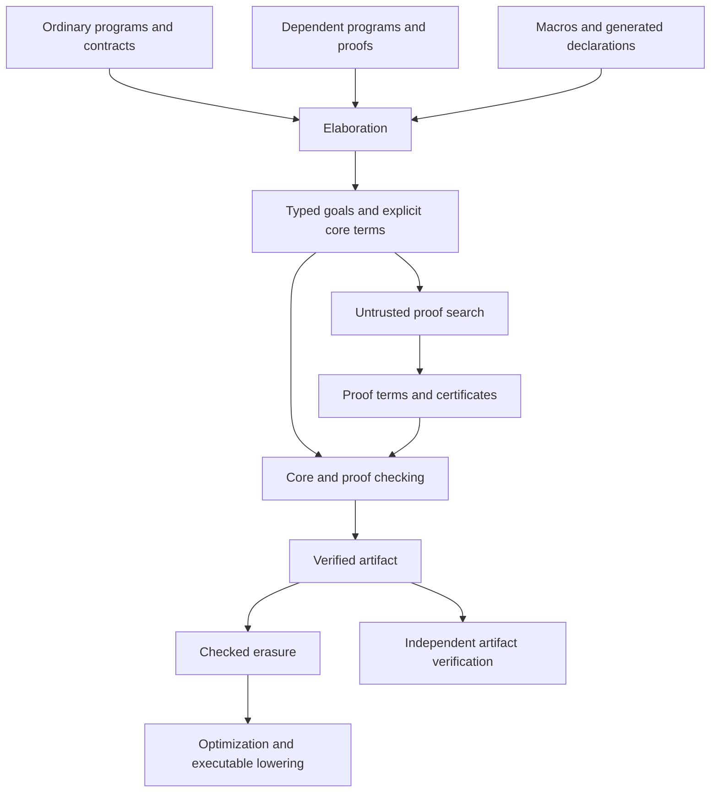
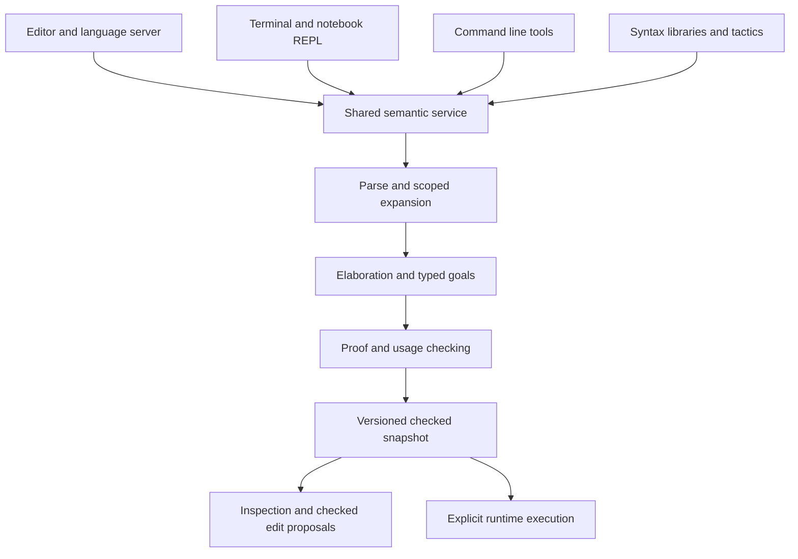
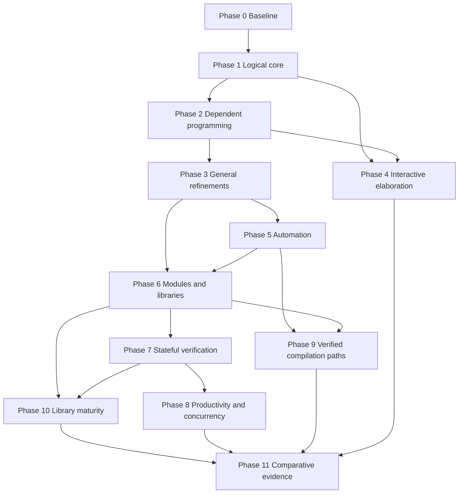

# Cinch Formal Verification Specification and Implementation Roadmap

Source: [Collaborative specification](https://chatgpt.com/space/page_6c092eb66dd08191bfd6538374983935). This is a draft target design with historical implementation baselines, not a fresh audit of the current compiler. The [delivery checklist](formal-verification-checklist.md) tracks acceptance evidence.

Draft specification dated 8 November 2026

Cinch should support ordinary programming, precise contracts, dependent programming, and general theorem proving through one coherent language. A programmer should be able to start with a normal function, add a useful guarantee, discharge routine obligations automatically, and write an explicit proof when automation reaches its limits. The same guarantees should survive modules, higher-order functions, mutation, code generation, optimization, and separate compilation.

The ambition includes the respective strengths of Liquid Haskell, F*, Idris 2, and Lean. Matching a few examples or adding a solver is insufficient. Cinch must combine expressive specifications, dependable checking, usable proof development, competitive execution, and libraries large enough to make these capabilities practical.

This is a proposed target specification and an implementation roadmap. MUST describes a requirement of the target system; SHOULD describes a strong default with documented exceptions. Neither word claims the capability already exists. Existing implementations are distinguished in the baseline below. New examples are schematic unless explicitly identified as current Cinch syntax.

# 1 Goals and measures of success

The primary goal is to make strong guarantees practical throughout a software project. A function with a refined type should remain easy to call. A library using dependent types should remain composable. A theorem should be checked independently of the tool that discovered its proof. An optimized implementation should carry a precise account of what was verified and what remains trusted.

The comparative goals are distinct:

| Reference system | Capability to match | Direction for Cinch to surpass it |
| --- | --- | --- |
| Liquid Haskell | Measures, abstract refinements, useful inference, automated verification of functional programs | Integrate those conveniences with full dependent types, ownership, effects, and executable performance guarantees |
| F* | Expressive specifications, recursive lemmas, automated verification, specifications of stateful computations | Combine proof-producing automation with quantitative resource checking and a smooth ordinary programming experience |
| Idris 2 | First-class dependent programming, indexed pattern matching, implicit arguments, quantitative types, interactive development | Make dependent programs easier to elaborate, debug, verify automatically, and execute efficiently |
| Lean | General theorem proving, reliable proof checking, extensible tactics, interactive goals, reusable mathematics | Improve measured proof effort, verification of executable implementations, and integration with resource-aware software without weakening assurance |

These are goals for measured comparison, not current superiority claims. Every published comparison MUST identify the tool versions, workload, assumptions, automation budget, hardware, and result being compared. Proof strength, proof effort, checking time, compilation time, and executable performance are separate measurements.

Success includes general mathematical development. A competitive theorem prover needs reusable definitions, theorems, documentation, discovery, and maintenance tools. A narrow collection of verified systems examples cannot establish broad parity with Lean.

There is no requirement to infer every dependent type or solve every true proposition. Some questions have no general decision algorithm. The requirement is that users can express the intended mathematics, supply explicit checked evidence, and understand what automation did or could not do.

# 2 A practical introduction to the concepts

## Types and dependent types

A type describes which values a program can use. Nat describes natural numbers. List a describes lists whose elements have type a.

A dependent type can mention a value. Vec n a describes a vector of exactly n elements. Its length is part of its type. An append function can therefore promise that appending lengths n and m produces length n + m. The compiler must connect that promise to the implementation for unknown n and m, not just for literal lengths.

Dependent pairs package a value with something whose type depends on it. A filtered vector can return a new length k together with a Vec k a and evidence that k is at most the original length. The length must remain available at runtime if the program needs it.

## Refinements and predicates

A predicate is a property of a value. “n is less than five” and “xs is sorted” are predicates. A refinement restricts a carrier type to the values satisfying a predicate. Small can mean a Nat with evidence that it is less than five.

A refinement need not allocate a wrapper. If its evidence is irrelevant to execution, the runtime representation can be exactly the carrier. The type checker retains the guarantee while the executable retains the data.

Dependent types and refinements overlap, but each offers useful ergonomics. Vec records structure through an index. A refined List records a proved property of an ordinary list. Cinch MUST support both without forcing every API into one style.

## Statements and proofs

A proposition is a statement that can be proved. A proof is a term whose type states the proposition it establishes. To establish that append preserves length, a proof describes why the statement follows for the empty list and for a list with one more element.

Proving a property is different from testing examples. Ten thousand passing tests can find mistakes and support confidence; they do not establish a theorem about every possible input. A proof establishes the stated property under its listed assumptions.

A proof also does not establish an unstated property. A sorting theorem about a mathematical list model does not by itself show that a particular machine implementation implements that model, terminates within a deadline, or leaks no secrets.

## Decision procedures and automation

A decision procedure is a total algorithm that returns either evidence for a proposition or evidence against it. Comparing two concrete natural numbers is decidable. Determining whether every arbitrary program terminates is not.

Automation is broader. A tactic may search for a proof and fail. An SMT solver combines reasoning about supported mathematical theories, such as arithmetic and equality. A SAT solver searches Boolean assignments. These tools can be useful without being trusted to assert facts: they can return proof terms or certificates that another component checks.

A certificate is a compact explanation of a result. For example, an arithmetic certificate can show that adding valid inequalities produces an impossibility. Checking that addition can be much simpler than discovering which inequalities to add.

## The kernel and the trusted base

The kernel is the final proof checker. An elaborator turns convenient source code into explicit terms for that checker. A tactic helps construct those terms. A compiler later turns executable terms into machine code.

The trusted computing base is the set of components whose correctness a guarantee relies on. If the kernel checks an ordinary proof, the solver that found it need not be trusted. If a result is accepted because compiled code says its certificate is valid, the correctness of that compiled check joins the trusted base.

A small trusted base is valuable because fewer components need critical scrutiny. Small size alone does not establish correctness; the rules, implementation, models, and assumptions still need examination.

## Equality and computation

Definitional equality means that two expressions become the same through the language's specified computation rules. Substituting an argument into a function body is an example.

Propositional equality is a statement established by proof. Two differently structured arithmetic expressions may be equal without the normal computation rules reducing them to identical syntax.

Transport uses an equality proof to move a value between equal types. For example, a proof that n + 0 equals n can justify treating a vector of length n + 0 as one of length n. Cinch may insert this step automatically, but it MUST remain checkable.

## Totality and termination

A total function produces a result for every permitted input. Structural recursion terminates by recursing on smaller pieces of a finite value, such as the tail of a list.

Well-founded recursion uses a measure that cannot decrease forever. A proof about an algorithm may show that each recursive call reduces the size of the remaining problem.

Logical proofs cannot use unrestricted divergence to manufacture evidence. Ordinary applications can still contain servers, waiting, or partial computations, provided their types describe the relevant effects and they do not enter the logical fragment as total proofs.

## Ownership and erased information

Ownership and multiplicity describe how a value may be used. Cinch currently distinguishes erased, linear, affine, and unrestricted uses. Linear means exactly once on each admitted path; affine means at most once.

Erasure removes information that execution does not need. A proof of a bound can disappear. A buffer length used to allocate memory cannot disappear merely because it also appears in a type.

This interaction matters: a proof may mention a resource without consuming it at runtime, but it must not create permission to duplicate that resource.

## A worked example of evidence

Suppose division requires a nonzero divisor. An unrestricted divisor d cannot satisfy that contract just because its type is Nat: zero is also a Nat.

If a branch tests whether d is zero, the nonzero branch obtains a fact about the exact tested value. The checker can use that fact to justify division. The check executes once; the evidence need not allocate a wrapper or execute another check at each consumer.

Now suppose the program stores the divisor in mutable state and changes it after the test. The old fact no longer justifies division using the new contents. A snapshot preserves a statement about the old value, while a fresh decision can establish a fact about the new one.

A universal theorem is different again. To prove that a particular transformation always produces a nonzero result, the user supplies a proof over every input. The compiler checks that proof once rather than testing every possible future input. This distinction explains why Cinch needs both general proofs and executable decision procedures.

# 3 The starting point

The source baseline is the repository snapshot [94348a6](https://github.com/iand675/cinch/tree/94348a6faa00b3cf47dbddd8d939dd3efd60c50e). Baseline statements here describe the reference documentation and the implementation boundaries established in the preceding review, rather than a newly executed conformance run.

| Area | Existing basis | Work still required for the target |
| --- | --- | --- |
| Refinements | Erased evidence, named and anonymous refinements, weakening, narrowing, branch facts, argument-dependent results | General predicates, extensible measures, predicate parameters, stronger inference, dependable composition through abstraction |
| Arithmetic | Difference constraints and checked linear certificates | Integer reasoning beyond rational relaxation, richer theory combinations, general proof-producing solver interfaces |
| Dependent programming | Dependent functions and pairs, indexed families, selected conversion and induction | General dependent elimination, broader transparent reduction, richer recursion and positivity, robust elaboration |
| Logical evidence | Checked proof terms, totality restrictions, explicit unsupported outcomes | A general retained proof language and independently replayable artifacts |
| Ownership | Multiplicities, borrows, regions, mutation invalidation | Compositional state specifications, logical snapshots, framing, integration with general dependent proofs |
| Effects | Rows, capabilities, selected handlers | General cross-call handlers and specifications preserved through effectful abstraction |
| Staging | Typed quotation, hygienic generation, recorded capabilities | Goal-aware metaprogramming and tactics with typed context access |
| Modules | Dictionaries, contracts, identities, selected parameterization | Dependent interfaces, associated result families, more general composition |
| Tooling | Diagnostics, hover, completion, navigation | Interactive proof states, typed holes, checked proof actions, proof-oriented diagnostics |
| Assurance | Recorded law and assumption statuses | Complete transitive trust accounting and independent verification of retained proof artifacts |

The [refinement reference](https://github.com/iand675/cinch/blob/94348a6faa00b3cf47dbddd8d939dd3efd60c50e/reference/06-refinements.md), [dependent type reference](https://github.com/iand675/cinch/blob/94348a6faa00b3cf47dbddd8d939dd3efd60c50e/reference/08-dependent-types-and-proofs.md), and [proof automation design](https://github.com/iand675/cinch/blob/94348a6faa00b3cf47dbddd8d939dd3efd60c50e/design/proof-automation.md) describe these foundations.

Several limitations are conservative refusals rather than soundness defects. The roadmap replaces them with stronger checked rules; it does not remove them before those rules exist. Current declaration names or accepted syntax MUST NOT be treated as evidence that every use of a feature works.

The Rust compiler and the self-hosted compiler are separate implementation targets. A successful Rust-side test does not establish that the published self-hosted compiler accepts the same source or preserves the same guarantee.

# 4 Architecture and proof artifacts

## One logical foundation with several ways to use it

Cinch MUST have one account of types, propositions, evidence, and equality. Ordinary functions, refined APIs, dependent programs, and mathematical proofs may have different surface conveniences, but they MUST elaborate to compatible checked representations.

The implementation may retain optimized representations for common predicates. Such representations MUST have a defined translation to the general logic. A built-in inequality and a user-written theorem about that inequality must mean the same thing.



The search component can include local inference, tactics, external solvers, or a future AI proof assistant. None receives a special right to create evidence.

## The checked core

The core MUST represent variables by stable identities; dependent functions and applications; dependent pairs and projections; universe levels; propositions; inductive declarations and eliminators; equality and transport; usage annotations; and the connection between effectful computation and logical observations.

The core MUST retain enough information to check every logical claim before erasure. It MUST NOT depend on unresolved source names, mutable compiler state, an earlier successful tactic run, or an unrecorded dictionary selection.

The artifact verifier MUST reconstruct well-formed declarations, dependencies, universe constraints, positivity obligations, recursive definitions, and proof terms from the artifact. It MUST reject unknown semantics or malformed certificates. It may consume already verified dependencies with exact identities; hashes identify content but do not prove that content correct.

Cinch SHOULD provide a small reference checker with a simple evaluation strategy alongside the optimized implementation. Agreement between implementations is useful testing evidence, though it is not itself a soundness proof.

## Stable proof artifacts

A verified artifact MUST identify its core format, kernel semantics version, declarations, dependency identities, universe information, proof evidence, admitted axioms, foreign contracts, models, and any special checking backend.

Proof checking MUST be replayable without installing the original proof-search tools. An external SAT solver may be required to discover a proof but must not be required to replay a stored certificate.

Proof caches MUST account for the goal and local context, universe instantiation, definition bodies or opacity boundaries, selected instances, imported theorems, model versions, and checking policy. A hash of the displayed goal string is insufficient. Local evidence depending on mutable state also needs its state identity and validity window.

A cache hit MUST satisfy the same acceptance policy as a fresh result. Changing a callee, assumption, model, or checker semantics must invalidate affected results.

## Erasure and compilation

Erasure MUST preserve executable behavior and usage guarantees. It may remove proofs and explicitly erased inputs, but must retain data required by execution. A rejected proof cannot become acceptable because its executable representation would be unit.

Logical verification and executable compilation are separate claims. The system MUST identify which erasure, optimization, runtime, ABI, and backend steps remain trusted. Later milestones may verify more of that path without changing what an ordinary theorem means.

# 5 Logical foundation

## Universes and propositions

The proposed foundation uses a predicative hierarchy of computational types, with universe variables and constraints. Type at one level belongs to a higher level. Type MUST NOT be its own type. Library declarations MUST support universe polymorphism so the same definition can work at different levels without manual duplication.

The proposed default for erased logic is a proof-irrelevant Prop, with impredicative quantification into Prop and restricted elimination into computational types. In plain terms, propositions can quantify over large domains without becoming runtime data, and programs cannot inspect which proof established a proposition.

This is a target design choice requiring a precise calculus and metatheory in Phase 1. It is not established by erasing proofs to unit. If the selected combination of dependent types, usage, and effects cannot support these rules soundly, the foundation must be revised explicitly before they ship.

A computational witness belongs in Type or a retained dependent pair. An existential proposition in Prop MUST NOT silently supply an executable witness. A runtime decision must retain its outcome even when the evidence attached to that outcome erases.

## Equality and transparent computation

Definitional equality MUST support alpha-equivalence, beta reduction, reduction of checked constructor eliminations, let reduction, and unfolding of transparent total definitions under an explicit transparency policy. Record eta and proof irrelevance rules MUST be specified precisely rather than added opportunistically by the elaborator.

Opaque definitions expose their type and exported theorems while hiding their implementation from client conversion. Transparency and reducibility MUST survive interfaces and participate in invalidation.

The kernel MUST NOT invoke arbitrary SMT search or optimizer rules to decide definitional equality. Proof search may establish propositional equality and insert transport. This keeps ordinary type checking predictable and prevents an optimization assumption from becoming a logical axiom accidentally.

Reduction MAY use configurable resource budgets. Exhaustion must produce an explicit resource-limit outcome, not a claim that expressions are unequal or propositions false. A proof found within a search budget remains valid independently of that budget.

## General logic and assumptions

The language MUST express implication, conjunction, disjunction, universal and existential quantification, falsehood, equality, and user-defined inductive predicates. It MUST support higher-order quantification over functions and predicates.

Logical connectives may be library definitions over the core where that preserves the selected Prop elimination rules. An uninhabited type and falsehood must support sound elimination into other goals.

The core MUST support equality transport. Function extensionality, which allows equality of functions to follow from pointwise equality, is proposed as a named logical principle with an explicit trust classification until derived from an adopted foundation. Proof irrelevance concerns evidence, not equality of arbitrary computational values.

Classical reasoning, including excluded middle or choice, SHOULD be available through explicitly identified modules and assumptions. Importing classical reasoning MUST NOT manufacture a terminating runtime decision procedure for every proposition or extract an executable witness from erased choice.

Every theorem MUST expose its transitive logical assumptions. “No declared axioms in this file” is insufficient if dependencies introduce them.

## Inductive definitions and recursion

The checker MUST admit indexed inductive families with sound positivity checking, generated elimination principles, constructor injectivity and disjointness, and universe-correct recursors.

Positive nesting through known constructors, such as a tree containing a List of child trees, SHOULD be supported when the nesting constructor has a checked positivity account. Negative occurrences remain rejected. Mutually defined families require joint checking.

Total recursion MUST include structural recursion and explicit well-founded recursion. The elaborator SHOULD infer useful decrease arguments, including lexicographic or size-change arguments, and emit checked evidence or reduce to an accepted recursor.

Mutual recursion MUST be accepted when its entire recursive component has a valid termination argument. Rejecting every recursive cycle is a temporary implementation boundary, not the target rule.

The logical fragment MUST reject effectful or divergent evidence. A purity annotation alone does not prove termination. The same requirement applies transitively to called definitions, generated code, imported bodies, and callbacks.

## Concrete foundation and quotient design

### A precise initial kernel

The proposed first kernel, K0, is a small dependent type theory for pure logical and computational descriptions. Executable effects and resource usage add checked judgments around that foundation; they must not become reduction rules that allow an effectful program to prove an arbitrary proposition.

K0 expressions include universe sorts, bound variables, instantiated global declarations, dependent function types, lambdas, applications, lets, inductive constructors, and checked eliminators. Dependent pairs and records can be ordinary checked inductive declarations. Equality is an indexed inductive family with reflexivity and a checked eliminator. Quotients add the limited rules described below.

A declaration records its universe parameters, type, checked body or named foundational status, transparency, dependencies, and the validation information for any inductive or recursive component. Binder identity in the kernel uses an explicit representation such as de Bruijn indices; source names remain diagnostic information.

The essential judgments are context formation, type formation, term typing, definitional equality, universe inequality, inductive admissibility, and recursive-definition admissibility. The integrated executable checker additionally verifies usage, effects, state dependencies, and erasure. A successful source elaboration must discharge every applicable judgment before publishing a completed declaration.

This is a proposed calculus boundary. The implementation must provide the actual inference rules and substitution lemmas, then validate their combination. The design must not claim logical consistency from a collection of passing examples.

### Universes and elimination

Use a bottom sort for Prop and successively higher computational universes. Computational Type u belongs to a higher universe. Universe expressions contain parameters, successor, and maximum; elaboration solves constraints and exports explicit level parameters and constraints.

A dependent function returning a proposition remains in Prop, including when it quantifies over a large computational domain. A dependent function returning computational data uses the appropriate maximum universe level. Universe cumulativity is a checking relation under validated level inequalities, not an assertion that distinct universe levels are definitionally equal.

Proof irrelevance applies to checked proofs of the same proposition. It must not identify arbitrary data values, erase required witnesses, or replace a type-checking obligation with “both compile to unit.”

Elimination from Prop into computation is restricted. The kernel may generate an elimination rule for falsehood, equality, or an eligible singleton proposition. The eligibility test must be explicit: at most one constructor, with remaining constructor fields proposition-valued after parameters and indices are accounted for, together with the ordinary positivity and universe checks.

An existential proposition with a computational witness fails that singleton-field test. It cannot supply an executable witness merely because it has one constructor. A retained dependent pair remains the way to return such a witness.

Each generated eliminator must state its allowed target sorts. A user-written case expression cannot obtain a more permissive rule by changing source syntax.

### Equality principles and reduction

Definitional equality includes alpha equivalence, beta and let reduction, constructor elimination, permitted projection reduction, transparent total definitions, and the selected proof-irrelevance rule. Reduction must respect opacity and declared recursive principles.

General recursive source bodies are compiled into an accepted structural or well-founded construction. Declaring a decreasing measure is not a new kernel equation until its termination obligations have been checked.

Function extensionality states that pointwise equal functions are equal. Proposition extensionality states that equivalent propositions are equal as propositions. The initial design may expose these as separately named foundational principles; their use must appear in theorem dependencies until they are derived from an adopted foundation. Neither principle changes arbitrary runtime comparison into logical equality.

Classical choice and excluded middle belong to explicit mathematical modules. A noncomputable definition relying on choice must not be accepted as executable code without a separately checked computational implementation. A decidable instance can be inferred only from an actual decision procedure or an explicitly non-executable classical interpretation.

Kernel resource limits produce an incomplete-check outcome. The optimized checker and simple reference checker must agree on successful judgments under the same semantics; neither may treat exhausted reduction as a proof of inequality.

### Quotients for reasoning modulo an equivalence

A quotient treats equivalent representations as one mathematical object. Fractions illustrate the need: one half and two quarters should denote the same rational number even though their numerator and denominator fields differ.

The target includes a checked Setoid structure containing a carrier, an equivalence relation, and proofs of reflexivity, symmetry, and transitivity. Quotient S is the type of equivalence classes for that structure.

Its initial public operations are:

| Operation | Required meaning |
| --- | --- |
| class-of | Embed a representative into its equivalence class |
| sound | Related representatives have equal classes |
| lift | Define an operation on classes from an operation on representatives plus a proof that it respects the relation |
| induction | Prove a proposition about every class by proving it for an arbitrary representative |

For lift, changing a representative must not change the result. The kernel checks the supplied respectfulness proof. Reduction on an explicitly constructed class returns the representative-level operation. There is no general operation that extracts a preferred representative.

General dependent computational elimination requires additional coherence and must initially use checked derived constructions. The basic quotient API does not grant it automatically.

Quotient rules are part of the versioned foundation and must be listed as such. Their presence does not imply that equality of arbitrary quotient values is decidable. Canonical executable representations can be provided separately: a normalized rational implementation may prove correspondence to the quotient model.

The acceptance example constructs rational values from integer numerator and nonzero denominator, proves representation equivalence, defines addition through a respectful lift, and checks that equivalent fractions give equal results. The suite must reject a representative-sensitive operation such as exposing an arbitrary raw numerator.

### Independent checking and metatheory

The reference checker must reconstruct declaration formation, universe constraints, positivity, elimination permissions, recursive constructions, and equality checks. It must not trust the elaborator's labels for those properties.

The first metatheory deliverable covers a delimited K0 fragment: well-formed substitution, weakening, preservation under reduction, and the consistency or normalization result appropriate to its named primitives and principles. Quotients, proof irrelevance, and chosen extensionality principles require explicit treatment rather than silent inclusion in a theorem about a smaller fragment.

The executable extension then needs a linking argument: effectful or divergent computations cannot enter logical conversion; ghost observations remain attached to valid values or state snapshots; usage and erasure preserve the stated runtime observations.

Completion requires both independent-checker tests and published statements identifying exactly which formal soundness arguments exist. “K0 implemented,” “K0 independently checked,” and “the selected calculus has a metatheory proof” are distinct statuses.

# 6 General refinement types

## Meaning and introduction

A refinement consists of a carrier A and a predicate P over values of A. A value x inhabits the refinement when checked evidence establishes P x. With erased evidence, it has the same runtime representation as x.

The source language MUST admit arbitrary well-formed predicates, including predicate parameters and quantified properties. Runtime decidability MUST NOT be a prerequisite for forming a refinement.

A schematic contract illustrates the target:

```text
mapPreserving
  accepts a function f
  accepts evidence that P x implies Q (f x) for every x
  accepts a list whose elements satisfy P
  returns a list whose elements satisfy Q
```

The theorem about f can be passed as erased evidence. No procedure needs to decide P or Q for every possible element.

Introducing a refined value requires proof. That proof may come from an explicit term, a known theorem, branch evidence, inferred obligations discharged by automation, or a successful runtime decision. A failure to find evidence MUST NOT insert an unchecked cast.

## Decision procedures are additional capabilities

A runtime validator for P MUST require a total decision procedure with a checked relationship to P. Its positive branch yields evidence of P x; its negative branch yields the corresponding refutation. The actual decision may consume runtime resources and must have the appropriate effects or cost model.

A predicate can be useful without having such a validator. Function monotonicity and rich program equivalences are examples.

Existing built-in decision tests SHOULD remain efficient primitives or library instances with explicit semantics. Their logical statements and runtime implementations must be connected. Rebinding a familiar source name MUST NOT change the meaning of an already checked test.

## Weakening and strengthening

Weakening from P to Q requires evidence that P implies Q. The existing interval and conjunction machinery can supply it cheaply. General lemmas can supply it when the built-in procedure cannot.

Strengthening requires new evidence of the stronger property. Forgetting conjuncts discards guarantees; it does not establish new ones. Recovering the carrier remains representation preserving.

The elaborator SHOULD infer safe weakening and straightforward refinement introduction without requiring ceremonial casts. It MUST avoid uncontrolled coercion search or ambiguous changes in instance selection. Structural refinements with distinct useful instances need explicit, predictable rules; numeric facts need not force users to unwrap values before arithmetic.

## Measures and reflection

A measure is a function used to summarize data in a specification, such as tree height, list length, or the keys of a map. Users MUST be able to define total measures over their own datatypes.

Reflection exposes a checked definition to reasoning. The system MUST support controlled unfolding of total user definitions, equations for recursive cases, and lemmas describing opaque implementations. Mutable observations require the snapshot discipline in Section 12.

The current closed body representation can remain a fast path for stable numeric facts. It MUST NOT be the only way a user definition can acquire logical meaning. General recursion over datatypes belongs in the checked logical language.

## Inference and higher-order contracts

Cinch SHOULD infer local refinements, simple postconditions, and missing refinement predicates within explicit supported fragments. A candidate invariant is a conjecture until checked. The source or build policy MUST bound search. The initial algorithm is the finite-qualifier constrained-Horn procedure specified below; higher-order contracts use its explicit variance and annotation rules.

Public interfaces SHOULD publish checked contracts. Interface meaning MUST NOT vary because another machine happened to run a different heuristic or spent longer searching.

Function contracts MUST survive storing functions, passing callbacks, partial application, closures, module boundaries, and effect handlers. The elaborated function type must bind the values its postconditions reference. The implementation must retain or name stable arguments when required rather than silently lose a required guarantee.

For mutable arguments, retaining a reference alone is insufficient: a contract about old contents must name a snapshot or state version. Where a guarantee cannot be retained, the compiler MUST explain the lost relation and reject a use that requires it.

## A concrete refinement inference procedure

### Initial scope and representation

The first inference engine targets pure first-order control flow and applications of functions with known contracts. Higher-order code participates through explicit callback contracts and expected types. General predicates remain expressible even when the inference fragment cannot discover them.

Elaboration assigns stable identities to strict lets and call results. Mutable observations additionally carry state versions or snapshots. Unknown refinements are represented by predicate variables over an explicit list of in-scope values and their sorts.

For each unknown predicate, construct a finite set of candidate qualifiers. A qualifier is a small property such as value >= 0, value <= limit, value == input + 1, or a supported measure relation. Candidates come from explicit contracts, branch conditions, known library facts, and bounded templates instantiated over the relevant values.

Every term in a qualifier must have a checked logical interpretation. A familiar name, a pure-looking signature, or an overloaded operator spelling is insufficient. Field observations and measures must identify the actual model, dictionary, and state dependencies.

### Generate and solve refinement constraints

Generate implications describing entry, construction, branch flow, function calls, results, and recursion. The supported inference fragment uses constrained Horn clauses: an antecedent of known facts and predicate applications implies a property or another unknown predicate application.

For output and invariant inference, begin with the strongest candidate conjunction and remove qualifiers that cannot be maintained. Recheck predecessor constraints when a candidate changes. Because the pool is finite and the process only removes candidates, this iteration terminates within a bounded number of removals.

The arithmetic or theorem service proves each implication. Unknown and resource-limit outcomes may cause conservative removal or a reported inference limit; they must not be reported as a confirmed counterexample.

After reaching a candidate solution, discharge every generated obligation using accepted evidence. Recursive invariants require initialization and preservation evidence tied to the checked recursion or control-flow semantics. The inferred predicate is not introduced as an axiom simply because it is self-consistent.

Caller requirements already fixed by an explicit public signature must remain fixed. The engine cannot make a bad implementation verify by silently strengthening its input precondition or weakening its published postcondition.

Public inferred contracts require an explicit publication policy: display the proposed interface, check its evidence, and store the resulting stable signature. Consumer builds must not depend on rediscovering the same contract using the same heuristic.

### A worked invariant

Consider a worker starting at i = 0, incrementing i while i < n, and returning i when the condition fails. To prove that it returns n, an appropriate invariant is 0 <= i && i <= n.

The qualifier engine can discover the bounded part using these obligations:

| Obligation | Reason |
| --- | --- |
| Initialization: 0 <= n | n has mathematical Nat semantics |
| Preservation: i <= n and i < n imply i + 1 <= n | Exact integer arithmetic |
| Exit: i <= n and not (i < n) imply i == n | Order reasoning |

The measure n - i justifies termination when its domain and strict decrease are checked. Inferring an invariant does not by itself prove termination.

The artifact retains the invariant, initialization, preservation, exit, and decrease evidence. An off-by-one variant must fail the published result claim or produce a concrete diagnostic; it cannot be repaired by changing the claimed output silently.

### Higher order contracts and variance

For a function to satisfy an expected callback contract, it must accept every input permitted by that contract and return a result satisfying the expected guarantee. Input conditions therefore vary contravariantly and output conditions covariantly.

The checker generates evidence for both directions and verifies compatible effects, usage, and state footprints. A callback requiring positive input cannot be passed where arbitrary Nat input is promised unless the caller's protocol supplies the required restriction.

Predicate parameters such as p and q remain rigid logical inputs while checking a generic combinator. The engine must not replace an arbitrary p with whichever arithmetic predicate makes the example pass. At a concrete call, expected types and actual refinements may instantiate implicit predicate arguments; genuinely ambiguous instantiations require an annotation.

Unknown predicates outside the supported positive Horn fragment require a declared contract, a lemma, or explicit evidence. This is a limit of inference, not a ban on those types.

### Precision controls and diagnostics

Expose the candidate pool, selected invariants, failed obligations, and dependencies through inspection. Users should be able to add a qualifier or give a local invariant without changing unrelated source.

If the pool lacks a useful relation, report that the current candidates are insufficient. If a solver cannot prove a candidate, distinguish that from a checked refutation. A sample-generated candidate remains a conjecture until verified.

Scope and state identity are part of the inference key. Rebinding, mutation, changed dictionaries, changed measure bodies, and changed assumptions invalidate affected solutions. Equal display strings do not identify the same predicate application.

The acceptance suite includes inferred interval bounds, guarded subtraction, a recursive counter invariant, a callback with abstract predicates, preservation through generic containers and partial application, and intentional forgetting through a weaker annotation. Rejection cases cover contravariant input mistakes, stale measure facts, hidden precondition strengthening, and a nonlinear relation outside the initial qualifier pool.

# 7 Dependent programming and elaboration

The elaborator MUST support expected-type-directed checking, scoped metavariables, implicit arguments, universe constraints, higher-order pattern unification where applicable, delayed constraints, and explicit user annotations when inference is insufficient. It need not solve unrestricted higher-order unification.

Dependent matching MUST refine branch contexts using constructor equations while preserving the identities of outer variables. It MUST construct a motive, meaning the result type as a function of the matched value, and insert checked transports where needed.

Unknown indices are normal inputs to library functions. A generic Vec n a operation MUST NOT require n to be a literal merely to inspect its constructors. Impossible branches require a checked contradiction; an unsolved equation is not automatically an impossibility.

Nested patterns, dependent records and pairs, constructor-local parameters, and higher-rank polymorphic arguments MUST compose. Higher-rank here means that a function argument can itself be polymorphic, rather than quantification appearing only at the outermost signature.

The user-facing contract is annotation predictability. Adding an ordinary local binding or passing a function through an equivalent wrapper should not gratuitously destroy its dependent relationship. Where principal inference is unavailable, diagnostics must identify the missing annotation or equality.

Resource checking MUST participate in elaboration. Solving a type metavariable cannot retroactively authorize duplication of a linear value. Deferred constraints must carry usage, region, effect, and binder identities with them.

The implementation MUST distinguish an inconsistent constraint, an unresolved constraint, an unsupported inference problem, and exhaustion of its resource budget. These outcomes call for different user actions.

## Dependent elaboration algorithm and proof development

### Bidirectional checking with a constraint graph

Use two primary operations: synthesize a type for an expression whose form supplies one, and check an expression against an expected type. Applications, variables, and annotations usually synthesize; lambdas and dependent matches often check most naturally.

Each elaboration metavariable records its type, permitted context, universe information, usage and effect conditions, origin, and current dependencies. Assigning it must pass occurs checking, scope checking, and the relevant resource conditions.

Rigid parameters are fixed unknown inputs. They must never be assigned simply to make a constructor branch fit. A metavariable introduced to infer an omitted index can be solved; the n supplied by a caller to a function that works for every n cannot.

Maintain an explicit constraint graph. A constraint records its kind, source, dependencies, status, and any evidence or transport needed to discharge it. Separate conversion, universe inequalities, instance selection, index propositions, effects, usage, and state validity rather than putting all failures into a generic unification error.

A deterministic worklist should process immediately decidable structural constraints, controlled reduction, higher-order pattern assignments, and then blocked constraints whose dependencies have changed. Instance resolution waits when essential type information is unknown. A remaining mathematical equality becomes a proof obligation; it is not silently added to definitional equality.

A source annotation can expose an expected type or select a specific instantiation. The elaborator should suggest the smallest useful annotation, with its location and unresolved relationship.

### Dependent pattern matching over unknown indices

For a value xs of type Vec n a, matching Nil creates the branch equation n = 0. It does not globally set n to zero. Matching Cons creates a fresh predecessor index and the corresponding successor equation.

The branch context contains those equations and the constructor fields. The elaborator constructs a motive describing the result type as a function of the scrutinee and indices, then transports branch results as required.

For zip-same with type Vec n a -> Vec n b -> Vec n (a, b), matching the first vector refines the possible constructors of the second. In the Nil branch, the second vector has length zero. Its nonempty constructor is impossible only when the corresponding index contradiction is checked.

Coverage has three distinct outcomes: a reachable branch needs an implementation, an impossible branch has a checked refutation, or the checker cannot yet determine reachability. The last outcome requests evidence or an annotation. Solver failure is never proof that a branch is impossible.

Elaboration produces a complete checked eliminator. An optimization may remove an impossible branch later, but it must retain the justification. Source-level coverage analysis is not an independent source of logical axioms.

Nested patterns, equality evidence already in scope, dependent record fields, and generalized variables must follow the same branch-equation mechanism.

### Higher order inference and generalization

Implement higher-order pattern unification: an unknown applied to suitable distinct local variables can be solved by abstracting a well-scoped term. More general higher-order problems remain blocked or require an annotation.

Generalization is subject to the value and resource restrictions. An effectful expression or captured linear resource cannot acquire unrestricted polymorphism through a convenient local binding.

Higher-rank arguments require explicit polymorphic types at their introduction boundary when inference cannot recover them. Checking a callback against that known type must propagate its predicates, universes, usage, and effects into the body.

Partially applying a dependent function substitutes stable supplied values and retains unsupplied binders. It must not discard a postcondition merely because the remaining function has become a value. If a mutable argument's old contents matter, retain the specified snapshot, not a live reference pretending to be immutable.

Constructors and lets preserve an inferred refinement unless a particular expected type deliberately forgets it. Generalization must preserve relations through properly scoped parameters or dependent packages; it cannot export a free local name.

### Recursion and admissible datatypes

Start structural recursion checking from constructor-derived subterm relationships. Aliases retain provenance but do not manufacture a decrease. For broader recursion, elaborate a well-founded relation, a measure, and decrease proofs for every recursive edge.

A mutually recursive component is checked as one group. A size-change or lexicographic inference procedure may discover a justification, but accepted code must retain a construction the kernel's recursion principles validate.

Nested positive datatypes are admitted through known positive parameter positions and a checked elaboration to supported inductive constructions. A user-defined Functor instance is not proof of positivity. A datatype containing a negative recursive occurrence remains invalid even if a library claims otherwise.

Dependent records elaborate to inductive data and projections with explicit earlier-field dependencies. Their erased fields and runtime witnesses must retain the distinction specified by the erasure rules.

### Interactive proof elaboration and maintenance

A proof script elaborates to the same constraint and goal graph as an explicit term. Each step records its source node, context, generated premises, evidence, and dependencies. Branch-local hypotheses and resource state must remain inspectable.

When a user edits one proof step, reuse a prefix only if its semantic context and dependencies still match. Invalidate affected descendants and shared constraints. Do not keep a solved goal after its supporting hypothesis changed.

The standard interface should support applying a theorem with inferred arguments, reviewing resulting premises, choosing an induction principle, generalizing variables, rewriting a dependent goal, and exposing inserted transports. A generated proof term should be available even when the default display uses readable tactics.

The acceptance suite includes symbolic vector append and zip, existential filtering, a positive nested tree, a higher-rank callback, a universe-polymorphic theorem, and justified mutual recursion. Each has an incorrect neighbor: wrong index, captured binder, unproved impossible branch, invalid generalization, negative recursion, or missing decrease evidence.

These programs must develop through holes and explicit terms, survive imported interfaces, and replay independently. A parser-only example or a literal-index specialization does not complete this gate.

# 8 Human approachable surface syntax

## Design commitment and proposal status

Approachability is a language requirement. A programmer must be able to read an ordinary function, understand its contract, handle a failed input check, and improve a diagnostic without first learning the vocabulary of proof theory.

The preferred surface uses Cinch's existing `::` signatures, curried application, named arguments in types, layout, `if`, `case`, `let`, records, and explicit effects. New syntax adds contracts and a gradual proof workflow. Advanced users retain arbitrary predicates, dependent functions and pairs, higher-order contracts, induction, explicit evidence, and user-defined tactics.

All examples in this chapter are proposed source syntax unless a subsection explicitly says otherwise. They define concrete design candidates for implementation and usability testing. They are not claims that the current parser or checker accepts them. Library names in examples must acquire the stated checked contracts; spelling a helpful name never establishes its law.

The surface must satisfy three tests. A reader should understand the claim. A programmer should be able to predict what runs. An expert should be able to inspect the exact elaborated meaning. Editor explanations support these tests, but the source must also be readable in a code review without the editor.

## Begin with an ordinary function

An ordinary total function remains small:

```text
increment :: Nat -> Nat
increment n = n + 1
```

A function with a precondition can name its inputs and state the condition below its type:

```text
divide :: (numerator :: Nat) -> (divisor :: Nat) -> Nat
  requires divisor > 0
  ensures quotient => quotient <= numerator

divide numerator divisor = nat-div numerator divisor
```

Read this as: divide takes two natural numbers, requires a positive divisor, and returns a quotient no greater than the numerator. The definition stays an ordinary function equation.

The `requires` clause creates an obligation for each caller. The function body may rely on that condition. The `ensures` clause creates an obligation for the implementation and a guarantee for callers. The name before `=>` binds the returned value only within that clause.

No runtime test is inserted by either clause. A caller supplies evidence or establishes the condition through ordinary control flow. A dynamic check is written in the program. This distinction must appear in the first contract tutorial and in diagnostics.

The named signature binders are required only for inputs mentioned in the contract or later types. Existing short signatures remain appropriate for functions that do not need such names. Input names in clauses resolve to signature binders, not to coincidentally named locals in an equation.

The quotient guarantee follows from the checked contract of `nat-div`; the example does not require the compiler to discover the implementation of division afresh.

## Ordinary branches should establish ordinary facts

A function that accepts any divisor handles zero explicitly:

```text
try-divide :: Nat -> Nat -> Option Nat
try-divide numerator divisor =
  if divisor == 0 then
    None
  else
    Some (divide numerator divisor)
```

The nonzero branch establishes the precondition for divide. A reader does not need to see a proof token. The elaborator nevertheless records evidence about the exact value tested.

A literal call such as `divide 20 4` is discharged statically. A call using an unrestricted unknown divisor produces a useful diagnostic:

```text
divide needs: divisor > 0

At this call, divisor may still be zero.

Check the zero case, accept a positive divisor,
or supply a proof of the required condition.
```

The diagnostic should link the caller, the contract clause, and any fact that almost establishes it. It should identify a resource limit separately when the condition may be true but automation stopped.

A check over mutable contents establishes a fact about the state actually read. Later writes do not preserve that fact merely because the source identifier is unchanged.

## Name a useful invariant with the existing refinement form

Keep the existing recognizable declaration:

```text
type Positive = refine (n :: Nat) with n > 0

type NonEmpty a =
  refine (xs :: List a) with length xs > 0
```

The words `refine` and `with` explain the relationship: keep the underlying type and add a property. A named refinement is useful when the property is reused across APIs.

A caller can pass `Positive` rather than repeat a positive-input contract at every interface. A one-off relationship between several arguments is often clearer as `requires`.

Both forms elaborate through the same logic. Built-in interval discharge is an optimization of evidence production, not a separate meaning for the comparison.

Do not add a second everyday spelling such as `Nat where n > 0` alongside this form. Multiple equivalent preferred spellings increase the burden on readers, tools, documentation, and search.

## Runtime validation is visibly executable

Use the existing decision vocabulary:

```text
positive :: Nat -> Option Positive
positive n =
  case decide (n > 0) of
    Yes witness -> Some (Positive n witness)
    No _ -> None
```

Here the decision executes. The positive branch obtains evidence; the negative branch follows an application policy. Returning None, returning an error, or asking for another value is the program's choice.

For general propositions, `decide P` requires an appropriate total decision procedure. A universal theorem may be available even when no runtime validator exists. The error for that situation should say “No decision procedure is available for this property,” rather than suggest the property itself is invalid.

Keep separate names and diagnostics for proof search, runtime validation, and any application-level assertion that can fail. A single ambiguous `check` construct would hide materially different behavior.

## Add an explicit proof only when needed

A proof expression begins with `by`:

```text
proof next-index :: (i :: Nat) -> (limit :: Nat)
                 -> i + 1 <= limit
  requires i < limit

proof next-index i limit = by
  arithmetic
```

The claim is readable before the strategy. `arithmetic` asks a proof-producing procedure to establish it. Failure leaves a goal; it never supplies a default truth value.

The same expression form works where evidence is expected:

```text
let bound :: i + 1 <= limit = by
  arithmetic
in use-bound bound
```

A direct evidence term remains valid. `refl`, a named lemma application, or a constructor proof does not have to be wrapped in `by`.

Inside a proof block, the preferred initial vocabulary is small:

| Form | Reader meaning |
| --- | --- |
| `exact evidence` | This existing term proves the goal |
| `apply lemma` | Use the lemma and show its remaining premises |
| `have name :: P = evidence` | Establish a named intermediate fact |
| `show P` | State the goal being proved at this point |
| `rewrite evidence` | Rewrite the goal using this equality |
| `simplify` | Use checked computation and registered simplification lemmas |
| `simplify using evidence` | Also use this explicitly supplied fact |
| `arithmetic` | Use the supported arithmetic procedures |
| `induction value of ...` | Prove the claim by its checked recursive cases |
| `auto` | Try the configured bounded collection of strategies |

These commands have typed implementations and are extensible. They are not an unreviewable list of special compiler truths. The editor must offer documentation and show the premises introduced by `apply`.

The existing top-level `rewrite ... justify` declares an optimizer transformation. A `rewrite` command inside `by` rewrites a proof goal. Their grammatical contexts and effects are distinct, and neither extends definitional equality with arbitrary assumptions.

## Induction should resemble ordinary pattern matching

A recursive list proof should look like a recursive list program:

```text
proof append-empty :: forall a. (xs :: List a)
                   -> Eq (append xs Nil) xs

proof append-empty xs = by
  induction xs of
    Nil ->
      simplify
    Cons x rest with hypothesis ->
      simplify using hypothesis
```

The empty-list case and the nonempty-list case are familiar patterns. In the second case, the checker supplies hypothesis: the theorem for the smaller list rest.

The `with hypothesis` suffix names evidence generated by the checked induction principle. It does not assume whatever statement the author would like to use. More than one recursive field may introduce several named hypotheses, with their exact types visible in the goal view.

The library supplies the checked equations for append. Simplification unfolds those equations and uses the induction hypothesis. It does not rely on finite testing of the theorem.

For a dependent family, the induction principle may require additional indices or generalized variables. The simple form should infer the routine motive. An advanced form may specify a checked induction principle with `induction xs using principle of ...`. The core always retains the actual motive, recursor, and transports.

For general case analysis without an induction hypothesis, ordinary `case` remains available. The user should not need a new family of pattern spellings solely because the enclosing definition is a proof.

## Calculations should read from top to bottom

A calculation block exposes a sequence of justified equalities:

```text
proof remove-empty :: forall a.
  (xs :: List a) -> (ys :: List a) ->
  Eq (append (append xs Nil) ys) (append xs ys)

proof remove-empty xs ys = by
  calc
    append (append xs Nil) ys
    == append xs ys by rewrite (append-empty xs)
```

Each line establishes a relationship to the previous expression. The final expression must match the goal. Longer blocks can use equality and supported order relations with checked transitivity rules.

The relation markers inside `calc` are proof syntax. The equality marker establishes logical equality; it cannot invoke an unrelated runtime equality instance.

Outside `calc`, operator meaning follows resolved, checked definitions. A custom Boolean comparison cannot silently become logical identity. `Eq x y` remains the unambiguous advanced spelling for propositional equality of arbitrary values. Arithmetic contracts can use familiar comparisons where the selected operators have the required logical interpretation.

This choice avoids asking every beginner to distinguish several equality glyphs in their first example, while keeping expert code precise.

## Dependent data should remain visible as useful data

A vector API can express its length guarantee directly:

```text
append-vector :: forall a (n :: Nat) (m :: Nat).
  Vec n a -> Vec m a -> Vec (n + m) a
```

The type says that the result has the combined length. The caller normally does not supply n or m explicitly because the input vectors determine them. A pretty-printer can show those inferred values when useful.

A variable-length result is often more approachable as a named dependent record:

```text
record Selection (a :: Type) (limit :: Nat) where
  count :: Nat
  values :: Vec count a
  erased fits :: count <= limit

select :: forall a (n :: Nat).
  (a -> Bool) -> Vec n a -> Selection a n
```

A reader sees a count, values with that count, and erased evidence that the count fits within the original limit. `Selection` is an ordinary user-defined abstraction, not a compiler-known special case.

The count remains available when execution needs it. The fits field is evidence and erases. Removing that evidence must not remove count or change the vector's meaning.

The advanced direct spelling remains:

```text
Sigma (count :: Nat).
  refined (count <= limit) (Vec count a)
```

This packages a retained count and a vector whose type carries the bound. Dependent records and dependent pairs elaborate to the same general capabilities. A beginner can use the named record without learning the name Sigma first.

## Shorthand and long form contracts

Cinch should offer two deliberate views of the same checked contract: a compact signature for pure value relationships and an explicit long form for teaching, complex contracts, and stateful behavior. Both remain proposed syntax.

The shorthand names the actual result:

```text
divide :: (divisor > 0, quotient <= numerator) =>
  (numerator :: Nat) ->
  (divisor :: Nat) ->
  (quotient :: Nat)
```

Its long form is:

```text
divide :: (numerator :: Nat) -> (divisor :: Nat) -> Nat
  requires divisor > 0
  ensures quotient => quotient <= numerator
```

The implementation equation is identical in either form. Neither spelling inserts a runtime test. Both elaborate to the same input obligation and result refinement, with the same effects, usage, evidence, and assumptions.

The final `(quotient :: Nat)` is a named result binder. It names the returned value and does not introduce a third function argument or a free value the solver may choose.

### Classification and scope

For the initial shorthand, use a fixed rule for pure total function contracts over stable values:

- A proposition clause whose free variables refer only to inputs, type parameters, or surrounding stable bindings becomes a requires clause.

- A proposition clause with a free occurrence of the named result becomes an ensures clause.

- Classification applies to each whole comma-separated clause. It must not split apart implications or disjunctions and assign different obligations to their pieces.

- Resolve binder identities before classification. A shadowed name inside a quantifier is not a reference to the result. Classification must not depend on whether unfolding a definition happens to remove an occurrence.

- The complete function node binds its inputs and named result over its prefix contract. Unbound names and duplicate binder names are errors. A result name cannot silently shadow an input.

This is a deterministic role-assignment rule, not a heuristic guessing the programmer's intention. Ordinary existing using contexts retain their caller-supplied evidence and dictionary meaning; they are not retroactively reinterpreted by the new shorthand.

The long form remains necessary when the intended role is not captured by that rule. An output-independent guarantee can be stated explicitly with ensures. Stateful assertions, old-state observations, footprints, and termination measures use the long form initially. For example, Sorted buffer alone does not say whether sortedness is required on entry or established on exit.

An effect-polymorphic function is not eligible merely because the currently visible row contains no concrete effect. Shorthand eligibility must establish the required purity and stable observations. The compiler should explain why explicit clauses are needed rather than guess entry or exit state.

At a particular function-type node, choose shorthand or long-form role-bearing clauses. Parenthesized callback types and aliases may choose their own form. Existing dictionary contexts and refinements remain available. This prevents accidental duplication of the same contract in two presentations.

### Guarantees carry through reusable signatures

The returned bound must be available as a reusable type:

```text
type AtMost (limit :: Nat) =
  refine (value :: Nat) with value <= limit

divide :: (numerator :: Nat) -> (divisor :: Nat) -> AtMost numerator
  requires divisor > 0

subtract-from :: (limit :: Nat) -> AtMost limit -> Nat
subtract-from limit amount = limit - amount
```

The result type here exposes the same bound as the two earlier divide signatures. Once divisor positivity is established, `subtract-from n (divide n d)` must use that bound without another runtime decision or a manually reconstructed witness.

Inferred bindings and partial applications must preserve the relationship to the actual numerator. Passing the function through a callback, container, or exported interface must retain the published contract. When the numerator must travel with the result, use an appropriate dependent record or pair so the relationship remains well scoped.

An explicit weaker result annotation may deliberately forget a guarantee. Inferred signatures and “extract function” actions must not discard it silently. Propagation establishes only justified properties: positive divisor does not imply positive quotient.

### Editor support and acceptance

Provide Expand contract and Compact contract actions. Expanding always shows explicit responsibility and binder scope. Compacting is offered only when role assignment is lossless and the contract is eligible.

Hover and signature export should support both presentations without changing the underlying type. A formatter preserves the author's chosen form unless an explicit style rule requests conversion. It must not use source spelling changes to alter an API's guarantee.

Required tests include equivalence of the two divide signatures, unchanged implementation checking, contract retention through inference and higher-order use, correct treatment of shadowed result names, whole-clause handling of disjunctions, and rejection of ambiguous stateful shorthand. Round-trip conversion must preserve the checked contract and must not introduce extra arguments.

## Higher order contracts should be reusable names

A complex callback contract deserves a name, just like a complex record type:

```text
type Growing = (x :: Nat) -> Nat
  ensures y => y > x

use-growth :: Growing -> (n :: Nat) -> Nat
  ensures result => result > n

use-growth grow n = grow n
```

This proposes general transparent type aliases in addition to the current refinement declaration form. The alias names the function contract; it does not create a new runtime wrapper or nominal identity. Inline parenthesized function types must support the same clauses for users who need them.

Contracts are part of the function type. They are retained when grow is stored, partially applied, passed through a closure, or exported. The compiler must not reduce Growing to an unconstrained Nat-to-Nat function at those boundaries.

The editor should show the readable alias initially and let the reader expand its contract. A plain-text signature export must also preserve the contract.

## General predicates should look like ordinary definitions

The existing `spec` declaration introduces a total logical definition:

```text
spec monotone :: (Nat -> Nat) -> Prop
spec monotone f =
  forall (x :: Nat) (y :: Nat).
    x <= y -> f x <= f y
```

This says that f preserves ordering. The arrow between propositions means implication. Quantification and implication are logical meaning, not loops over every possible input.

A predicate-polymorphic combinator can remain an ordinary function:

```text
map-preserving :: forall a b
  (p :: a -> Prop) (q :: b -> Prop).
  (f :: a -> b) ->
  List (refined p a) ->
  List (refined q b)
  requires forall (x :: a). p x -> q (f x)

map-preserving f xs =
  map (\x -> f (unrefine x)) xs
```

Here p and q are implicit logical parameters. Their preservation premise is checked. Each input element supplies p for that exact value; the premise establishes q for its image. The function itself carries no runtime predicate argument.

Expected-type-directed checking and ordinary theorem instantiation must support this body. If those mechanisms cannot complete a particular use, the editor exposes the missing proof rather than pretending the declaration itself proves preservation.

The default text spelling of quantifiers is ASCII `forall` and `exists`. Unicode mathematical notation may be an explicit library feature later; it is not required to type ordinary code. `exists` in Prop hides an erased logical witness. A retained witness still uses a dependent pair or record. The compiler must explain an attempted runtime extraction from an erased existential.

Advanced user-defined inductive propositions remain available through `data ... :: Prop` and checked constructors. Friendly contracts are conveniences over that foundation.

## Resource usage should have readable binder forms

In new explanatory source, prefer word forms at a named binder:

```text
consume :: forall r a. (once task :: Task r a) ->{Async r} a
choose :: (at-most-once fallback :: Unit -> Nat) -> Nat
```

These are proposed contextual binder modifiers. `once` means exactly one use on every admitted path. `at-most-once` permits dropping but forbids duplication. Neither says the entire function is called only once, and neither is a synonym for borrowing or memory ownership.

The existing `%1` and `%aff` forms remain accepted explicit usage notation. `erased` names a value unavailable to execution. A formatter can preserve the user's chosen existing style; migration must not rewrite a whole repository gratuitously.

For resource-heavy APIs, the visible usage annotation is valuable information. The editor should explain “must be used once” on hover and show where a resource was consumed. A returned closure's captured resources remain subject to these rules.

These aliases require the grammar to accept dash-separated modifiers without confusing `at-most-once` with subtraction. Their contextual position inside a binder makes that decision syntactic.

## Stateful contracts should name what changes

The proposed state-contract clauses use operations ordinary programmers recognize:

```text
sort-in-place :: forall r.
  (buffer :: Mut r (List Nat)) ->{State r} Unit
  writes buffer
  ensures _ =>
    Sorted (contents buffer) &&
    Permutation (old (contents buffer)) (contents buffer)
```

This example assumes a specified State effect and content-observation API. It does not claim those exact library declarations ship today.

`writes buffer` bounds the mutable footprint. It is a checked permission and preservation claim, not documentation. `old` inside a postcondition denotes the entry-state logical observation. The postcondition compares the original contents with the final contents. The underscore explicitly declines to name the Unit result.

A corresponding `reads` clause can describe observations when the state specification needs them. These clauses complement the effect row and the ownership system. An effect label alone cannot establish the footprint or the permutation theorem.

The syntax must not make old contents look like a free executable copy. `old` is restricted to logical specifications unless an actual retained snapshot is explicitly requested.

For recursive workers, use a `decreases` clause:

```text
count-down :: (remaining :: Nat) -> Nat
  decreases remaining

count-down remaining =
  if remaining == 0 then 0
  else count-down (remaining - 1)
```

The clause names the termination measure and creates proof obligations. It does not assert termination by declaration. Branch facts justify subtraction and the smaller call.

A loop-like library syntax can expose `invariant` and `decreases` while elaborating to the same checked recursion principles. There should not be a second unverified loop logic hidden in a macro.

## Parsing and scoping are part of the design

The proposed grammar has an explicit contracted-type node with two surface forms: a prefix shorthand constraint list and named result, or a function type followed by explicit contract clauses. Both produce the same core contract. At a top-level signature, long-form clauses are indented continuations of that signature. Inside a named alias, record field, or parenthesized type, either form belongs to that local function node.

```text
contract-clause =
    requires proposition
  | ensures result-name => proposition
  | reads footprint
  | writes footprint
  | decreases measure
```

Repeated requires clauses mean conjunction. Repeated ensures clauses each bind their own result name and mean conjunction. A result binder cannot silently shadow an input binder. Multiple footprint clauses combine under documented footprint rules; the initial implementation should reject conflicting or ambiguous forms.

Clauses bind to the complete function type at their syntactic nesting level. A postcondition for an earlier stage of a curried function requires parentheses or a named alias. The parser must not guess the intended stage from a predicate's free names. The shorthand follows the same stage boundary: its named result belongs to that complete node. Binder resolution determines clause roles within the node; it does not choose which function stage the syntax describes.

The result of parsing must be determined without type inference. Contextual keywords are recognized in their clause or binder positions; existing functions with those spellings elsewhere must remain resolvable under the language-version policy.

The layout pass must explicitly support `by` and `calc` blocks. New block delimiters cannot rely on parser-error-based indentation repair. Comments, explicit braces, nested quotations, and incomplete editor input need specified behavior.

A short local binding of the form `let name :: T = value in body` is also proposed as sugar for the existing separate local signature and equation. It introduces no new generalization rule.

## Exact meanings behind the readable forms

| Surface | Required elaboration |
| --- | --- |
| Shorthand proposition over inputs only | An implicit erased input premise, under the shorthand eligibility rules |
| Shorthand proposition mentioning the named result | A guarantee about the actual returned value |
| `requires P` | An implicit erased premise with P available in the function body |
| `ensures result => Q` on a pure function | A result refinement binding the actual returned value and earlier arguments |
| `ensures` on a stateful computation | A postcondition over the return value and specified entry and exit states |
| `by commands` | A checked evidence term constructed by the tactic API |
| `induction xs of ...` | A checked recursor, motive, branches, and induction hypotheses |
| `calc` | Checked relation steps and transitivity applications |
| `once` and `at-most-once` | The corresponding quantitative binder annotations |
| `old observation` | A logical observation of the specified entry state |
| `decreases measure` | A termination obligation checked at each recursive call |
| A named contract alias | The same transparent type, without a new nominal identity |

Requires clauses should interoperate with existing `using (P) => ...` obligations. Explicit evidence and dictionaries remain available in the advanced surface. The language must not turn every such binder into an unlabeled solver query.

## Choices to reject and choices to test

Support the deliberate shorthand and long form as two views of one contract, with lossless editor conversion where eligible. Avoid accumulating unrelated synonyms for every formal concept. Avoid automatic fallible runtime checks hidden behind a type annotation, a proof-only punctuation vocabulary that ordinary code never uses, and treating an arbitrary equality comparison as mathematical identity.

Keep useful established mathematical vocabulary in advanced APIs. Hiding Sigma, induction principles, universe parameters, or explicit proof terms entirely would obstruct expert use and make generated terms hard to inspect.

A pleasant-looking example is a candidate, not a usability result. Before freezing the surface, test whether programmers new to formal methods can explain a contract, repair a missing precondition, distinguish a proof from a runtime check, finish a small induction with editor assistance, and understand a stale-state diagnostic.

Run parsing, formatting, completion, and macro-expansion tests over those same original examples. Compare alternatives using task completion, time, error causes, and recall. Keyword count and short source length alone do not establish approachability.

## Syntax implementation and usability gates

The concrete syntax needs parser and formatter fixtures, typed elaboration fixtures, editor snapshots, and runnable programs as it lands. The same original source must pass through ordinary compilation, the self-hosted path, the REPL, and any syntax adapter that claims to support it.

The grammar proposal must account for the new contracted-type node and its shorthand/long-form equivalence, named result binders, general transparent aliases, contextual usage binders, proof blocks, calculation blocks, named development holes, and short typed local bindings. Each feature needs a versioned source-support status. Until its implementation passes those gates, documentation must label it as proposed.

Test at least three experience levels: ordinary programmers new to formal methods, users who can write small proofs, and experienced dependent-type or theorem-prover users. Give them the same tasks and compare explanations and repairs, not only visual preference.

The everyday path must remain readable with explicit type information and good diagnostics. The expert path must permit explicit proof terms, induction principles and motives, universe arguments, dictionary choices, and type transports. Both paths must establish the same claim under the same checking policy.

# 9 Language server REPL and macro experience

## One semantic service behind every interface

The language server, REPL, command-line compiler, macro expander, and proof tools MUST share parser semantics, declaration identities, elaboration, goals, effects, usage accounting, and assurance reporting. They may offer different presentations without creating different versions of the language.

The core interaction is a checked snapshot: a particular project revision, open buffers, imports, syntax packages, model versions, and accepted declarations. A query identifies that snapshot and returns answers associated with it.



Checking and executing are separate service operations. Inspecting a type must not run an I/O action, consume a task handle, or refresh a remote schema unexpectedly. Authorized staging effects needed for a build or expansion must use the project's explicit staging policy and recorded inputs.

Both a plain terminal client and a rich editor must expose the essential operations. A required proof action cannot exist only as a proprietary widget.

## Current tooling and experimental foundations

This tooling baseline is pinned to [snapshot 4d98b8f](https://github.com/iand675/cinch/tree/4d98b8f06d92d083b3d721daafdd47f67ff4d825). It supplements the earlier compiler baseline with the REPL and library-syntax experiments.

The [REPL reference](https://github.com/iand675/cinch/blob/4d98b8f06d92d083b3d721daafdd47f67ff4d825/reference/26-repl.md) describes an existing full-screen and piped REPL, shared analysis, persistent declarations, basic inspection commands, pure evaluation, transactional project load and reload, and temporary native probes for selected runtime operations. Running evaluation is currently synchronous, and arbitrary persistent runtime sessions remain incomplete.

The [language server reference](https://github.com/iand675/cinch/blob/4d98b8f06d92d083b3d721daafdd47f67ff4d825/reference/27-language-server.md) and current handler surface provide diagnostics, hover, definition, completion, full semantic tokens, and full-text document synchronization. Goal interaction, signature help, robust versioned asynchronous work, general refactoring, and complete project lifecycle handling require further work.

The [library-language experiment](https://github.com/iand675/cinch/blob/4d98b8f06d92d083b3d721daafdd47f67ff4d825/experiments/malleable-syntax/README.md) already explores explicit syntax imports, declarative grammars, host-expression holes, generated syntax highlighting, source maps, and an adapter to the native server. Its [goal-aware tactic probe](https://github.com/iand675/cinch/blob/4d98b8f06d92d083b3d721daafdd47f67ff4d825/experiments/malleable-syntax/TACTICS.md) connects expected propositions and scoped facts to bounded assumption and arithmetic search.

Those experiments are valuable implementation evidence for a bounded slice. Their production integration, public reflected-context API, general scoped syntax representation, and artifact semantics remain work. The target below extends these foundations rather than treating them as completed general facilities.

## The first editor experience

Opening a project should select a matching compiler, library, syntax-package set, and target profile. The editor should explain the selected configuration and show a useful startup error when it cannot connect.

An empty source file should offer a small runnable example and documentation, not begin with a proof-system configuration exercise. Project-aware completion should insert needed imports explicitly and respect visibility.

The default view shows normal code, contracts, the most relevant diagnostic, and the current goal when a hole or proof command is selected. Universe details, inserted dictionaries, transport terms, and certificate internals remain one inspection away.

No presentation mode may hide an unresolved guarantee, an effect, a linear obligation, or an assumption that changes the claim. Progressive detail concerns explanation depth, not weaker checking.

## Essential editor capabilities

| Capability | Required behavior |
| --- | --- |
| Hover | Show the readable type, contracts, effects, usage, defining identity, and checked status; allow expansion to inferred arguments and core |
| Curried signature help | Identify the argument currently supplied and remaining arguments, including named requirements and callback contracts |
| Completion | Rank candidates using expected type, scope, effects, and resource availability; explain remaining obligations |
| Goal panel | Show the required claim, available hypotheses, remaining resources, relevant state versions, and next subgoals |
| Explain this error | Connect expected and actual types, originating contract, related facts, and invalidating operations |
| Find a lemma | Search by goal shape, type, names, and hypotheses, with a preview of the premises each result would create |
| Checked code actions | Propose a source edit, explain its new obligations or effects, and recheck the exact changed source |
| Navigation | Follow semantic identity through modules, aliases, generated declarations, and syntax definitions |
| Rename and references | Respect binders, contracts, quotations, imports, hygiene, and generated origins |
| Formatting | Preserve parsing, meaning, comments, raw island content, and attribute attachment |
| Assurance inspection | List assumptions, proof backend, model identities, and remaining implementation trust |
| Expansion inspection | Show the original syntax, expansion stages, generated code, inferred types, and source relationships |
| Counterexample inspection | Distinguish validated inputs from abstract candidate models and show which claim they challenge |

Completion must not rank an unavailable consumed handle as an immediately usable argument. A theorem that requires an extra assumption can still be a useful suggestion, but it must not be displayed as a completed solution.

Signature help must work for curried application, operators, holes, and partially applied functions. It should explain the information the caller supplies rather than dump an entire elaborated telescope by default.

## A proof and resource panel

For the next-index example, a useful panel is:

```text
Goal
  i + 1 <= limit

Known here
  i :: Nat
  limit :: Nat
  i < limit

Suggested action
  Prove using arithmetic
```

For a resource-sensitive example, add:

```text
Resources
  task: must be used once; still available
  buffer: uniquely borrowed in this region

State facts
  index < length buffer: valid for the current state
```

The panel should offer named explanations for “known here,” “must be used once,” and “current state.” An expert can expand exact binder identities, permissions, and proof dependencies.

Selecting a proof step shows the state before and after that step. Unfinished branches retain their own states. Failed tactics leave the goal unchanged and display a trace of what they tried.

## Checked actions must preserve the intended claim

For a missing precondition, useful actions can introduce an explicit branch, change the input type to an appropriate refinement, pass an available witness, or add a necessary requirement to the function's public contract.

These choices have different consequences. Adding a requirement changes callers. Introducing a branch changes behavior. A code action must show those consequences in its preview. It cannot quietly weaken a postcondition, insert an axiom, or suppress an error.

A “split cases” action should generate the reachable constructors at the actual indices, preserve ownership, and leave named holes for unfinished branches. A “use this lemma” action should show the resulting premises before applying the edit.

An action that changes public contracts should identify affected callers. An action over generated code should edit the user-owned source or offer a generator change, rather than save an invisible patch to a transient expansion.

## Shared inspection API

The proposed semantic API should expose the following versioned operations. Method names are design candidates, not existing public endpoints.

| Operation | Result |
| --- | --- |
| goalsAt | Goals and expected types at a source position |
| explain | A structured diagnostic explanation and relevant dependencies |
| inspect | Type, effect, usage, contract, and assurance information |
| normalize | Controlled pure reduction with a stated transparency policy |
| expand | Expansion stages, source maps, introduced binders, and expected types |
| search | Ranked lemma or completion candidates with remaining premises |
| tryAction | A transactional attempt yielding evidence, a source edit, or an explicit failure |
| dependencies | The definitions, lemmas, models, syntax packages, and assumptions supporting an answer |
| run | Explicit execution under a selected runtime session and capability set |

A response envelope needs a snapshot identifier, document revision, stable goal or declaration identity, checked versus provisional status, dependency information, and a request/result identity. Edits also need version guards and source ranges.

Identifiers are opaque. Frontends must not reconstruct a goal by hashing its displayed string. Two equal-looking statements can name different binders, dictionaries, or state versions.

Syntax and proof extensions receive typed handles into this service. They cannot mutate the accepted environment directly. A failed tryAction must roll back metavariables, universe constraints, usage, effects, state dependencies, and generated declarations.

## Protocol and responsiveness

Use standard LSP requests where their semantics fit: signature help, completion and resolve, code actions, references, rename, formatting, semantic tokens, inlay hints, workspace symbols, and document lifecycle support.

Add a small versioned Cinch protocol for goals, proof-step state, expansion graphs, assurance, and interactive sessions. Advertise capabilities explicitly and provide text fallbacks. Custom requests should not duplicate ordinary LSP behavior unnecessarily.

Every asynchronous result must identify the source revision it analyzed. Cancellation must stop obsolete work or prevent its results from publishing. Expensive proof search should run separately from cheap diagnostics, with progress and resource limits.

Provisional performance targets should be measured at the 95th percentile on declared reference projects and hardware: ordinary text editing must remain responsive; warm local hover and completion should aim below 200 ms; local goal refresh below 250 ms; first useful diagnostics after an edit below 500 ms. These are engineering targets, not measured current results or limits on complete project verification.

Large searches may take longer. The interface should show their state and let users cancel them while ordinary navigation continues. A resource-limit outcome is not a failed theorem.

The protocol must negotiate position encodings and test non-ASCII source content. Full-text synchronization should transition to incremental updates only with correct revision, offset, and recovery handling. Server crashes should preserve unsaved buffers and provide a clear recovery path.

## The REPL as a development workbench

The REPL should support learning, exploration, proof development, and reproducible experiments. It must use the same source language and goal service as the editor.

Preserve existing commands such as `:type`, `:kind`, `:browse`, `:load`, and `:reload`. Add a coherent inspection and proof workflow:

| Proposed command | Behavior |
| --- | --- |
| `:check expression` | Elaborate and check without executing effects or consuming runtime resources |
| `:inspect name` | Show type, contracts, effects, usage, definitions, and assumptions with expandable detail |
| `:normalize expression` | Perform bounded pure logical reduction under a named transparency policy |
| `:eval expression` | Evaluate an admitted pure expression with explicit resource limits |
| `:run expression` | Execute under the selected runtime session and capability context |
| `:goal name` | Select and display a named development goal |
| `:fill name expression` | Check a proposed term against the goal and update the development source transactionally |
| `:search query` | Find declarations or lemmas by names, type, and the selected goal |
| `:expand expression` | Display syntax expansion and provenance under the current recorded staging state |
| `:assumptions name` | Display transitive logical, model, and backend dependencies |
| `:undo` | Revert an accepted source or proof edit where doing so preserves runtime resource validity |
| `:export path` | Write a reproducible source development with necessary imports and explicit unfinished goals |
| `:session` | Show project revision, target, runtime mode, live resources, and pending goals |

These commands are proposed extensions, not the current command set. Command discovery and completion must report the actual running version.

A named development hole uses `?name`. A pattern wildcard remains `_`; it never promises a value. Completed artifacts reject unresolved holes.

An illustrative target transcript is:

```text
cinch> proof next-index :: (i :: Nat) -> (limit :: Nat) -> i + 1 <= limit
...>   requires i < limit
...> proof next-index i limit = ?bound
Draft accepted: next-index has one unfinished proof.

cinch> :goal bound
Need: i + 1 <= limit
Know: i :: Nat, limit :: Nat, i < limit

cinch> :fill bound by arithmetic
Proof checked. No unfinished goals in next-index.

cinch> :assumptions next-index
Arithmetic evidence checked.
Additional logical axioms: none.
```

The final output must also make the applicable checker tier inspectable. “No additional axioms” does not erase kernel, model, or execution trust.

A draft with holes lives in a development environment separate from the completed checked environment. The REPL must not execute a value whose computation depends on an unresolved hole. It may still evaluate independent completed declarations.

Selecting a proof step in the REPL should expose the same hypotheses and remaining resources as selecting it in the editor. Users can export ordinary source and continue in another frontend.

## Evaluation modes and live resources

Pure expressions may retain convenient automatic evaluation. Effectful expressions should use an explicit execution operation in the preferred new-session behavior, making the difference between inspection and action visible. The existing automatic native-probe fallback requires a documented compatibility transition.

A temporary native probe is a separate process. Its runtime handles cannot simply be copied back into an in-process evaluator or treated as persistent live values. A persistent runtime REPL requires a worker or equivalent runtime context with explicit ownership of values and capabilities.

Every runtime value needs an identity, session and target association, usage state, and lifetime. Consuming a linear task updates the session immediately. Repeating an input cannot make the old handle usable again.

A resource-aware transcript should make this clear:

```text
cinch> :inspect task
Task r Nat
Usage: must be used once; available

cinch> :run join task
42 :: Nat
task is consumed

cinch> :run join task
Cannot use task again.
It was consumed by the previous join.
```

Undo reverts source and proof development, not external effects or physical history. It cannot resurrect a consumed handle, reverse a file write, or undo a remote request. Deleting a declaration must account for any live resource it owns.

Source reload can be transactional while runtime migration is not. An existing runtime value may remain attached to the old code revision; it must not be silently retyped as a value of the new revision. The interface should explain whether it can retain that worker, migrate under checked rules, or require a fresh runtime context.

Printing values must respect ownership and effects. Pretty printers should not silently consume a linear result or run arbitrary I/O. Show a safe summary and offer an explicit observation operation when needed. Limit depth and output size for large or infinite values.

Interrupt running evaluation and proof search separately from aborting pending input. An interrupted external computation may already have performed effects; the session must report what is known and preserve conservative resource states.

A notebook frontend should display dependency order. Re-running a cell invalidates dependent declarations and proofs. Effectful cells require explicit execution; exporting or replaying a notebook must not automatically repeat their actions.

## Library syntax should participate in normal tooling

The target includes explicitly imported library languages:

```text
import syntax Ui.Html as html

greeting :: String -> Html
greeting name = html!{<h1>Hello {name}</h1>}
```

The package-oriented import is proposed production syntax. The current experiment uses explicit descriptor paths through its adapter. Ordinary runtime imports remain separate; importing a runtime library must not silently change the host grammar.

The editor should complete tags and attributes, infer the expected types of components, and treat the expression inside braces as ordinary Cinch. A hover over name must navigate to its host binding. An error in the embedded expression must highlight that expression, not a generated temporary.

The same mechanism should support domain-specific query syntax, protocol declarations, binary formats, calculation notation, and custom tactics. Every syntax package must describe its grammar and its relationship to checked host expressions; the editor should not need a hand-written special case for each domain.

## Three extension layers with distinct responsibilities

| Layer | Available information | Responsibilities |
| --- | --- | --- |
| Syntax parsing and expansion | Structured source, declared categories, scoped names, origin information | Recognize the notation, preserve bindings, and construct source or typed syntax |
| Elaboration extension | Expected type, typed local context, metavariables, effects, usage, and goals | Construct a candidate typed term, declaration, or evidence through transactional APIs |
| Proof and certificate checking | Explicit terms, declarations, certificates, and dependencies | Validate the result under the selected core semantics |

A grammar template cannot infer a proof context by reading nearby source strings. A tactic cannot change the meaning of a binder by guessing its printed name. An elaboration extension cannot bypass the final checker.

The standard `by` form can use the same public expected-goal machinery as a library-authored proof notation. The experimental `by!{ linear }` demonstrates a useful route into that machinery; it does not already provide arbitrary reflected contexts or a complete tactic API.

Generated declarations must preserve their phase and parameter contexts. A macro used in a parameterized module needs the module parameters that its output mentions. Cross-module quotation and splicing must retain definition-site and call-site identities explicitly.

## Syntax objects and grammar packages

A production syntax object needs node categories, tokens and comments, source ranges, binding identities, scopes, and an expansion-origin stack. A string plus a source range is not a sufficient hygiene model.

A grammar package should expose its identity and version; named entry categories; lexical rules; delimiters; precedence and associativity; recovery points; host-expression holes; binding and scope relationships; expansion entry point; and formatting and semantic-classification support.

Host holes need explicit categories such as expression, type, pattern, or declarations. A binding hole must say which later fragments it scopes over. Splicing caller syntax and deliberately introducing a public name require explicit APIs.

Fresh temporary names protect expansion internals. They do not by themselves establish every binding relationship or guarantee that a captured expression executes once.

For constructs promising single evaluation, the expansion should bind the expression once and check subsequent uses normally. A syntax package should declare whether a host fragment is evaluated once, repeated, or delayed where that is part of its contract. The elaborator can then validate or construct the required structure.

Parsing must be bounded and support incremental recovery. Explicit islands such as `html!{...}` provide a useful default boundary. Do not permit an imported library to reinterpret unrelated host code or change surrounding layout implicitly.

Grammar conflicts must be diagnosed by identity and scope. A syntax alias chooses a particular imported grammar. Updating a package invalidates parsing, expansion, and proof dependencies that rely on it.

## Completion and recovery inside incomplete syntax

The editor must handle an unfinished tag, partial query, missing delimiter, or incomplete proof block. Recovery should preserve known surrounding bindings and host holes, without accepting the unfinished program as checked.

Inside an HTML attribute, completion should offer valid properties and explain their types. Inside a query, it should offer fields from the selected schema snapshot. Inside a proof block, it should suggest lemmas or commands for the actual goal.

The common API should expose the expected category, expected type when known, current syntax node, enclosing scope, and recorded external model or schema identity. It must not derive authority from stale cached source or an unrelated schema with the same display name.

A parser's provisional tree must be distinguished from a checked expansion. Completion can use partial information while marking uncertainty. Build success still requires full expansion and checking.

Editor grammars and compiler parsing must have a defined correspondence. If an editor parser is generated from a descriptor, its supported subset and recovery behavior need differential tests against the compiler. Highlighting a construct correctly does not establish parser acceptance.

## Expansion debugging and source maps

Users need an Expand action showing each stage, the generated host code, inferred types, inserted evidence, helper identities, and the originating syntax package. An Explain action should answer why a helper, constraint, or effect appeared.

Source maps must support copied fragments, introduced binders, duplicated fragments, generated declarations, and nested expansions. The relationship is often many-to-many, not a constant line offset.

Navigation to a generated operation should lead to the relevant user declaration and optionally its generator definition. A rename should distinguish a public emitted name from a private hygienic temporary.

Expansion diagnostics should identify the best user-facing source location and retain the full expansion trace for inspection. When only generated code can explain the failure, show it as a linked virtual document rather than an unexplained temporary path.

Generated virtual documents should be read-only by default. The interface should propose an edit to the source or generator. A change to a generated display must never masquerade as a durable source edit.

Formatting must preserve raw text and observable whitespace in syntax islands. A package may supply formatting rules; absent such rules, preserve the island and format known host holes. The formatter must not rewrite embedded text according to the host language's whitespace conventions.

## Capability controlled extension execution

Parsing and cheap syntax inspection should be deterministic and bounded. Hover, completion, and formatting should use already accepted expansion state or a pure bounded analysis path by default.

A macro that needs files, a schema tool, or another staged input must declare that dependency and use the project's staging policy. Refreshing external inputs is a distinct action with visible progress. Typing one character should not implicitly refresh a database schema or launch an unbounded process.

Extension work must be cancellable or isolated so that a broken syntax library does not freeze navigation across the whole workspace. Limits and failure states should identify the responsible extension.

Recorded staging inputs support replay. Changes to syntax code, grammar descriptors, imported definitions, or external snapshots must invalidate the appropriate results. Typed code and proof artifacts still undergo ordinary checking.

## A complete learning interaction

The introductory experience should follow one small task across all tools.

First, the programmer writes divide with its requires clause. Hover explains that the condition must be established before a call. An invalid call produces a linked diagnostic.

Second, an action previews an if expression handling zero. The editor shows the new behavior and the fact gained in the other branch. The programmer can make the same change manually.

Third, the programmer asks for the type in the REPL and evaluates a pure example. Inspection shows the contract; evaluation shows a result. The interface does not blur the two outcomes.

Fourth, the programmer extracts a named refinement and later supplies a theorem for a more general property. A hole exposes the missing claim, and a bounded tactic fills it.

Finally, the programmer uses a library syntax form. Expansion shows that the same evidence and resource rules apply underneath it. The project remains explainable in ordinary source rather than depending on hidden editor state.

Tutorials should use the same programs as parser, editor, REPL, and macro integration tests. A reader should be able to switch frontend without switching semantics.

## Tooling implementation workstreams

The following milestones run alongside the main compiler roadmap. They are not deferred until theorem proving is otherwise complete.

| Milestone | Engineering work | Completion evidence |
| --- | --- | --- |
| Shared semantic snapshots | Extract versioned analysis services, stable identities, invalidation, cancellation, and document/position handling | CLI, editor, and REPL agree on the same revision; stale answers never overwrite newer ones |
| Surface and parser tooling | Implement proposed contract and proof syntax, source recovery, formatter round trips, and expected-category queries | Original examples parse, format, reparse, and preserve meaning; incomplete examples remain navigable |
| Interactive goals | Add hole states, resources, proof-step inspection, transactional actions, and editor/terminal views | The same proof is developed in the editor and REPL and exports to checked source |
| Runtime sessions | Separate inspection from execution; add explicit worker identity, live-value ownership, interruption, and revision policy | Linear values cannot be reused; interrupted or repeated actions do not fabricate rollback |
| Production syntax packages | Integrate scoped syntax, grammar identities, host holes, source maps, and artifact dependencies | Typed completion, navigation, rename, diagnostics, and formatting work inside imported syntax |
| Extension author tools | Provide grammar validation, expansion traces, scope inspection, context APIs, and extension tests | A library author builds a new syntax or tactic without editing the compiler for its domain |
| Usability and performance | Measure task success, recovery, proof effort, latency, and large-project responsiveness | Newcomers complete the learning interaction; expert users retain access to explicit terms and stable automation |

## Required integration tests

The acceptance suite must exercise behavior through real protocol messages and terminal submissions, not only internal helper functions.

Open a document containing a contract and a named hole. Request its goal and signature help. Change the document while search is running. The old result must not apply to the new revision.

Insert a suggested lemma. The resulting source edit must use available names, add necessary imports explicitly, preserve resource use, and recheck. Undo must remove the source edit without changing the runtime history.

Load an HTML or query syntax package. Complete a host expression inside an unfinished island, navigate to its binding, rename it, finish the syntax, and check the result. Introduce a type error and verify the diagnostic maps to original source.

Change a syntax package or schema snapshot. Parser, expansion, editor, and proof caches must invalidate consistently. A stale completion must not create a checked field access for a removed field.

In the REPL, obtain and consume a linear value. Try history replay, source undo, project reload, and a second execution. None may restore permission to use the consumed value. A type query must not consume it.

Crash or cancel a macro expansion, proof search, and runtime worker separately. Each failure should preserve the strongest valid source and session state that remains and clearly identify any runtime effects or resource outcomes that cannot be rolled back.

Run source formatting over contracts, proof calculations, Unicode strings, comments, and raw syntax text. Reparse and compare the relevant meanings and origins. Preserve text whitespace where it affects a library language's result.

Export an editor or REPL proof development. Check it with the ordinary CLI and replay its completed proof artifact without the interactive frontend. Hidden session state must not be required for success.

# 10 Proof search and solver integration

## A common goal interface

Every automation provider MUST receive the same essential information: a typed goal, local hypotheses with stable identities, available definitions and lemmas, universe instantiations, usage and state dependencies, the permitted assumption policy, and resource limits.

The proposed provider result is one of the following:

```text
Proved:
  evidence plus referenced dependencies

Refuted:
  checked evidence of the negated claim

Counterexample:
  candidate inputs and a validation result

Unknown:
  no result within the supported method

Unsupported:
  the method does not handle this goal

ResourceLimit:
  time, memory, or search budget exhausted

ProviderError:
  malformed input, crash, or protocol failure
```

A counterexample to a function contract normally supplies inputs, not a universal refutation of every related statement. A solver model MUST be checked against the original program semantics before being presented as a confirmed counterexample. A model of an abstraction or relaxed arithmetic problem may be only a candidate.

Unknown, unsupported, exhausted, and failed outcomes MUST NOT become evidence. Providers may propose a proof that the kernel rejects. The user must see that rejection without the compiler accepting the proposition.

The kernel MUST check the exact original goal. Translation to a solver's language requires its own checked justification or reconstruction, including variable sorts, integer semantics, overflow policy, constructor equations, and local assumptions.

## Automation sequence

The default inexpensive sequence SHOULD use definitional reduction, exact hypotheses, constructor reasoning, congruence, registered simplification lemmas, and bounded arithmetic. Larger searches and external solvers SHOULD be explicit or governed by a named project policy.

A simplifier rewrites expressions using proved equalities. It MUST preserve conditions, instantiate universes correctly, record used lemmas, and control loops. Users need local lemma sets, exclusions, tracing, and a way to see which rewrite prevented progress.

Congruence closure combines equalities: if x equals y, then a pure f x equals f y. It MUST respect function identity, implicit dictionaries, effects, and state observations. Two calls with the same printed name but different selected implementations are not interchangeable.

Lemma search SHOULD index types, symbols, and useful patterns. E-matching means recognizing when a quantified lemma's pattern matches an expression in the goal. Instantiating that lemma must still produce ordinary checked evidence.

Induction automation SHOULD choose a relevant induction principle, expose hypotheses clearly, and leave understandable subgoals. It must not conceal termination assumptions or generalize over linear resources unsafely.

## Arithmetic work

The arithmetic roadmap has several distinct components.

First, retain the current cheap difference-constraint path. A bound such as i < n can establish i + 1 <= n over exact integers. Machine wrapping addition needs different reasoning.

Second, retain and generalize checked linear certificates. A Farkas certificate is a nonnegative combination of inequalities that proves the desired contradiction. Its checker must validate every cited source inequality and arithmetic operation.

Third, add integer-specific reasoning such as cutting planes or an omega-style procedure. The current rational relaxation cannot establish all integer facts. For example, no integer x can be both 2*y and 2*z + 1. The new procedure needs checked steps that exploit integrality.

Fourth, add ring normalization for polynomial equalities, ordered arithmetic support where justified, and explicit domain assumptions for division. A ring procedure does not automatically solve arbitrary nonlinear inequalities. Natural-number subtraction and machine overflow must follow their actual Cinch semantics.

Fifth, combine theories through checked equality exchange or proof reconstruction. Arithmetic, datatypes, and uninterpreted functions must agree on shared terms. A collection of separately sound solvers is not automatically a sound combined solver.

Each procedure MUST specify its supported fragment, complexity controls, certificate format, failure modes, and resource accounting. Search limits affect automation completeness, never the definition of truth.

## SAT and bitvectors

A bitvector is a fixed-width sequence of bits with defined operations. Cinch MUST provide models for machine integer operations, including signedness, shifts, conversions, overflow, and exceptional cases.

A SAT bridge SHOULD start with a supported certificate format such as LRAT, which records steps allowing a checker to verify an unsatisfiability proof. The entire translation from the source bitvector goal through Boolean circuits to SAT must be justified.

A strict verification profile MUST replay proof evidence through the kernel or an explicitly accepted primitive checking rule. A faster compiled-check mode MAY exist, but its extra trust dependency must appear in artifacts.

A proved certificate checker is not enough if the compiler can miscompile its execution. A strict replay path needs kernel evaluation or a separately justified execution mechanism.

## Verification conditions and combined automated reasoning

### From a program to obligations

The verification-condition generator must work from checked typed code and contracts. It emits goals for preconditions at calls, postconditions at returns, refinement construction, index transport, loop initialization and preservation, recursive decrease, state framing, and exceptional or cancellation paths.

Each goal retains its source origin, context, stable values, selected implementations, and permitted assumptions. The generator must justify its rules against the source operational semantics. Proving every emitted formula establishes the program claim only if that generation step is itself sound.

The generator should return a bundle containing the program and specification identities, the contextual obligations, and a checked reconstruction theorem. After abstracting each obligation over its permitted context, that theorem states that their proofs imply the requested program-correctness claim. Final assembly applies the theorem to the checked obligation evidence. A trusted label saying that generation succeeded is insufficient.

Ordinary type and usage checking remain active. A solver result cannot compensate for duplicating a linear value or constructing an invalid dependent index.

### A concrete automatic pipeline

The default pipeline should proceed through bounded stages:

1. Elaborate the exact goal and freeze its logical context, usage requirements, and state dependencies.

2. Reduce permitted transparent computations and use exact local hypotheses.

3. Apply constructor disjointness, injectivity, projection equations, and registered simplification lemmas with retained evidence.

4. Build congruence explanations over typed terms, preserving global, instantiation, and dictionary identity.

5. Collect relevant checked lemmas and instantiate them under explicit scope and sort conditions.

6. Run the inexpensive difference and linear procedures, followed by supported integer and algebraic procedures.

7. If enabled by policy, translate the supported residual fragment to an external solver and request reconstructible evidence.

8. Check all translations, instantiations, theory steps, and final evidence against the original goal.

9. Report success, remaining goals, a validated counterexample, or a distinct failure outcome with the relevant source explanation.

These stages may cooperate or repeat under a shared budget. Their interface exchanges typed terms and proofs of facts, not unsupported Boolean assurances.

### Recursive definitions and quantified lemmas

Reflection exposes the equations of total checked definitions. A constructor-headed recursive call may reduce. A symbolic call may be expanded using checked equations with explicit branches, or remain opaque with lemmas supplying its useful properties.

Use bounded unfolding and memoization keyed by the instantiated definition, arguments, and context. Exhausting unfolding fuel must leave a residual goal. It must never turn a recursive equation into an unchecked termination claim or justify a circular proof.

Quantified lemma instantiation starts from an explicit relevant lemma set. Patterns, often called triggers, select terms at which a lemma may help. The matcher proposes substitutions; checking verifies scope, types, universes, conditions, and the resulting application.

The solver may suggest an instantiation, but it cannot add a quantified axiom without a checked originating theorem. Classical principles and foreign assumptions must remain separately identified.

Induction is an explicit or registered proof-producing strategy. Repeatedly unfolding a recursive function is not a replacement for its induction principle.

### Theory translation and combination

Begin with equality, algebraic datatypes, linear integer arithmetic, and fixed-width bitvectors as separately specified fragments. Rational, real, and floating-point reasoning require distinct models and later supported bridges.

Mathematical Nat and Int must not be encoded as wrapping machine integers. Nat subtraction needs its actual domain evidence. Bitvector shifts and conversions need width and signedness. A user-defined comparison needs the selected implementation's logical interpretation.

Indexed data require a checked translation of constructors and index constraints. An unindexed solver datatype cannot erase the very index equation that makes a branch impossible.

Higher-order applications may be translated through a checked first-order encoding within a documented fragment. Arbitrary function equality must not become pointer identity or unconstrained Boolean equality. Extensionality requires the appropriate logical principle or an explicit pointwise proof.

Combined solvers exchange equalities and side conditions with explanations. The certificate checker must validate these bridges; separately correct arithmetic and equality solvers are insufficient if their shared-term mapping is wrong.

A first production external bridge may support ground SAT with LRAT, linear refutations, and congruence explanations. Broader quantified SMT support requires a selected proof format and a checker or reconstruction strategy for every admitted rule. Unsupported proof steps must cause a named refusal, even if the solver reports unsatisfiable.

### Counterexamples and diagnosable failure

A model for an abstract formula is initially a candidate. Validate its concrete values, constructor and index constraints, arithmetic semantics, and relevant function behavior before presenting it as an actual program counterexample.

When function variables or external state cannot be realized faithfully, show the candidate's limitations. A timeout or an incomplete model is not evidence that the contract is false.

A successful proof should identify the small set of premises and lemmas used. A failure should identify the nearest unresolved obligation and useful actions: add an invariant, expose a definition, provide a lemma, choose a supported theory, or increase an explicit budget.

The comparison gate with F* includes verified recursive sorting with permutation and ordering properties, a quantified map theorem, an indexed data operation, a guarded byte-copy loop, and an implementation using a callback contract. Each benchmark records assumptions, proof effort, solver policy, emitted evidence, replay time, and unsupported cases.

The introductory divide example supplies a useful bound. A complete division specification needs the stronger relation:

```text
divide :: (numerator :: Nat) -> (divisor :: Nat) -> Nat
  requires divisor > 0
  ensures quotient =>
    quotient * divisor <= numerator &&
    numerator < (quotient + 1) * divisor
```

Over mathematical Nat, this characterizes the quotient uniquely. The implementation must prove this contract; an always-zero implementation fails it for suitable inputs. Clients should obtain the simpler AtMost numerator guarantee by checked weakening and use the stronger relation for remainder proofs.

The exact quotient and remainder example is mandatory: a range bound alone must not count as verified division. Its contract must characterize division, and a separate client must prove the remainder bound using only the exported contract and ordinary algebraic lemmas.

## Concrete tactics and metaprogramming design

This section specifies a proposed public extension API. Its signatures and examples describe the target design, not currently shipped modules. Tactic and macro implementations are ordinary compile-time Cinch programs; their outputs must pass the same core, effect, usage, and proof checks as handwritten source.

The current bounded goal-aware experiment already connects expected propositions to assumption lookup and arithmetic certificates. The next step is to expose typed inspection, construction, transactions, and evidence through a general API rather than extend a compiler-owned list of strategy names.

### The user experience and the author experience

A caller should be able to use a library tactic as simply as a standard one:

```text
proof next-index :: (i :: Nat) -> (limit :: Nat)
                 -> i + 1 <= limit
  requires i < limit

proof next-index i limit = by
  Bounds.easy
```

Bounds.easy resolves to a compile-time value of type Tactic. Its definition and dependencies are imported normally. The proof artifact retains the resulting evidence, so replay does not need to rerun Bounds.easy.

A tactic author needs a richer view: the exact goal, local hypotheses, local values, relevant definitions, available resources, effects, and state dependencies. Names are presentation; stable identities determine which values and facts an expression refers to.

The standard by block sequences typed tactic actions. An extension may introduce another notation using a syntax package, but it ultimately invokes this same public goal API.

### Four representations with explicit boundaries

| Representation | What it contains | What it establishes |
| --- | --- | --- |
| Syntax category | Tokens and syntax nodes with comments, origins, scopes, and binding relationships | The source has a specified syntactic category; it may still be ill typed |
| Expr | A reflected core-expression candidate with explicit local and global identities | A term can be inspected or constructed; it has not necessarily passed checking |
| CheckedTerm | An opaque receipt for a checked expression at an exact context and expected type | The expression satisfies that check, including applicable usage and state requirements |
| Code a | Typed staged code for the supported computational staging model | Executable code has the stated type; this is not a certificate for an arbitrary logical claim |

A syntax quotation does not produce CheckedTerm. A Code value cannot be cast into proof evidence. An Expr constructed by a tactic remains subject to checking.

Expr handles carry context, snapshot, and transaction identity. CheckedTerm receipts additionally identify the expected type and checked dependencies. Reusing either under a different context requires explicit revalidation.

The initial API may enforce these relationships dynamically through opaque handles. A later scope-indexed API can catch more errors in the metaprogram's own type. Independent artifact checking must not trust either kind of receipt as an unexplained assertion: it checks the retained term and dependencies.

### Goals and the elaboration effect

The following is proposed Cinch-style API notation:

```text
type Tactic = GoalId ->{Elab} Unit

Goal.inspect :: GoalId ->{Elab} GoalInfo
Goal.check   :: GoalId -> Expr ->{Elab} CheckedTerm
Goal.close   :: GoalId -> CheckedTerm ->{Elab} Unit

Goal.introduce :: GoalId -> BinderHint ->{Elab} Introduced
Goal.apply     :: GoalId -> Expr ->{Elab} List GoalId
Goal.refine    :: GoalId -> Syntax Expression ->{Elab} List GoalId

Expr.local  :: ContextId -> LocalId ->{Elab} Expr
Expr.global :: GlobalId -> Instantiation ->{Elab} Expr
Expr.apply  :: Expr -> List Expr ->{Elab} Expr
Expr.typeOf :: ContextId -> Expr ->{Elab} Expr
Expr.whnf   :: ContextId -> Transparency -> Expr ->{Elab} Expr
```

Elab is a compile-time effect handled by the elaboration service. It grants specific inspection and construction operations, not arbitrary runtime I/O or permission to add axioms. The host checks every operation's session and scope.

GoalInfo contains the snapshot and context identities, expected type, ordered local declarations, proposition hypotheses, unresolved constraints, usage summary, state dependencies, parent goal, and source origin. Display names and documentation are provided separately from semantic identity.

Goal.check checks a candidate against the goal's exact expected type. It may solve permitted inference constraints transactionally. It returns CheckedTerm only when the required expression is established; a candidate that remains blocked on unresolved information is reported as blocked.

Goal.close uses that receipt to assign the matching goal and records its dependencies. A receipt for another goal is not sufficient merely because the printed propositions look identical.

Goal.introduce exposes a function or implication binder and returns a fresh local identity and a child goal. Goal.apply instantiates a lemma and creates goals for its premises. Goal.refine elaborates a source template with holes, creates the corresponding goal graph, and retains a provisional proof skeleton.

A parent with outstanding descendants is not a completed proof. Finalization checks every reachable obligation, shared metavariable, universe constraint, effect, resource requirement, and evidence dependency before sealing the term.

Expr.whnf performs controlled computation to expose the head of an expression; it does not run a general theorem search. Nonmutating equality queries and mutating unification must be different API operations. A failed query must not leave hidden assignments behind.

### Local and global inspection

A local declaration record contains its identity, display name, type expression, optional definitional value, usage classification, and state dependencies. A hypothesis is a local whose type is a proposition; its truth is available only in its valid scope.

Inspecting a runtime linear value creates a reflective description of the binder, not a runtime copy of the value. A proof may mention that value in permitted erased positions without gaining permission to duplicate or consume it.

Global inspection exposes a declaration's type, universe parameters, transparency, defining module identity, selected instance evidence, theorem assumptions, and any permitted logical body. Private implementation details remain governed by the module boundary.

Expression inspection should return structured views for locals, globals, applications, binders, literals, constructors, projections, and metavariables. Matching printed strings is not a supported reasoning technique.

Constructing a binder requires a scoped builder: introduce a fresh local, build the body in the extended context, then abstract it. Local expressions that escape without abstraction must be rejected. Substitution, renaming, and opening binders must be library services with checked scope conditions.

### A library implemented assumption tactic

The first useful tactic searches the current hypotheses and tries them against the goal:

```text
stage assumption :: Tactic
stage assumption goal = do
  info <- Goal.inspect goal
  first-complete goal
    (map
      (\hypothesis -> \() -> do
        candidate <- Expr.local info.context hypothesis.id
        evidence <- Goal.check goal candidate
        Goal.close goal evidence)
      info.hypotheses)
```

This is a proposed implementation sketch using ordinary functions and explicit elaboration operations. Hypotheses are tried in a documented order, preferably newest first so fresh evidence is considered before older equivalent facts.

Each candidate attempt runs transactionally. The tactic succeeds only if checking and closing the requested goal succeeds. It cannot turn a local with an equal-looking name into evidence of a different proposition.

Using Goal.check allows definitional equality and admitted inference to participate. A simpler exact-identity mode can be provided for predictable search. Neither mode treats a Boolean local as a proof merely because its name sounds like a property.

If a hypothesis depends on mutable state, its dependency and validity window must remain attached to the emitted proof. Later invalidation checking can still reject the use. The tactic must not erase those dependencies when it returns.

### Tactic composition and rollback

```text
first-complete :: GoalId ->
  List (Unit ->{Elab} Unit) ->{Elab} Unit

attempt :: forall a. (Unit ->{Elab} a) ->{Elab} Attempt a
all-goals :: List GoalId -> Tactic ->{Elab} Unit
```

The Unit closures delay alternatives in strict Cinch. Constructing the list must not run all the tactics before first-complete can choose among them.

Attempt records whether an action succeeded or had a recoverable miss. A miss rolls back goal assignments, new goals, metavariables, universe constraints, selected instances, effects, regions, usage, state dependencies, and provisional declarations.

First-complete tries each closure against the same initial state. An alternative commits only if the requested goal and the obligations reachable from its proposed evidence are complete. Merely creating easier subgoals is insufficient.

An outer rollback invalidates handles created by a committed inner attempt. Transaction generations detect attempts to reuse them. Global search budgets and cancellation are not rolled back: repeated failed alternatives cannot replenish time or search allowance.

Traces can retain failed-attempt explanations without retaining their semantic changes. Logs must distinguish attempted changes from committed proof steps.

Cancellation, budget exhaustion, malformed API operations, and invalid certificates are not ordinary “try the next lemma” failures. The API must preserve those distinctions. General external I/O cannot be rolled back; speculative Elab operations therefore use pure or recorded services, with external search mediated by the solver interface.

A repeat combinator must require actual progress and obey a budget. Progress means a meaningful change in the goal graph or checked constraints, not a new display name or a log message.

### A useful library strategy

A small composed tactic can first try an existing hypothesis, then simplify and solve the residual goals arithmetically:

```text
stage easy :: Tactic
stage easy goal =
  first-complete goal [
    \() -> assumption goal,
    \() -> do
      remaining <- Simp.run goal Simp.standard
      all-goals remaining arithmetic
  ]
```

Simp.run returns residual goals and records a checked relationship between the original and simplified problems. An empty list means the goal was solved. All-goals applies the supplied tactic to each residual goal.

If arithmetic cannot complete the second alternative, first-complete rolls that alternative back. A more interactive tactic may deliberately return progress instead; the API must distinguish that behavior from a tactic claiming completion.

No new compiler strategy name is required for easy. A library can export it, another library can compose it, and an editor can invoke it through the same typed binding.

### Simplification and theorem registries

The simplifier needs a public rule set with explicit theorem identities, instantiations, orientation, conditions, priority, and scope. A simplification attribute is a request to register a checked theorem, not permission to invent a rewrite axiom.

For example, the proposed registration can use the existing attribute mechanism:

```text
#[simp]
proof append-empty :: forall a. (xs :: List a)
                   -> Eq (append xs Nil) xs
```

The actual proof declaration must be supplied and checked. Registration rejects unsupported shapes and records required conditions. Conditional rewrite premises become goals; failing to discharge them prevents that rewrite from being used.

Simp.standard must identify a versioned rule set. Local additions and removals must be inspectable. A tactic can request a restricted set rather than depending on every imported lemma.

Rewriting under a binder requires checked congruence and scope handling. Rewriting a dependent index may require transport, and that transport must remain in the proof term.

Rewriting hypotheses creates derived evidence. It must retain original dependencies and state-validity windows. Simplifying an old fact after a write is not a fresh observation and cannot make stale evidence current again.

The service should provide simplify-goal, simplify-selected-facts, and simplify-all-facts as explicit options. The user-facing command `simplify facts using lemma` names the corresponding operation; ordinary simplify need not rewrite every hypothesis invisibly.

### Arithmetic with a certificate boundary

The arithmetic API can have this shape:

```text
Linear.reify :: GoalId ->{Elab} LinearProblem
Linear.search :: LinearProblem ->{Elab} SearchResult LinearCandidate
Linear.check :: GoalId -> LinearProblem -> LinearCandidate
             ->{Elab} CheckedTerm
```

LinearProblem retains the original goal and context identity, exact arithmetic sorts, translated facts, source mappings, and the checked interpretation of each opaque term.

LinearCandidate is untrusted data. Search may be implemented in Cinch or delegated through an authorized solver service. An ordinary tactic cannot call a hidden compiler function that merely says the goal is true.

Linear.check must validate the candidate against the original goal, recheck the translation and cited facts, and construct retained evidence. Changing a constraint, sort, dictionary selection, state identity, or interpretation invalidates the candidate.

The target arithmetic tactic is:

```text
stage arithmetic :: Tactic
stage arithmetic goal = do
  problem <- Linear.reify goal
  outcome <- Linear.search problem
  case outcome of
    Found candidate -> do
      evidence <- Linear.check goal problem candidate
      Goal.close goal evidence
    Unknown reason ->
      Tactic.miss reason
    Unsupported reason ->
      Tactic.miss reason
```

Budget exhaustion, cancellation, and malformed certificates are reported through their distinct service outcomes. They are not silently caught by the two ordinary miss branches above.

The original difference and linear procedures can initially implement this interface. Strict replay requires the certificate's meaning to be checked through the adopted kernel evidence path. The current Rust certificate checker remains an explicitly classified implementation tier until that connection exists.

### A proof that combines tactics

A complete division contract gives a consumer facts about the actual quotient. Establishing a remainder bound requires algebraic rewriting as well as linear reasoning.

The library supplies a checked theorem with the following statement:

```text
proof successor-mul :: (q :: Nat) -> (d :: Nat)
  -> Eq ((q + 1) * d) (q * d + d)
```

A consumer can then state:

```text
proof remainder-bound :: (n :: Nat) -> (d :: Nat) -> (q :: Nat)
                      -> n - q * d < d
  requires d > 0
  requires q * d <= n
  requires n < (q + 1) * d

proof remainder-bound n d q = by
  simplify facts using successor-mul
  arithmetic
```

The lower bound justifies exact Nat subtraction. The rewriting step derives the upper fact n < q * d + d. Linear reasoning can then treat q * d as one stable opaque quantity and establish the subtraction bound.

This does not require a complete nonlinear arithmetic solver. It requires correct cooperation: a proved algebraic identity, evidence-preserving rewriting, and linear arithmetic over the resulting terms.

The proof artifact must retain the successor-mul theorem dependency and arithmetic evidence. Replacing multiplication with a wrapping operation, or changing the quotient premise, must not reuse the old proof.

### Induction through the same API

```text
Goal.induct :: GoalId -> LocalId -> InductionOptions
            ->{Elab} List CaseGoal
```

InductionOptions selects the inductive argument, variables to generalize, an optional checked principle, and an optional explicit motive. CaseGoal describes the branch constructor, local field identities, generated induction hypotheses, and branch goal.

The service constructs the recursor application and branch structure. Its result is provisional until the branches and any motive constraints are checked. The API must never accept fabricated constructor equations as axioms.

For the ordinary list example, the user writes induction xs of Nil and Cons branches. For dependent families, an expert may supply the motive or principle while using the same mechanism.

Introduce, apply, refine, and induct should work for ordinary program-construction goals as well as propositions where their rules permit. Constructing executable data must satisfy computational witness and usage requirements; a proof-only shortcut cannot satisfy them.

### Outcomes visible to tactics and users

A root tactic run must distinguish solved, progress with remaining goals, recoverable no-match, blocked on inference, resource limit, cancellation, and extension error.

Blocked results identify the unresolved constraints or metavariables they depend on, allowing the elaborator to retry when that information becomes available. No-match means a particular method could not solve the goal, not that the goal is false.

Goal completion is checked independently of whether a tactic returned Unit. An empty success value is not evidence. Conversely, a valid retained proof does not depend on the original strategy continuing to succeed after a heuristic update.

### Syntax macros and category checked quotations

Macros run at the syntax layer. A category-indexed API should distinguish expression, pattern, type, and declaration syntax. The initial target introduces category-checked quotation alongside existing declaration quotation and typed Code quotation.

```text
macro twice :: Syntax Expression -> Syntax Expression
macro twice value = quoteExpr (
  let saved = $(value)
  in saved + saved
)
```

quoteExpr is proposed expression-syntax quotation. The splice must provide expression syntax. The saved binder is hygienically fresh; references to saved inside the template refer to that binder. Helpers such as the addition operation retain their definition-site identity, with ordinary checked dictionary instantiation.

An invocation such as twice!(next-value ()) evaluates next-value once under ordinary strict let semantics, then uses the resulting value twice. If that use duplicates a restricted resource, ordinary usage checking rejects the expansion. Hygiene alone is not a proof of single evaluation; the generated binding structure establishes it.

The macro does not know the expected proof goal and cannot call Goal.inspect. A notation requiring typed goal access must register an elaboration extension at the next layer.

A pattern splice cannot be accepted as an expression merely because its printed tokens look plausible. Splicing a captured binder into another scope requires explicit binding metadata or a scoped construction operation. Textual replacement is not the underlying API.

The production library should provide syntax inspection, category validation, hygienic templates, deliberate public-name introduction, fresh private binders, declared capture relationships, source attachment, and structured diagnostics.

quoteDecls where remains the declaration-template form. Existing [| expression |] remains typed Code quotation for its admitted computational staging model. The new expression-syntax quote must not silently change those meanings.

### Typed elaboration extensions

An elaboration extension receives syntax together with the expected type, if known, and a typed context. It returns a candidate expression or declaration through Elab operations.

The proposed interface is:

```text
Elab.expression :: ContextId -> Syntax Expression -> ExpectedType
                ->{Elab} Expr
Elab.type :: ContextId -> Syntax TypeExpression ->{Elab} Expr
Elab.proof :: GoalId -> Syntax Expression ->{Elab} CheckedTerm

Decl.inspect :: GlobalId ->{Elab} DeclInfo
Decl.emit :: Syntax Declarations ->{Elab} List GlobalId
```

ExpectedType explicitly distinguishes a known expectation from an unknown one. If an extension fundamentally requires the expected proposition, it reports blocked or an explanation that an annotation is needed. It must not invent a proposition by parsing surrounding text.

Elab.expression produces a candidate, possibly with explicitly owned pending constraints. It does not itself promise final proof completion. Elab.proof requires completed checked evidence for the requested goal.

Decl.emit checks a declaration batch transactionally, including types, universes, positivity, recursion, effects, usage, visibility, and proof obligations. Definitions can be built with holes in a draft development, but such a batch cannot be sealed as a completed artifact until every required check finishes.

Extensions cannot overwrite another module's declarations or expose private implementation details through quotation. Emitted public names require explicit ownership and collision checks. Internal names remain hygienic.

The service needs both inspection and construction APIs. Providing an AST printer and a way to submit generated source is insufficient for reliable binder-aware elaboration and proof generation.

### Library authored proof notation

A syntax package can offer a domain-specific proof block:

```text
import syntax Bounds.Proof as bounds

proof next-index i limit = bounds!{
  solve from available facts
}
```

The imported grammar parses that phrase into structured arguments. Its elaboration entry point receives the actual next-index goal and calls the exported Bounds tactic. The phrase itself grants no proof authority.

The expansion pipeline is: parse with the imported grammar, create scoped syntax, invoke the elaboration extension with the expected goal, run typed tactic operations, validate evidence, and retain source origins.

The standard by block uses the same expected-goal bridge. The library notation is not limited to selecting one of a few literal compiler strategy names.

Syntax packages should be able to provide completion categories and command documentation. Semantic completions use the same goal context, so a custom proof notation can suggest relevant facts and lemmas without maintaining a second parser for the user's hypotheses.

### Concrete declaration generation with correctness evidence

Consider generating decidable equality for a nonrecursive record:

```text
record Point where
  x :: Nat
  y :: Nat

generate do
  emit (derive-equality!(Point))
```

derive-equality is a proposed library declaration generator. Its syntax wrapper produces a declaration request; a registered typed handler runs after Point has been resolved. Type inspection occurs during declaration elaboration, not raw syntax expansion. Its initial supported domain is a finite product record with fields whose equality procedures already have checked correctness theorems. Arbitrary functions or opaque fields without that evidence cause a named refusal.

The generated surface includes:

```text
equal-point :: Point -> Point -> Bool
equal-point a b = a.x == b.x && a.y == b.y

proof equal-point-sound ::
  (a :: Point) -> (b :: Point) ->
  Eq (equal-point a b) True -> Eq a b

proof equal-point-complete ::
  (a :: Point) -> (b :: Point) ->
  Eq a b -> Eq (equal-point a b) True
```

The generator must emit checked proof bodies for the two statements. Emitting their signatures or passing example-based tests is insufficient.

Its implementation has concrete steps:

1. Resolve Point by declaration identity and inspect its parameters, fields, visibility, and constructor.

2. Resolve a decidable-equality provider for each field type. Each provider supplies a Boolean operation plus checked soundness and completeness evidence relating it to logical equality.

3. Construct the Boolean conjunction using those selected operations, recording their exact dictionary identities.

4. Construct soundness evidence by extracting each field's positive comparison evidence and applying a checked record-extensionality theorem.

5. Construct completeness evidence by projecting a record equality to field equalities, using each provider's completeness theorem, and combining the Boolean results.

6. Emit the function, both proof bodies, and selected exports in one declaration transaction.

7. Run ordinary checking and retain all theorem, provider, and record dependencies in the artifact.

Record extensionality must itself be derived through checked constructor and elimination rules, or supplied as a checked theorem. It is not an axiom granted to the generator.

A user-defined Boolean Eq instance without correctness evidence cannot substitute for a decidable-equality provider. A field containing an arbitrary function should produce a diagnostic explaining the missing decision procedure.

Recursive datatypes require a later extension with a checked recursive construction and termination argument. The initial product-record generator should not pretend to support them.

This example exercises syntax generation, declaration reflection, typed construction, dictionary selection, proof generation, and artifact dependencies together.

### Typed program transformations

A metaprogram that proposes replacing checked executable code needs a stronger interface than syntax generation. Its proposal must identify the original expression, replacement, observation relation, side conditions, and equivalence evidence.

An optimization registry must check that evidence under the exact selected implementations and target models. The resulting code must also pass effect, usage, ownership, and dependent-type preservation checks.

A source macro defines the meaning of a notation by generating code. It does not automatically establish that a replacement preserves the meaning of an already checked program. A typed transformation can use tactics to construct the necessary equivalence proof.

This interface connects metaprogramming to the existing rewrite ... justify design. It must not create an alternate unchecked optimization path merely because an extension can manipulate Expr values.

### Generic registries and extension packages

An extension package should export ordinary declarations and a manifest identifying grammar categories, syntax entry points, elaboration handlers, tactic bindings, attributes, required capabilities, and API version.

The manifest grants names and entry points, not logical authority. A checked theorem may be registered as a simplification rule; an arbitrary stage function cannot register a new fact as true.

Derived instances must follow ordinary coherence. Two generators cannot silently create competing instances for the same head. Parameterized modules must pass their abstract types, dictionaries, and laws into the generation context explicitly.

Tactic and macro package identities participate in source elaboration and cache invalidation. Completed proof replay needs the evidence and semantic theorem dependencies; it does not need to trust or execute the original search implementation.

### Tactic debugging and interactive execution

A proof debugger should step through the same compiled tactic actions used during ordinary elaboration. The editor and REPL must not substitute a simplified second implementation.

Each trace event should identify the source node and expansion stack, snapshot, goal, tactic binding, transaction, before and after goal states, constraints assigned, hypotheses used, generated evidence, resource usage, and outcome.

A reader can ask why a tactic succeeded, which fact it used, which lemma created a subgoal, or why an alternative failed. The default display should show a concise explanation; the full reflected terms remain inspectable.

An editor action can run a tactic speculatively and present the resulting proof or source change. Accepting the action requires rechecking against the current document revision. A returned proof from an old context cannot simply be pasted as an already checked answer.

The REPL should expose the same operation through the selected goal and source-level by expressions. A source export preserves either the readable tactic invocation with its dependencies or explicit generated evidence. A completed artifact always preserves replayable evidence.

A “show proof” operation should display a readable reconstruction and offer an expanded core view. It need not print a huge certificate by default, but must identify its format, checker, and dependencies.

### Budgets and reproducibility

Every metaprogram run needs limits on evaluation steps, allocation, recursion, goals, declaration output, expression size, and external-search work. Limits apply across nested tactic attempts.

The API should support deterministic tests with fixed inputs and policies. Any randomized search seed and relevant solver configuration must be recorded for discovery reproducibility, even though proof validity does not depend on rerunning that search.

Macros and tactics may access external data only through authorized staged services with recorded dependencies. Pure goal inspection, completion, and formatting should not launch arbitrary external work. A proof-search service may use an external solver under the selected policy and return a candidate certificate for checking.

A declaration transaction must not partially publish generated names if checking or expansion fails. Successful components may be cached internally, but a client cannot observe an incomplete public interface as checked.

Source elaboration can depend on a tactic package version. Proof replay should depend on the emitted evidence and its actual logical and model dependencies. The artifact must distinguish those two dependency sets.

### Implementation sequence

| Increment | Concrete implementation | Acceptance gate |
| --- | --- | --- |
| T0 Expose the current expected goal | Add opaque context and goal handles, inspection, exact checking, closure, and source attachment around the existing probe | A library assumption tactic solves the same original examples and rejects missing, shadowed, and stale facts |
| T1 Make reflected construction general | Add structured expression views, local/global resolution, scoped builders, substitutions, type inspection, and controlled reduction | A library constructs and checks applications and lambdas without parsing printed types or capturing a local |
| T2 Add transactions and goal graphs | Implement apply, refine, introduction, owned metavariables, rollback generations, budgets, and completion sealing | A failed alternative leaves no assignments, goals, usage changes, or usable escaped handles |
| T3 Move useful automation into libraries | Implement the public simplifier registry, certificate-facing arithmetic tactic, composition, and traces | The library easy tactic and remainder-bound proof produce independently checkable evidence |
| T4 Integrate typed declaration extensions | Add declaration reflection, checked batch emission, provider resolution, grammar-to-elaboration handoff, and expansion maps | The Point equality generator emits the operation and both correctness proofs; unsupported fields receive a precise refusal |
| T5 Complete induction and interactive tooling | Expose induction principles and motives, branch goals, proof-step inspection, custom notation completion, and REPL integration | A dependent induction proof can be developed interactively, exported, and replayed without the tactic implementation |

T0 builds on the bounded goal-aware experiment. It does not require shipping an unrestricted low-level API all at once. Strict independent replay depends on the retained proof core from Phase 1. Induction and richer generated definitions also depend on the general dependent elaboration work.

The pure syntax layer and scoped quotation can develop alongside these increments. Typed declaration extensions must wait for the checked contexts they require, rather than infer those contexts from source text.

### Required extension conformance tests

The test suite must include:

- A tactic that reports success without assigning its goal; completion must reject it.

- A proof term for the wrong goal or wrong local context; checking must reject it.

- Two hypotheses with the same display name but different binders; lookup must preserve identity.

- A failed alternative that solved a shared metavariable or consumed a usage allowance; rollback must restore the original state.

- A handle created inside a rolled-back branch; later use must fail.

- A simplified hypothesis derived from stale mutable evidence; simplification must not refresh its validity.

- A search candidate with a changed goal, sort, source fact, or dictionary; certificate checking must reject it.

- A quotation that would capture a caller binder under textual substitution; scoped expansion must preserve the intended bindings.

- A macro that duplicates a restricted value; usage checking must reject the generated program.

- A declaration generator with an unsupported field or invalid proof; the entire completed publication must fail.

- A tactic or generator that exhausts its budget or is cancelled; no partial accepted environment may escape.

- A stored proof artifact replayed without its tactic and syntax packages; logical checking must still succeed when its actual semantic dependencies are present.

These tests must run through original source, real editor or REPL requests where relevant, the Rust implementation, and the actual self-hosted path that claims support. Prototype-only success must retain its explicit support classification.

# 11 Interactive proof development

A hole is an unfinished part of a program or proof. Cinch MUST support typed holes in development mode and reject unresolved holes in completed artifacts.

A goal view MUST display the expected type, local values and hypotheses, multiplicities, effects, relevant state versions, universe constraints when needed, and remaining subgoals. Names should be readable while retaining stable internal identities.

Editor actions MUST support introducing binders, constructing a case split, applying a theorem, suggesting a term, rewriting with an equality, simplifying a goal, and running bounded search. Actions must produce source edits or explicit evidence that can be rechecked.

A useful diagnostic explains the gap in the user's terms. For example: “This index was bounded using the buffer's earlier state; the write here invalidates that evidence.” Another example: “The branch requires length n, but this expression has length n + 0; apply or enable this equality lemma.”

The elaborator MUST preserve useful information in incomplete programs. One hole should not erase unrelated goal states or make the entire project unusable. Goal identities must be stable enough for editor navigation and asynchronous cancellation.

A program snapshot MUST have matching source versions, elaboration context, and diagnostics. Results from an earlier edit cannot overwrite a newer goal state. Stale tactic actions must be rejected or recalculated.

Proof search SHOULD offer an explanation or trace of used lemmas. A successful tactic should support producing a maintainable proof script or retained evidence, rather than requiring the exact same heuristic behavior forever.

The language server MUST present assumptions and assurance levels near the claims they qualify. It must not display a sample-checked law as a theorem.

## Mathematical proof development beyond tactic commands

### Implicit arguments coercions and mathematical structure

The proof elaborator must infer omitted type and universe arguments from a theorem's expected statement and known applications. It must preserve explicit dictionaries and predicate parameters in the resulting term. Ambiguity must produce an annotation request rather than a different mathematical interpretation.

Theorem statements involving an abstract algebraic structure require the correct operations and laws. Literals such as zero and one are interpreted through the selected structure and expected type, not an unrelated default numeric type.

Registered coercions must have explicit types, scope, and semantics. The initial system should prefer deterministic coercion paths with a bounded search; competing paths require a diagnostic or explicit selection. Coercions must preserve effects and resource conditions and cannot silently assert an invariant.

Mathematical notation belongs to scoped declarations with known fixity and elaboration rules. The editor can expose its defining operation and dictionary. A familiar multiplication symbol is not enough to invoke integer theorems on an arbitrary operation.

### Maintaining understandable goals

Goal presentation should group ordinary values, hypotheses, class dictionaries, resource permissions, and unresolved inference constraints. Display the names used in source while retaining an expandable exact identity view.

Theorem application should offer a preview of instantiated arguments and remaining premises. A failed application should identify the first incompatible premise or unresolved instantiation, not only a large normalized type.

Rewriting must show the selected occurrence and direction when there is ambiguity. Dependent rewriting exposes any transport or side condition it introduces. A simplifying step should be traceable to its checked lemma set.

The system should support extracting a repeated subproof into a lemma, generalizing a variable before induction, changing an equivalent goal through checked transport, and inspecting a generated term. Each refactoring preserves dependencies and resource scope.

### Theorem discovery as a checked service

Index theorem types by result shape, relevant constants, domains, structure parameters, and assumptions. Search candidates using a mixture of exact matching, higher-order pattern matching, and bounded speculative application.

Ranking can consider relevance, number and difficulty of remaining premises, new imports, additional assumptions, and supported theory fragments. These are search heuristics; a ranked candidate is not a proof.

A selected theorem must be instantiated and checked in the actual context. Search must not merge two theorems because their printed types are equal, or reuse a lemma about a different dictionary.

The editor and REPL should support queries such as “a theorem about length and append,” “something that proves this bound,” and structured type queries. Natural-language retrieval may suggest candidates, but it shares the same checked application boundary.

### A mathematical development gate

The first Lean comparison development should include an abstract algebraic structure with reused lemmas, a quotient construction with respectful operations, an inductive collection proof, and a theorem whose proof combines rewriting and arithmetic.

An independent author must be able to find the lemmas, inspect assumptions, write and debug the proofs, export ordinary source, and replay the artifacts. The gate also measures how the development survives a theorem rename, a changed simplifier rule set, and an implementation refactor behind an unchanged opaque interface.

A broad mathematical claim requires further domain coverage. A successful arithmetic tactic or one elegant proof script does not establish the usability of analysis, probability, or large algebraic libraries.

# 12 Specifications for state and effects

## Logical views of mutable values

A fact about mutable data refers to a particular state. A snapshot is a logical view of that state that does not change when the program later mutates the data.

Cinch MUST distinguish a live mutable location, a stable immutable value, and a snapshot. A snapshot may be erased when used only in proofs. If execution needs it, the system must retain an actual value or compute it explicitly.

A proof that a buffer was sorted before a write remains a statement about that old snapshot. It MUST NOT establish sortedness of the buffer after the write. The current invalidation rules remain a necessary conservative foundation.

The specification system MUST describe both structural observations, such as length, and content observations, such as the sequence of bytes. It must know which writes can affect which observations. A content write need not invalidate a length fact if the operation's checked semantics preserves length.

## Preconditions and postconditions

A precondition states what must hold before a computation. A postcondition states what holds after it returns. A frame condition states what the computation leaves unchanged.

For a byte copy, the specification should say which regions can be read and written, which slice is copied, what the destination contains afterward, and what remains unchanged outside that slice. Proving only that indices are in bounds establishes less.

Cinch MUST give computations the outcome-indexed predicate-transformer specification described below. It computes or characterizes the preconditions needed for specified normal, exceptional, cancellation, and fault outcomes, with explicit partial or total correctness and resource framing. Its internal representation may use dependent dictionaries or an indexed interface while preserving the specified composition rules.

The logic MUST distinguish partial correctness, meaning the postcondition holds if execution returns, from total correctness, which additionally establishes termination. Cleanup and cancellation specifications must describe the paths they cover.

Loop verification MUST support invariants, entry and exit obligations, preservation across each iteration, and termination measures when total correctness is claimed.

## Ownership and framing

Separation logic reasons about disjoint pieces of state. Its frame rule allows a proof about one region to be reused while unrelated owned regions remain unchanged.

Cinch SHOULD connect this discipline to its existing ownership and borrow checker rather than requiring duplicate handwritten ownership bookkeeping everywhere. The logical resource model must explain sharing, unique access, allocation, deallocation, and borrowing.

Permission to read a logical model is not permission to duplicate a runtime resource. Returning an erased theorem must not extend a borrow's lifetime. Moving ownership must preserve the identities used in specifications.

Logical assertions about memory and ordinary pure propositions need an explicit relationship. If some assertions carry consumable permissions, they cannot all be treated as freely duplicable proof-irrelevant facts.

## Effects and handlers

An effect row describes possible actions; it does not establish their functional behavior. Cinch MUST support operation specifications and handlers with checked interpretations of those operations.

Handlers must preserve contracts across calls, returns, captured continuations, and cancellation. One-shot continuation usage remains part of checking. A handler that introduces divergence must not be accepted as a proof of termination.

Specifications of higher-order callbacks MUST account for their effects and allowed state changes. A callback that can mutate a buffer may invalidate a fact even when the surrounding function looks syntactically pure apart from invoking that callback.

Concurrency requires an explicit memory and interference model. Race freedom does not imply application correctness or liveness. Advanced concurrent specifications should follow verified sequential state reasoning, with invariants, synchronization protocols, and stated fairness assumptions added deliberately.

## Infinite behavior

Cinch MUST distinguish productive codata from computations that may wait indefinitely. A productive stream can supply each requested finite observation under its stated conditions. A searching process may never find its next element.

Guarded corecursion and a checked productivity principle must support reasoning about infinite values. Bisimulation establishes that two infinite structures have matching observations over time; it is not automatically definitional equality.

Temporal safety means something bad never happens. Liveness means something good eventually happens. Liveness proofs require progress arguments and, where applicable, scheduling or environmental fairness assumptions. The assumption manifest must record those conditions.

## A concrete computation and state specification calculus

### States permissions and outcomes

The initial sequential model has a heap state, allocation identities and generations, stored values, logical state versions, and a separate resource-permission context. A pointer address alone is not an allocation identity; reuse must not revive facts about a previous allocation.

A pure proposition describes a mathematical fact. A spatial assertion describes an owned portion of state. The initial spatial model can use disjoint heap portions plus fractional read permissions: a positive share permits reading, full compatible ownership permits writing, and combined shares cannot exceed the permitted whole.

A spatial assertion may be represented mathematically as a predicate over resources, but proving that description does not mint a runtime access permission. Actual ownership remains in the quantitative resource context. The logic must not allow ordinary duplication of a Prop proof to duplicate ownership.

Computations have separate outcome continuations for normal return, raised application error, cancellation, and specified terminal faults. Divergence is a possible execution behavior rather than a normal return. Blocking and environmental termination assumptions are identified separately.

Each outcome postcondition describes the returned information, exit state, and remaining resources. A contract that covers only normal return must not imply cleanup or resource recovery on errors or cancellation.

### Predicate transformers and correctness modes

The proposed computation specification is an outcome-indexed predicate transformer. Given desired postconditions for the admitted outcomes, it describes the precondition required to execute the computation with those guarantees.

Partial correctness requires every permitted terminating execution to satisfy its corresponding postcondition and forbids illegal behavior. It may permit divergence only where the computation's effect and termination classification allows it.

Total correctness additionally requires every admitted maximal execution to terminate under the stated environmental and resource assumptions. A waiting network call cannot acquire that guarantee merely because a local loop measure decreases.

The computation descriptor records the result type, effects, outcome postconditions, footprint, resource transition, and correctness mode. It is an internal specification, not a mandatory runtime wrapper or a second user-level monad replacing Cinch's direct execution model.

Pure contracts lower to a simpler instance of this descriptor. Stateful ensures clauses refer to entry and exit observations. The shorthand result-occurrence rule is not used to infer the state in which a mutable assertion should hold.

### Core composition rules

For return v, the precondition is the normal postcondition applied to v, the current state, and resources. Return does not alter state or synthesize permissions.

For sequencing c followed by f, the normal continuation of c is the precondition for running f on its returned value. Exceptional and cancellation continuations propagate according to the specified control behavior. f is not executed on a path that never returns normally.

A branch verifies each arm under the appropriate fact about the actual test. The resulting specification joins the arms while preserving path-sensitive resource usage.

A frame rule allows a specification to carry unrelated owned resources through a computation. The frame must be disjoint from the write footprint and compatible with its reads, allocation effects, and aliasing conditions. Disjoint source variable names do not establish this condition.

For a loop or recursive worker, supply an invariant, prove initialization and preservation, and prove that exit establishes the desired postcondition. Total correctness additionally needs a well-founded decrease and the relevant operation-termination premises.

These rules must be implemented as checked rules or justified translations to the adopted core. A verification-condition generator that omits an exceptional path does not establish the advertised contract.

### Primitive memory rules and snapshots

A read requires a current compatible read permission, returns the value observed at the specified location, and preserves the relevant resource and state. A write requires exclusive compatible permission, updates the state and version, and replaces the old ownership assertion with one about the new value.

Allocation creates a fresh allocation identity and initial ownership under its outcome specification. Deallocation consumes the required ownership and invalidates outstanding live observations and borrows. Failure outcomes must follow the actual allocator and runtime model.

An immutable logical snapshot describes an earlier state. A proof about that snapshot remains a statement about the earlier state even after mutation. Reusing it as a statement about current contents requires a preservation theorem or a new observation.

A writes clause bounds what may change. Observations outside that footprint can be preserved by framing. A read-only length observation may survive content writes if the primitive's checked semantics preserves length; invalidating every observation in a large region is a conservative implementation fallback, not the ideal precision.

Borrow creation splits or temporarily transfers permissions according to the borrow rules. Returning a borrow cannot outlive its allocation or owner. Ghost facts mentioning a location do not keep a runtime resource alive or authorize an escape.

### Failure cancellation and handlers

An exception specification must say which resources are returned, transferred, or consumed. Catch and finally-like operations compose those specifications explicitly. Cleanup must be checked on every admitted outcome.

Cancellation follows the structured-concurrency model: identify where it can occur, which scopes own cleanup, and which resources remain available afterward. Linear resources cannot be silently dropped because a path is inconvenient to verify.

An effect operation exposes an operation contract. A handler implementation must establish that contract or provide a checked interpretation transforming it into another specification. The return clause and operation clauses compose with the continuation specification.

The initial general handler calculus remains one-shot: a continuation carrying linear resources cannot be resumed twice. Cross-call operations must retain the same specifications through the actual runtime dispatch mechanism.

Foreign operations require explicit models or assumed contracts. Proving a client under a foreign contract does not prove the foreign implementation. Allocation exhaustion, process termination, and external failures must match the runtime's specified outcomes rather than disappear under a generic successful Result.

### A byte copy verification example

For copy-range src si dst di count, the initial version requires disjoint source and destination access footprints, valid read and write permissions, si + count within source length, and di + count within destination length.

Its postcondition states that the destination slice equals the entry-state source slice, destination contents outside that slice are unchanged, source contents are unchanged, and both lengths are preserved.

A worker at offset k uses the invariant:

- Zero <= k <= count.

- The first k destination elements match the corresponding entry-state source elements.

- The uncopied destination portion remains as specified by the original snapshot.

- The required permissions and unchanged source observation remain valid.

The guard k < count justifies the next read and write indices. One step extends the copied prefix; count - k decreases. Framing carries the rest of the buffers and unrelated heap through the operation.

Overlapping memmove behavior is a separate contract and algorithm. The verifier must not assume that the disjoint copy proof covers overlapping slices.

The acceptance gate checks the generated obligations, runs the implementation, and replays the proof evidence. It also tests aliasing, off-by-one bounds, stale snapshots, callback writes outside the footprint, and exceptional cleanup.

### Concurrent and temporal extensions

Sequential state reasoning is the first gate. Concurrent reasoning additionally specifies interference, synchronization, memory ordering, and invariant-opening rules. Source race freedom alone does not establish a concurrent algorithm's postcondition.

Atomic or synchronization operations need their own state transitions and logical permissions. Liveness adds explicit progress and fairness assumptions. These extensions must build on the same outcome and resource model rather than reinterpret sequential snapshots as permanently current facts.

# 13 Modules and reusable specifications

Modules MUST package abstract types, dependent operations, logical models, associated result families, laws, and implementations with stable identities. Later fields must be able to depend on earlier ones.

Associated result families allow different implementations to give different precise results. A vector filter can return an existential length and bounds while a list filter returns an ordinary list. Shared behavior still requires a semantic law, such as preserving order and selecting exactly the elements satisfying the predicate.

Dictionary selection MUST be part of term identity wherever it affects computation or a proof. A theorem about one implementation of comparison cannot justify a different instance simply because both implement Ord.

Modules need explicit opacity and generativity rules. Applicative instantiation gives equivalent module applications stable shared identities; generative instantiation intentionally creates fresh identities. The chosen behavior must be specified per form and preserved by interfaces.

Refined instances MUST state and prove their preservation conditions. Reusing the carrier's method is justified only when that method preserves the predicate. Equality of runtime representations does not establish algebraic laws.

Sample checks remain useful falsification tools. They MUST NOT authorize safety-critical refinement introduction or a proof-requiring optimization. An explicitly assumed law can support an assumption-bearing claim under an allowing profile; that dependency must propagate transitively.

The richer module model must integrate staged generators and parameterized modules. Generated code using an abstract type or law needs the correct parameter context, not a globally guessed name.

Separate compilation MUST retain exported contracts, permitted unfoldings, model identities, assumptions, and evidence necessary to check clients. A private implementation change that violates an exported theorem must invalidate that theorem and its affected clients.

## Dictionary entailment and coherent mathematical interfaces

Signatures should package operations, associated models, laws, and required superclass dictionaries explicitly. For example, an ordered structure can contain its equality structure as a field with a checked relationship to its ordering operations.

Superclass entailment resolves a requirement by projecting from the selected dictionary. It does not infer a law merely because two classes have familiar names. The proof term and executable term must both use the selected projection.

Dictionary diamonds require a defined coherence rule. If two paths supply incompatible equality dictionaries for the same carrier, reject the ambiguity or require an explicit dictionary. Do not assume identical short class names imply identical operations.

Instance search should normalize the relevant type, collect in-scope explicit supplies and applicable exported instances, solve their premises with bounded cycle detection, and retain the selected evidence. Unknown type information can block search. Missing or unsupported premises are not automatically satisfied.

Most-specific refinement instances require checked implication between their conditions, under the existing coherence policy. Incomparable applicable instances remain an error. Superclass projection and refinement weakening must not silently switch the implementation a theorem refers to.

Copy and the ownership-related structural properties remain compiler controlled. A user-defined dictionary must not make a nonduplicable runtime resource duplicable.

A completed dependent interface exports the operation types, model functions, law evidence, associated result families, permissible transparent bodies, and exact dictionary identities relevant to those claims. Clients can reuse the laws through opacity without importing every implementation detail.

The gate is a generic ordered collection library using inherited equality, a refined instance with a preservation theorem, and two implementations sharing a semantic interface. A conflicting dictionary diamond, a hidden law assumption, and an incorrect associated result family must each fail for the intended reason.

# 14 Verified implementations and optimization

A mathematical theorem and an implementation theorem have different subjects. “This mathematical addition is associative” does not establish that an overflowing machine instruction implements that addition.

Cinch MUST support explicit models for primitive operations and representation mappings from executable values to those models. Signedness, overflow mode, shifts, conversion ranges, floating-point behavior, and failure outcomes must be stated.

A verified optimization MUST identify the observation relation it preserves. For pure arithmetic this may be equality of results. For stateful programs it may include writes, effects, failures, resource consumption, or permitted traces. A transformation that changes an observable failure or duplicates an effect cannot be justified by a result-only equality.

The implementation chain has distinct links:

| Link | Claim | Required evidence |
| --- | --- | --- |
| Algorithm | The abstract operation satisfies its contract | A theorem about the mathematical model |
| Representation | Concrete data implements that model | Representation invariant and operation correspondence |
| Primitive body | The selected low-level body implements its primitive specification | Proof against versioned instruction semantics |
| Optimization | The replacement preserves the chosen observations | Checked equivalence under explicit side conditions |
| Erasure and lowering | The emitted program preserves relevant behavior | Verified pass, checked validation, or a recorded trusted component |
| Deployment | The program runs under the required target conditions | Target capability checks and matching artifact metadata |

Cinch SHOULD begin with straight-line integer primitives and a small instruction subset. LLVM poison, undefined behavior, alignment, memory operations, and target-dependent widths must be modeled before relying on them. Proving an LLVM fragment does not prove LLVM's subsequent lowering.

Translation validation checks a particular transformation or output rather than proving the entire compiler correct once. It is a practical route for selected optimizations, provided the validator checks the complete claimed relation.

Compiler-side preservation checks MUST run after transformations that can affect usage, effects, or dependent relationships. Rechecking ordinary types is useful but does not by itself establish semantic equivalence.

Cinch's verified primitive direction should be evaluated against specific assurance paths. Lean's ordinary kernel proofs do not generally trust its optimizing compiler; some compiled certificate-checking paths add that trust. Cinch must state exactly which path it improves on and which backend and hardware assumptions remain.

# 15 Assurance profiles and operational requirements

## Separate facts from assumptions

Every artifact MUST retain an assurance record for claims and their dependencies. Proposed statuses are:

| Status | Meaning |
| --- | --- |
| Kernel checked | The proposition has evidence accepted under the listed logical foundation |
| Compiled check | Acceptance depends on an explicitly identified compiled checking path |
| Assumed | A named axiom, foreign contract, or external assertion is required |
| Sample checked | Finite tests passed; the universal claim remains unproved |
| Unproved | No accepted evidence establishes the claim |

A checked theorem may still depend on axioms. The status and the assumption list therefore answer different questions. A foreign contract may be a valid explicit premise of a proof without proving that the foreign implementation satisfies it.

Policies MUST distinguish logical assumptions, external environmental assumptions, compiled-check dependencies, model fidelity, and executable backend trust. These dimensions cannot be accurately reduced to one “verified” badge.

A strict logical profile SHOULD require replayable evidence and an explicit allowlist of accepted foundational principles. An application profile may permit selected foreign contracts or compiled checks. Neither profile may promote samples or failed checks into proofs.

## Reproducibility and performance

The ordinary type-checking path SHOULD avoid launching external solvers implicitly. Project settings must define solver availability, budgets, reproducibility expectations, and allowed proof backends.

Replaying a proof artifact MUST not depend on network access or the availability of a proprietary search service. Recorded external inputs may guide generation; accepted evidence must remain checkable under the selected policy.

The implementation MUST measure elaboration, proof discovery, certificate checking, artifact loading, compilation, and executable runtime separately. Caching can improve discovery time without improving independent verification time; the measurements should reveal that distinction.

Proof erasure SHOULD add no runtime wrapper cost where representation identity is promised. Explicit runtime decisions still have their actual cost. Specialized code must preserve guarantees under both debug and optimized builds.

Large proofs require shared terms, efficient normalization, incremental checking, certificate trimming, and dependency-aware caches. Performance shortcuts that expand the trusted base must be explicit. Search limits and proof checker limits must produce distinct diagnostics.

# 16 Libraries and proof maintenance

The foundation library MUST provide logic, equality and transport, natural and integer arithmetic, finite indices, lists, vectors, products, dependent pairs, maps, sets, and the basic algebraic structures required by ordinary libraries.

Each central operation needs a stable theorem API. For a list append, users need equations, length preservation, associativity, and useful interaction lemmas. A theorem's existence is less useful if its name and shape make it difficult to discover or apply.

Automation libraries MUST register simplification lemmas, congruence rules, arithmetic translations, and induction principles through checked mechanisms. These registries must be scoped, inspectable, versioned, and resistant to accidental rewrite loops.

The mathematical library program SHOULD expand through order theory, algebra, finite mathematics, number theory, analysis, probability, and other selected domains. Those areas are separate sustained workstreams. Broad Lean parity requires actual reusable coverage, not only the ability to encode the relevant definitions.

The verified programming library SHOULD include sorting, trees and maps, parsing and codecs, buffers, resource protocols, and examples combining effects with precise contracts. Floating-point mathematics and numerical algorithms need their own models and error bounds.

Proof maintenance tools MUST identify a failing dependency, suggest relevant replacement lemmas where possible, and explain changes in assumptions. A changed simplifier heuristic should not invalidate an already stored proof artifact whose dependencies remain unchanged.

Imported proofs from another system MUST be translated and checked, or remain explicitly external assumptions. A parser for Lean or SMT syntax is not a verified interoperability layer.

Documentation MUST teach a progression from ordinary functions to refinements, runtime decisions, explicit lemmas, dependent data, induction, and stateful verification. Every tutorial example must carry a tested support status and a reproducible command.

## Library organization and scaling plan

### Concrete initial library layers

The target libraries should have separately versioned layers. Names below are package roles, not claims of current shipped modules.

| Layer | Initial contents | Required evidence |
| --- | --- | --- |
| Logical foundation | Connectives, equality, transport, quantifiers, induction, quotients, explicitly selected classical principles | Independent checking and transitive assumption records |
| Data foundations | Nat and Int, finite indices, products, dependent pairs, lists, vectors, sets, maps | Operation equations, invariants, extensionality where justified, and interface tests |
| Algebra and order | Semigroups, monoids, groups, rings, ordered structures, and compatible instance projections | Reusable laws and coherent dictionary evidence |
| Automation support | Simplification databases, congruence lemmas, arithmetic translations, induction registrations | Checked rules, bounded search behavior, and proof replay |
| Verified programs | Sorting, balanced maps, parsers, codecs, buffers, and resource protocols | Functional contracts, termination or explicit partiality, and relevant resource proofs |
| Low-level models | Bitvectors, primitive correspondence, layouts, and selected instruction semantics | Model identities and named correspondence theorems |

General mathematics then expands through selected number theory, analysis, probability, and other domains. Each domain needs reusable coverage and contributors; support cannot be inferred from the presence of the underlying logic.

### Stable theorem APIs

Every central operation should publish computational equations, primary correctness properties, and useful interaction lemmas. List append needs equations, associativity, length behavior, membership behavior, and compatibility with map. Sorting needs ordering and permutation, not only a length bound.

Prefer theorem statements that compose with standard representations and structures. Conversions between equivalent definitions should have bridge lemmas. Avoid requiring users to unfold a private implementation to apply a public theorem.

Automation registration is part of the API. A library should document its simplification rules, orientation, conditions, and scope. Importing a new domain should not unpredictably rewrite unrelated goals through an unbounded global rule set.

Theorem documentation needs worked applications, assumptions, nearby alternatives, and searchable type information. Naming conventions and deprecation aliases should support migration without requiring raw text search through generated code.

### Incremental checking and artifact identity

Separate an opaque theorem's checked interface from its proof-search implementation. Once a replacement proof is checked under the same statement, foundation, and relevant assumptions, clients need not rerun the old tactic merely because its strategy changed.

Transparent computational bodies are different: conversion, inlining, logical reflection, and verified optimizations may depend on their exact bodies. Track those dependencies explicitly.

Interface fingerprints must include semantic identities, types, universe constraints, relevant models and assumptions, and permitted transparency. Displayed signature text alone is insufficient. A changed assumption set can require rechecking even when the statement prints identically.

Caches may reuse checked internal results in an already validated environment. An independent verifier must check imported declarations or use an explicitly classified trust mechanism; an untrusted “already checked” flag does not establish a theorem.

Use shared expressions, memoized reduction, dependency-aware invalidation, and per-declaration scheduling. Source origins, proof dependencies, and generated declarations must participate in that graph.

### Scale and maintenance measurements

Measure cold and warm elaboration, proof discovery, independent checking, peak memory, artifact size, invalidation after local changes, and editor latency separately.

The benchmark program should grow from a single theorem to a package, a dependency chain, and several interacting mathematical and verified-program libraries. Include changes to a private proof, a transparent definition, a public contract, a dictionary, a syntax package, and a model version.

Record which declarations rechecked and why. A small private proof refactor should not force a whole-project rediscovery pass, while a changed semantic dependency must not leave a stale accepted client.

Contributors need regression examples, reviewed theorem interfaces, assumption policies, and performance tests for expensive automation. Proof maintenance is an ongoing engineering responsibility, not a final documentation task.

The completion gate requires independent users to complete nontrivial developments with library reuse, useful search, predictable rebuilds, and no per-domain compiler patch. Comparative reports must show missing topics and unsupported workflows as well as successful examples.

# 17 Rules that make the design precise

The following schematic judgments describe acceptance rules. A context is the set of in-scope values, types, hypotheses, usage permissions, and state identities. The final calculus must formalize them, including substitution and universe conditions.

| Situation | Required acceptance rule |
| --- | --- |
| Refinement introduction | If x has carrier A and evidence h proves P x, x can inhabit the refinement of A by P |
| Refinement weakening | A value satisfying P can satisfy Q when checked evidence establishes that P implies Q |
| Runtime decision | A successful checked decision for P x introduces evidence only into that outcome's valid scope |
| Dependent application | Applying a function substitutes the actual argument's stable identity into its result type |
| Equality transport | Evidence that indices are equal permits transport through the specified dependent family |
| Mutable observation | A fact about a live location requires a current matching state identity, or an immutable snapshot |
| Recursive proof | Every recursive component must have an accepted termination argument |
| Proof erasure | Erasure removes only information whose absence cannot affect executable computation or usage obligations |
| Solver acceptance | Evidence must establish the original typed goal under the original checked context |
| Optimization | Replacement requires the specified equivalence and side conditions under the active assumption policy |

These rules are also boundaries between components. Inference proposes evidence, the checker validates it, and erasure consumes the accepted classification. No component can skip a rule because a later pass would remove the resulting term.

The Phase 1 formalization MUST state the core grammar; context formation; typing and usage judgments; universe formation; conversion; inductive declaration and elimination rules; effectful computation rules; erasure; and the meaning of assumptions. Surface syntax may evolve while those meanings remain versioned.

# 18 Migration from the current compiler

The implementation SHOULD evolve through compatible slices rather than replace every subsystem at once.

Existing built-in predicates, arithmetic solvers, and branch facts should first gain a translation to retained evidence. Their current fast paths can remain. The translation must be checked against the general rules and preserve existing positive and negative behavior.

General predicate support should then relax source restrictions only where the core can express and check the resulting statements. Runtime decisions continue to require decision procedures; existing total constructors retain their behavior.

Dependent elaboration should replace rigid-index refusal cases with checked motives and transports. Every removed refusal needs an acceptance test and a nearby rejection test that would expose an unsound shortcut.

Refined function results should migrate from special positional bookkeeping toward genuine binder-aware contracts. During transition, both representations must agree on argument identity, partial application, snapshots, and erasure.

Interfaces require explicit versioning as proof terms, transparent bodies, contracts, and universe information become richer. Old artifacts must either be checked under an explicitly supported semantics or rebuilt. Unknown formats must not be guessed.

Existing law-sampling and assumption statuses remain visible. Migration must never reinterpret an old sample result as a universal theorem.

The Rust and self-hosted implementations MUST execute the same original source examples and compare acceptance, contract preservation, assumptions, diagnostics where specified, and runtime outcomes. A hidden fallback to the Rust checker does not count as self-hosted support.

Documentation changes must update current references and runnable tutorials separately from design proposals. The older “no SMT” and closed-predicate direction needs an explicit superseding decision: solver search may be broad, while acceptance remains evidence based.

# 19 Implementation roadmap

The roadmap is dependency based. Calendar dates would require a staffing plan and an initial measurement of the compiler's current condition. Each phase produces a usable capability, named artifacts, and acceptance evidence. Work on tutorials, libraries, performance, and compiler parity continues throughout.

## Delivery checklist

Track implementation and acceptance in the [100-item delivery checklist](formal-verification-checklist.md). It preserves stable item IDs, phase mappings, evidence requirements, and release gates. Checkbox status is maintained in that file to avoid duplicate trackers.

## Comparative gap acceptance matrix

These rows connect the comparison goals to concrete designs. They are completion gates, not declarations of current parity.

| Comparative gap | Specified mechanism | Required demonstration |
| --- | --- | --- |
| Lean logical foundation | K0 judgments, universe constraints, Prop elimination, equality, quotients, independent checking | A quotient-based rational development and rejected invalid eliminations, with exact metatheory and assumption status |
| Lean proof development | Dependent proof elaboration, theorem search, scoped notation, coherent structure inference, goal refactoring | An independent author develops algebra, quotient, induction, and mixed arithmetic proofs using reusable libraries |
| F* automated verification | Checked verification-condition bundles, reflection, quantified instantiation, theory combination, reconstructed solver evidence | Recursive sorting, a quantified map theorem, precise division and remainder, and indexed clients |
| F* state and effects | Outcome-indexed predicate transformers, permissions, framing, snapshots, handler and cleanup rules | Verified byte copy with content/frame guarantees and correctly handled failure or cancellation |
| Idris dependent programming | Rigid-index branch equations, checked motives and transport, scoped higher-order inference, general recursion principles | Symbolic append and zip, existential filtering, higher-rank callbacks, and positive nested data |
| Liquid Haskell inference | Finite qualifiers, Horn constraints, checked invariant solutions, explicit variance and publication policy | Inferred bounds and recursive invariants that survive higher-order abstraction without hidden strengthening |
| Libraries and scale | Layered theorem APIs, semantic dependency fingerprints, incremental checking, contribution and search tools | Independent substantial packages, predictable invalidation, documented coverage, and separate discovery/replay measurements |

Each demonstration must pass the applicable Rust and actual self-hosted paths, preserve source-level diagnostics, and replay completed proof evidence independently. A feature can be implemented in a bounded fragment while the corresponding broader comparison remains open.

## Phase 0 Establish an executable baseline

**Purpose.** Convert the current mixture of implemented features, design direction, and conservative refusals into a reproducible starting point.

Create a capability inventory covering source syntax, elaboration, logical checking, artifact representation, runtime execution, and editor support. Record the Rust compiler, self-hosted compiler, published seed, standard library, interface schema, runtime ABI, and relevant targets separately.

Select unchanged programs representing all central goals: symbolic vector operations, proof-carrying refinements, user measures, mutable buffers, handler callbacks, theorem automation, and proof artifacts. Preserve their source and expected outcomes. Existing failures remain visible.

Add malformed artifacts, forged evidence, shadowing, stale mutable facts, incorrect dictionary selection, overflow, and divergent proofs to the rejection corpus. These cases protect against accidentally “fixing” a refusal by accepting unsound source.

Include current LSP protocol transcripts, REPL command and reload behavior, the library-syntax adapter, and the bounded goal-aware tactic probe in the baseline. Record proposed source forms as unsupported until implemented. Establish newcomer tasks for reading contracts, repairing a call, explaining execution, and navigating a macro error.

**Deliverables.** A versioned feature matrix, reproducible baseline runner, source corpus, trust inventory, and failure report with source attribution.

**Completion gate.** A clean environment reproduces the claimed baseline for each compiler path. Reports distinguish unsupported, rejected, failed, and passed cases. No acceptance path silently falls back to another compiler.

**Dependencies.** None. This phase informs the precise order of repairs inside later phases.

## Phase 1 Specify and retain the logical core

**Purpose.** Give every future feature a common meaning and a final acceptance boundary.

Formalize the proposed K0 foundation, including computational universes, Prop elimination, equality, inductive declarations, quotients, recursive constructions, and its named foundational principles. Specify the usage and effect extension and validate its interaction with erasure. Record the exact scope of the independent checker and metatheory results rather than treating the proposed rules as already proved sound.

Introduce a retained core representation before erasure. Represent proof terms, recursors, transports, binder identities, and dependency information explicitly. Build a reference type and proof checker that can run independently of source elaboration.

Define and version the proof artifact format. Export and recheck simple closed theorems and parameterized theorems. Add bounded artifact parsing and explicit handling of unknown semantics.

Develop the metatheory for a carefully delimited pure core: substitution, type preservation, logical consistency or normalization relative to stated assumptions, and sound elimination. Extend the usage and erasure arguments as their corresponding features enter the core. Engineering tests and metatheoretic results must have distinct statuses.

**Deliverables.** Core calculus, foundation decisions, reference checker, retained proof IR, artifact schema, and an initial metatheory development.

**Completion gate.** Independent replay accepts identity, equality transport, elementary induction, and the current valid refinement evidence. It rejects Type in Type, negative recursive declarations, malformed transports, cyclic proofs, forged constructors, and unresolved evidence. Every primitive axiom is listed.

**Dependencies.** Phase 0. A useful minimal checker should land before broad automation or new logical syntax depends on it.

## Phase 2 Generalize dependent programming

**Purpose.** Make dependent data usable with unknown inputs and ordinary higher-order abstractions.

Implement transparent reduction for checked total definitions, clear opacity boundaries, and normalization with shared terms. Extend conversion without making arbitrary solver results definitional.

Implement dependent pattern elaboration with motives, constructor-local parameters, index equalities, coverage, and explicit transport. Support nested patterns and dependent records and pairs. Add checked positive nesting and mutually defined families.

Generalize termination to accepted well-founded and mutually recursive definitions. Separate inference of a decrease argument from checking that argument. Add universe variables, constraint solving, and exported universe-polymorphic interfaces.

Extend bidirectional elaboration, delayed constraints, higher-order pattern unification, and higher-rank arguments. Carry effects, usage, and region identities through every postponed constraint.

Add the general transparent aliases and contracted function types required by the surface design. Validate contract binding, partial application, nested type syntax, and parser/formatter round trips using the original readable examples. Expected-category queries and incomplete-source recovery should land with the syntax they support.

**Deliverables.** General indexed elaboration, recursor support, improved conversion, universe-polymorphic interfaces, and usable termination diagnostics.

**Completion gate.** Generic vector append, vector filtering with an existential result, a tree containing lists of subtrees, a universe-polymorphic theorem, and a justified mutually recursive definition check without literalizing their inputs. Wrong lengths, negative recursion, missing decrease arguments, and captured-binder mistakes are rejected. All results replay independently.

**Dependencies.** Phase 1. Work can proceed in slices, starting with the rigid-index examples that block existing libraries.

## Phase 3 Open refinements to general predicates

**Purpose.** Remove the ceiling imposed by the current closed predicate vocabulary.

Represent refinement predicates as checked logical functions or terms in the core. Preserve optimized encodings of common arithmetic facts through verified translations.

Separate formation of a refinement from provision of a runtime decision procedure. Add predicate parameters, quantified contracts, total user-defined measures, and controlled reflection.

Implement proof-driven weakening, strengthening, and ordinary introduction. Specify interactions with structural refinements, numeric facts, coercions, and instance resolution. Generalized weakening must not cause unpredictable dictionary changes.

Repair contract retention through callbacks, closures, partial application, containers, and module exports. Stable immutable arguments must retain their identities. Mutable arguments must use state-aware contracts rather than a stale reference.

Add bounded local refinement inference, publishing only checked results. Distinguish synthesis of a candidate property from proof of that property.

**Deliverables.** General refinement formation, decision-procedure interface, extensible measures, abstract refinements, and binder-aware function contracts.

**Completion gate.** A generic invariant-preserving map accepts arbitrary predicates with supplied preservation proofs. A tree invariant uses a user measure. A quantified refinement can be constructed with a proof while a request to decide it without a procedure is rejected. Passing a refined function through a closure and partial application retains its required relation.

**Dependencies.** Phases 1 and 2. Cheap existing discharge behavior must remain available throughout.

## Phase 4 Build interactive elaboration

**Purpose.** Let users develop programs and proofs incrementally rather than guess complete terms.

Add development holes with typed contexts, stable goal identities, and source-version tracking. Ensure holes are never accepted in completed proof artifacts.

Expose elaboration operations for introduction, case splitting, lemma application, rewriting, simplification, and term suggestions. Every operation must generate recheckable results and preserve resource constraints.

Extend the editor protocol with goal queries, cancellation, proof traces, assumptions, and actions tied to source versions. Keep useful state available around incomplete declarations.

Improve diagnostics for index equations, unavailable evidence, invalidated state facts, universe conflicts, and multiplicity failures. Use concrete expected and actual values rather than only internal metavariable names.

Deliver the shared semantic snapshot and goal APIs to both the editor and REPL. Implement curried signature help, type- and resource-aware completion, checked edit previews, development holes, proof-step state, search, and source export. Initial pure interactive workflows can land here; persistent effectful runtime sessions require the runtime and state support described in Phase 7.

**Deliverables.** Goal service, typed-hole workflow, editor actions, and tutorials written using those actions.

**Completion gate.** A reader can construct vector append, an induction proof, and a linear resource protocol using the editor. The goal view accurately reports remaining resources. Stale responses and actions cannot modify or misdescribe a newer source version.

**Dependencies.** Phase 1 and usable slices of Phase 2. This phase should overlap Phases 2 and 3, so implementation problems become visible through actual proof development.

## Phase 5 Establish reusable proof automation

**Purpose.** Make common proofs short while preserving independent checking.

Implement the shared goal/provider protocol, resource controls, evidence checking, and traces. Wrap the current arithmetic procedures through that interface.

Build a simplifier with conditional lemmas and scoped rule sets, congruence closure with explanations, constructor reasoning, and useful induction support. Add lemma indexing and controlled instantiation.

Add integer-specific linear reasoning with checkable evidence, followed by ring normalization and selected ordered arithmetic. Implement a first SAT certificate bridge and bitvector models. Then add an SMT bridge for a documented set of combined theories.

Expose the typed tactic API through staging. Support transactional constraint state and robust rollback. Tactic libraries become ordinary versioned packages.

Use the same transactional goal API for standard by blocks, custom library tactics, editor actions, and REPL goal filling. Preserve proof traces and source origins. Extend the existing bounded tactic experiment toward a public typed API rather than making its current literal strategy plan the permanent extension interface. The concrete tactics section specifies increments T0 through T5, including public handles, scoped expression construction, complete rollback, library strategies, checked declaration generation, and interactive induction. Phase 5 delivers the general goal and strategy interfaces; dependent elaboration, module integration, and tooling provide the remaining increment prerequisites.

**Deliverables.** Tactic runtime, standard automation library, arithmetic certificates, SAT bridge, and an initial proof-producing SMT path.

**Completion gate.** Shared automation proves bounds, parity contradictions, map fusion, sorting lemmas, ring identities, and selected bit tricks. Stored evidence replays without search tools. Corrupted certificates and incorrect source-to-solver translations are rejected. Resource exhaustion is reported accurately.

**Dependencies.** Phases 1 through 3, with Phase 4 providing the development interface. Initial simplification and arithmetic can land before the full solver portfolio.

## Phase 6 Complete dependent interfaces and verified library contracts

**Purpose.** Make strong guarantees reusable across implementations and packages.

Extend dictionaries and module interfaces to package dependent operations, models, associated result families, and law evidence. Specify applicative and generative identities, opacity, parameterized composition, and staged declarations using module parameters.

Export retained proof dependencies and allowed transparent bodies. Recheck client contracts against the exact selected implementation. Add interface versioning and transitive invalidation.

Require preservation evidence for refined instances under proof-requiring profiles. Keep finite sampling available as a separate development tool.

Develop the first stable theorem APIs for lists, vectors, trees, maps, arithmetic, and algebraic classes. Use actual clients to evaluate abstraction boundaries rather than only declaration acceptance.

Integrate production syntax packages with scoped syntax objects, stable grammar identities, host holes, recorded staging dependencies, and expansion source maps. Completion, navigation, rename, diagnostics, and formatting must work on original imported-syntax source. Verify parser/editor grammar correspondence and unfinished-input recovery. The first typed declaration-generation gate is the product-record equality generator: it must emit the Boolean operation and checked soundness and completeness proofs, with refusal for fields lacking an appropriate equality provider.

**Deliverables.** Dependent module interfaces, associated result families, law evidence in interfaces, and an initial verified base library.

**Completion gate.** List and vector implementations share a filtering observation interface while retaining their different precise results. Imported proofs work under opacity. Replacing a private body invalidates affected evidence when required. Selecting a different dictionary cannot reuse a theorem about the old one.

**Dependencies.** Phases 1 through 3 and useful Phase 5 automation. Module design and core library work should begin earlier.

## Phase 7 Verify sequential state and effectful composition

**Purpose.** Prove what mutable programs do, in addition to proving that they use resources safely.

Define snapshots, state identities, footprints, permissions, and the relation between logical views and executable storage. Integrate them with ownership and borrow checking.

Implement preconditions, postconditions, framing, sequencing rules, and loop invariants. Begin with sequential buffers and simple resources before attempting general concurrent verification.

Complete cross-call handler semantics needed by verified callbacks. Add operation and handler contracts, including one-shot continuations, visible effects, failure, cancellation, and cleanup.

Establish soundness arguments connecting state assertions to the operational semantics and usage discipline. Reconcile aliasing and frame rules explicitly; syntactic region separation alone cannot justify every content-level claim.

Complete the resource-aware runtime REPL with explicit worker and target identity, live-value lifetimes, interruption, and reload policy. Keep inspection separate from execution. Undo and history replay must not revive consumed handles or claim to reverse external effects.

**Deliverables.** Sequential state specification calculus, snapshot support, loop verification, handler contracts, and verified mutable examples.

**Completion gate.** In-place sorting proves sortedness and permutation of the original snapshot. A copy routine proves content transfer and preservation outside its destination slice. An effectful callback preserves its declared footprint. Deliberate aliasing, stale evidence, repeated continuation use, and missing cleanup paths are rejected or exposed as unproved obligations.

**Dependencies.** Phases 1 through 6, plus the general runtime handler implementation. Pure theorem-library work proceeds independently.

## Phase 8 Add general productivity and concurrent reasoning

**Purpose.** Support infinite data and long-running systems without confusing waiting with mathematical productivity.

Specify and implement the chosen guarded or sized discipline for corecursion. Add checked coinductive proof principles and bisimulation libraries.

Define sequential and concurrent observations, synchronization semantics, interference rules, cancellation behavior, and relevant scheduler assumptions. Build concurrent invariants over the established state and permission model.

Add temporal reasoning in stages: finite-scope safety and cleanup, inductive invariants over transitions, then selected liveness properties with explicit progress and fairness premises.

**Deliverables.** Productivity rules, stream equivalence libraries, concurrent specification model, and initial temporal proof tools.

**Completion gate.** A productive stream transformation preserves observations. A potentially searching filter is not falsely classified as productive. A scoped concurrent resource protocol proves its stated safety and cleanup properties. A liveness theorem displays its fairness and environmental dependencies and fails when a necessary premise is removed.

**Dependencies.** Phases 1, 2, 5, and 7. This work has substantial semantic content and must not be treated as a small extension to arithmetic automation.

## Phase 9 Verify primitives and selected compilation paths

**Purpose.** Connect source-level proofs to the code that executes.

Define bitvector models for existing integer primitives and prove their laws. Implement versioned semantics for the low-level instruction subset those bodies use.

Validate selected primitive bodies and optimizations against their models. Include overflow, shifts, alignment, exceptional cases, and target conditions. Extend to ISA models where appropriate.

Strengthen checked erasure and compiler preservation. Retain proof and model dependencies through specialization, generated code, linking, and target selection.

Add strict artifact replay and explicit compiled-check profiles. Compare the trust requirements and performance of each path.

**Deliverables.** Verified primitive library, low-level models, translation validation for selected transformations, and end-to-end assurance manifests.

**Completion gate.** A useful bitvector optimization, a representation conversion, and a selected vectorized implementation have replayable correspondence proofs. Incorrect overflow assumptions, target capabilities, or instruction models invalidate acceptance. Reports identify all remaining backend and runtime trust.

**Dependencies.** Phases 1, 5, and 6; stateful low-level validation also depends on Phase 7. Model development can start earlier.

## Phase 10 Build mathematical and application libraries at scale

**Purpose.** Turn the core and tactics into a system people can use for substantial work.

Organize domain work around stable theorem APIs, documentation, discoverability, automation registration, and maintenance practices. Grow mathematics and verified programming together without treating either as a proxy for the other.

Port representative developments from Lean, Idris, F*, and Liquid Haskell with clearly stated semantics. Translation requires source theorem review and Cinch checking. Different assumptions or representations must remain visible.

Measure build scalability, proof-checking memory, cache behavior, cross-package reuse, and editor responsiveness. Develop tools for theorem search, API migration, and diagnosis of changed dependencies.

Support contributors with examples of trusted code boundaries, proof style, good lemma design, and performance analysis. A mathematical library requires ongoing curation.

**Deliverables.** Substantial mathematical libraries, verified application libraries, documentation, contribution practices, and scalability evidence.

**Completion gate.** Independent contributors complete nontrivial developments without modifying the compiler for each domain. Libraries reuse shared abstractions. A changed dependency produces actionable failures and predictable rebuilds. Coverage comparisons identify entire missing topics rather than counting theorem names alone.

**Dependencies.** Early library work begins in Phase 2. Broad delivery depends on Phases 4 through 6; stateful and low-level domains depend on their corresponding phases.

## Phase 11 Establish comparative superiority

**Purpose.** Replace ambition with reproducible evidence.

Freeze comparison suites, tool versions, semantic assumptions, resource budgets, and measurement procedures before optimizing Cinch against them. Include representative user tasks and independent implementations.

Measure accepted specifications, annotation burden, proof effort, failure explanations, editor workflows, proof replay, compilation, executable behavior, and runtime performance separately.

Publish complete outcomes including unsupported cases, regressions, assumption differences, and workloads where another system performs better. A single combined score should not hide those differences.

Set improvement targets from measured baselines. Any numerical claims require experiments; this specification does not invent speedups or staffing-dependent delivery dates.

Include complete user journeys across editor, REPL, and library syntax. Measure contract comprehension and repair, proof development, macro-author effort, source-mapped debugging, export/replay, and responsiveness at declared project sizes. Compare newcomers and experts separately; visual preference alone does not establish usability.

**Deliverables.** Reproducible benchmark suite, comparison methodology, public capability matrix, and supported claims with exact scope.

**Completion gate.** Cinch demonstrates the claimed advantage on independent workloads under comparable assumptions. Broad claims require broad coverage; a win on bitvectors does not establish superiority in theorem proving generally.

**Dependencies.** Baseline comparison starts in Phase 0. Final claims require the relevant capability phases and mature libraries.

# 20 Dependencies and implementation boundaries

The critical path is a checked logical foundation, usable dependent elaboration, general contracts, reusable evidence-producing automation, and libraries demonstrating those capabilities. Editor work must overlap the early phases. State, concurrency, and verified lowering branch from that foundation and reconnect in end-to-end applications.



This diagram shows major dependencies, not a restriction on useful early experiments. Stateful Phase 9 examples additionally require Phase 7. A benchmark can be created before the implementation that eventually passes it.

The current file layout suggests the following starting points. These are integration locations, not a requirement to keep expanding the existing large files indefinitely.

| Work area | Current implementation starting points | Architectural destination |
| --- | --- | --- |
| Types and conversion | seed/src/types.rs | A shared typed core, conversion engine, and explicit universe constraints |
| Elaboration | seed/src/check.rs and check_terms.rs | Bidirectional elaboration with goal state and evidence production |
| Declarations and recursion | seed/src/check_decls.rs | Checked declaration, inductive, and recursive-component services |
| Stable numeric observations | seed/src/total.rs and check_total.rs | An optimized logical observation path backed by general semantics |
| Usage and erasure | Existing checker and erasure passes | Explicit usage judgments and checked proof removal |
| Interfaces | interface.rs and check_interface.rs | Versioned dependent contracts and replayable evidence |
| Editor | lsp.rs and analysis services | Incremental typed goals and checked actions |
| Self hosting | bootstrap compiler modules and bootstrap test suites | Actual source parity and verified artifact compatibility |

Implementation changes SHOULD establish smaller subsystem boundaries where they clarify invariants. A new solver should not need to modify declaration checking in several unrelated places. A new logical connective should not need a separate ad hoc erasure rule if it is already expressible in the core.

Each phase needs engineering ownership for semantics, compiler implementation, self-hosted parity, libraries, and user experience. Those are responsibilities, not necessarily separate people. Staffing and calendar estimates should be assigned after Phase 0 identifies the actual failures and available capacity.

# 21 End to end acceptance programs

A feature is complete when users can rely on it through realistic composition. The following programs form the minimum integration suite. Each must include nearby incorrect variants that fail for the intended reason.

## Symbolic vector programming

Implement append for Vec n a and Vec m a with a result Vec (n + m) a. Implement filter returning a retained length k, the corresponding vector, a bound on k, and a content-selection theorem.

Run with unknown indices, through an imported module, with a local helper and higher-order callback. Develop part of the proof through typed holes. Compare erased runtime data with the documented representation.

Reject a branch with the wrong length, a bogus impossibility claim, an unproved equality transport, and an attempt to use an erased length as runtime allocation data.

This program exercises dependent elimination, conversion, implicit solving, proof erasure, interfaces, and editor support together.

## General predicates and measures

Define a user datatype and a total measure such as height. Define a predicate that quantifies over values, and a combinator that preserves a predicate supplied by its caller.

Construct a refined value using a theorem. Separately validate a decidable predicate at runtime. Confirm that a meaningful nondecidable predicate can be used in a contract without pretending it has a validator.

Pass the combinator through partial application, a closure, and an exported interface. Reject a forged predicate witness and a runtime decision without an appropriate decision procedure.

This program establishes that the closed vocabulary has been superseded by a general logical account.

## Proof automation and replay

Prove list map fusion by induction, discharge a multi-variable arithmetic bound, prove the even-versus-odd contradiction, normalize a polynomial equality, and validate a fixed-width bit trick.

Record the exact lemmas, solver translations, and certificate dependencies. Replay the results without the original solver or tactic search. Change one dependency and ensure affected artifacts are rechecked.

Corrupt a proof step, give the wrong integer sort, change an overflow policy, and exhaust the search budget. None of these cases may turn into an accepted theorem.

This program exercises the distinction between discovery, evidence, independent checking, and caching.

## Mutable algorithms and effects

Verify in-place sorting against a snapshot of the input. Establish sortedness, permutation, termination under its stated conditions, and preservation of unrelated owned memory.

Wrap the operation in a helper and an effect handler. Use an effectful callback with a declared footprint. Verify cleanup or cancellation paths for the resources the example owns.

Introduce overlapping writes, callback interference, a stale snapshot claim, and a repeated continuation use. The relevant checker must identify which guarantee fails.

This program ensures that ownership safety and functional correctness actually compose.

## Verified implementation and package delivery

Choose an abstract operation with a concrete representation and an optimized primitive implementation. Prove representation correspondence and the optimization's side conditions.

Package its contracts, models, proofs, target conditions, and remaining assumptions. Import the package into a separate client, specialize a call, build the executable, and replay its proof evidence independently.

Change the target width, a low-level model version, a foreign contract, or a selected dictionary. The system must reject the mismatch or invalidate affected claims.

This program establishes an actual chain of guarantees rather than a collection of unrelated successful proofs.

# 22 Verification strategy and release gates

Every requirement needs tests at the layer that can establish it. Parser tests establish syntax. Checker tests establish acceptance or rejection for a fragment. Runtime tests establish behavior on executed inputs. Independent replay establishes the acceptance of retained evidence. Metatheory addresses why the rules justify general claims. None substitutes for all the others.

The test plan MUST include unit tests for substitution, universes, conversion, evidence, and certificates; original source tests for elaboration; artifact round trips; malformed input tests; end-to-end runtime tests; and performance measurements. Tests should assert meaningful behavior, not mirror implementation details.

Property-based generation and fuzzing SHOULD stress binders, substitution, shadowing, nested evidence, indexed coverage, interface loading, and certificate checking. Differential tests between checker implementations can reveal disagreement but do not prove both correct.

A release claiming a phase complete MUST provide:

- A versioned description of the supported semantics and remaining restrictions.

- Positive and negative examples for the new rules.

- End-to-end acceptance through the Rust and actual self-hosted paths.

- Independent proof replay where that phase introduces logical claims.

- Documentation and diagnostics matching the observed behavior.

- A list of assumptions, trusted components, and known failures.

- Performance results sufficient to identify material regressions.

The comparison suite MUST preserve semantic equivalence between systems. Idris examples must identify totality settings. F* examples must identify effects and verification options. Lean examples must list axioms and any compiled-check path. Liquid Haskell examples must identify measures, reflection, inference configuration, and assumptions. Cinch must report its corresponding settings.

Proof effort should combine annotation size with observed development work. Counting lines alone can reward unreadable compression or a stronger imported library. Studies with users should record task success, time, experience, and failure causes. Library coverage should examine reusable topics and important theorem families, not only declaration counts.

# 23 Risks and design decisions

| Issue | Proposed decision or required resolution | Evidence needed |
| --- | --- | --- |
| General predicates versus runtime decisions | Admit general predicates; require an additional decision capability only for runtime validation | Predicate-parametric and nondecidable-contract examples |
| Universes and erased logic | Predicative computational universes with proof-irrelevant Prop; proposed impredicativity must be formalized before shipping | Core rules, independent checks, and the delimited metatheory |
| Equality and extensionality | Keep conversion computational; make transport explicit in the core; expose additional logical principles by name | Conversion tests and transitive assumption reporting |
| Quotients | Adopt Setoid-based class construction, respectful lifting, and propositional induction under versioned kernel rules | Rational quotient construction and rejection of representative-sensitive operations |
| Recursion | Structural and well-founded reasoning, with checked mutual recursion | Valid recursive examples and divergent-proof rejection |
| Inference | Finite qualifier pools and constrained Horn solving, with checked invariants and explicit higher-order variance | Stable contracts, invariant proofs, and no hidden precondition strengthening |
| Solver trust | Search remains untrusted; acceptance requires checked evidence | Replay without search tools and rejection of corrupted certificates |
| Computation specifications | Outcome-indexed predicate transformers, explicit correctness mode, resource transitions, and framing | Byte-copy content/frame proof and correct exceptional or cancellation handling |
| Mutable facts | Use state identities, snapshots, and footprints | Stateful correctness examples and aliasing counterexamples |
| Resource assertions | Distinguish consumable permissions from ordinary reusable propositions | Sound interaction of state logic, usage, and erasure |
| Module identity | Specify opacity, associated families, and applicative versus generative instantiation | Cross-module identity and invalidation tests |
| Classical mathematics | Support explicit named principles without claiming executable decisions | Assumption-aware mathematical developments |
| Compiled certificate checks | Permit only as an explicit assurance path | Trust manifests and comparison with strict replay |
| Verified machine code | Extend correspondence in named stages; retain backend and model assumptions until discharged | Primitive and transformation validation |
| Calendar commitments | Estimate after baseline and staffing review | Reproducible failures, ownership, and measured implementation capacity |

The main engineering risk is fragmentation: separate reasoning mechanisms for refinements, indexed types, class laws, temporal contracts, and optimizer proofs can disagree even if each works on its own examples. Shared core meanings and retained evidence address that risk.

The main usability risk is making every ordinary programmer write a proof-assistant script. Cheap local discharge, good inference, standard lemmas, and interactive explanations should handle routine work. Explicit proofs remain available when the claim exceeds those conveniences.

The main scope risk is describing library maturity and foundation work as small compiler features. General mathematics, state semantics, concurrent reasoning, and instruction models are substantial programs. The roadmap preserves their dependencies and separate acceptance evidence.

The first implementable increment is Phase 0 plus a small Phase 1 proof artifact: export an existing valid equality or refinement proof, check it independently before erasure, reject a corrupted version, and run the same original source through both compiler paths. That increment exercises the architecture needed by every later phase.

# 24 Glossary for implementation terms

| Term | Meaning in this specification |
| --- | --- |
| ABI | Application binary interface: the calling, layout, and ownership conventions executable components use to communicate |
| Alpha equivalence | Treating expressions as the same when only the names of bound variables differ |
| Beta reduction | Computing a function application by substituting its argument into its body |
| Constructor | A way to build a value of a datatype, such as an empty list or a list with a head and tail |
| Context | The values, types, hypotheses, resources, and state identities available at a particular point |
| Conversion | The check that two types or expressions are equal by the language's specified computation rules |
| Core or IR | An explicit internal representation used after convenient source syntax has been elaborated |
| Elimination | Using a value by examining it or applying its associated reasoning principle; pattern matching is a common example |
| Ghost information | Data or definitions used for specifications and proofs rather than ordinary execution |
| Impredicativity | Allowing propositions to quantify over broad domains while remaining propositions; this requires carefully restricted rules |
| Judgment | A formal assertion the checker validates, such as a term having a type under a context |
| Lemma | A proved statement intended for reuse in other proofs |
| Metatheory | Mathematical reasoning about the language's rules themselves, such as why those rules cannot prove falsehood |
| Metavariable | A temporary unknown introduced during elaboration, to be solved before a completed term is accepted |
| Motive | The result type of a dependent match, described as a function of the value being examined |
| Normalization | Evaluating the permitted computation rules to obtain a simpler or canonical form |
| Opacity | A boundary that hides a definition's body from clients while exposing its type and selected theorems |
| Positivity | A restriction on recursive datatype definitions that prevents circular logical contradictions; safe nesting needs a checked rule |
| Predicativity | Organizing computational types into universe levels so forming types does not create unrestricted self-reference |
| Proof irrelevance | Treating proofs of the same proposition as interchangeable while preventing execution from inspecting proof identity |
| Recursor | The checked operation underlying recursive computation or induction on a datatype |
| Reification | Turning a typed expression into explicit data that a tactic or solver can inspect |
| Rigid index | A fixed but unknown parameter, such as the n in a function that must work for every Vec n a |
| Soundness | The property that accepted reasoning justifies the claims the system says it establishes, under its stated assumptions |
| Substitution | Replacing a variable with a term while preserving scope and avoiding accidental capture |
| Unification | Solving constraints that require types or terms containing unknowns to agree |
| Universe | A level organizing types themselves, preventing unrestricted Type in Type |
| Well founded | A relation that cannot follow an infinite chain of smaller predecessors and can therefore justify termination |

# 25 Source map and further reading

The following repository sources describe the existing direction and implementation boundaries. Requirements in this draft extend or supersede their narrower restrictions where stated.

| Source | Relevance |
| --- | --- |
| [Core language specification](https://github.com/iand675/cinch/blob/94348a6faa00b3cf47dbddd8d939dd3efd60c50e/specifications/core-language-specification.md) | Dependent foundation, effects, erasure, totality, productivity, and implementation notes |
| [Dependent core design](https://github.com/iand675/cinch/blob/94348a6faa00b3cf47dbddd8d939dd3efd60c50e/design/dependent-core-kernel.md) | Core judgments, universes, conversion, logical evidence, and open foundation choices |
| [Proof automation design](https://github.com/iand675/cinch/blob/94348a6faa00b3cf47dbddd8d939dd3efd60c50e/design/proof-automation.md) | Untrusted search, checked certificates, existing arithmetic, and tactic direction |
| [Verified primitives design](https://github.com/iand675/cinch/blob/94348a6faa00b3cf47dbddd8d939dd3efd60c50e/design/verified-primitives.md) | Machine models, primitive correspondence, assurance paths, and remaining backend trust |
| [Refinement reference](https://github.com/iand675/cinch/blob/94348a6faa00b3cf47dbddd8d939dd3efd60c50e/reference/06-refinements.md) | Current refinement formation, facts, weakening, preservation, and test suites |
| [Dependent types reference](https://github.com/iand675/cinch/blob/94348a6faa00b3cf47dbddd8d939dd3efd60c50e/reference/08-dependent-types-and-proofs.md) | Current accepted dependent fragment and named limitations |
| [Modules reference](https://github.com/iand675/cinch/blob/94348a6faa00b3cf47dbddd8d939dd3efd60c50e/reference/07-modules-and-packages.md) | Current dictionaries and modules, planned associated result families and composition |
| [Effects reference](https://github.com/iand675/cinch/blob/94348a6faa00b3cf47dbddd8d939dd3efd60c50e/reference/09-effects-and-capabilities.md) | Rows, capabilities, handlers, and current cross-call restrictions |
| [Ownership reference](https://github.com/iand675/cinch/blob/94348a6faa00b3cf47dbddd8d939dd3efd60c50e/reference/10-ownership-and-memory.md) | Multiplicities, regions, borrows, invalidation, and reclamation |
| [Staging reference](https://github.com/iand675/cinch/blob/94348a6faa00b3cf47dbddd8d939dd3efd60c50e/reference/14-staging-and-macros.md) | Hygiene, typed code, compile-time capabilities, and recorded inputs |
| [Language server reference](https://github.com/iand675/cinch/blob/94348a6faa00b3cf47dbddd8d939dd3efd60c50e/reference/27-language-server.md) | Existing editor functionality and lifecycle boundaries |
| [Surface syntax and grammar](https://github.com/iand675/cinch/blob/4d98b8f06d92d083b3d721daafdd47f67ff4d825/specifications/surface-syntax-and-grammar.md) | Current lexical, layout, type, and staging conventions informing the proposed surface |
| [REPL reference](https://github.com/iand675/cinch/blob/4d98b8f06d92d083b3d721daafdd47f67ff4d825/reference/26-repl.md) | Current terminal, evaluator, native-probe, command, and transactional reload behavior |
| [Library syntax experiment](https://github.com/iand675/cinch/blob/4d98b8f06d92d083b3d721daafdd47f67ff4d825/experiments/malleable-syntax/README.md) | Existing grammar, host-hole, editor composition, source-map probes, and production boundaries |
| [Goal-aware tactic experiment](https://github.com/iand675/cinch/blob/4d98b8f06d92d083b3d721daafdd47f67ff4d825/experiments/malleable-syntax/TACTICS.md) | Expected-goal assumption and arithmetic search, experimental hooks, and remaining public API work |

For background, [Theorem Proving in Lean](https://lean-lang.org/theorem_proving_in_lean4/) explains propositions, induction, and proof development; the [Idris 2 documentation](https://idris2.readthedocs.io/en/latest/) explains dependent and quantitative programming; the [F* tutorial](https://fstar-lang.org/tutorial/) introduces automated program verification; and the [Liquid Haskell project](https://ucsd-progsys.github.io/liquidhaskell/) describes refinement-based verification. These are learning resources and comparison references, not substitutes for the versioned experiments required by Phase 11.
