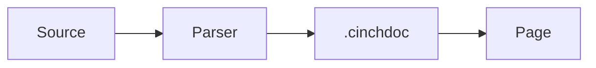

# Documentation comments and symbol lookup

Cinch documentation lives beside the declaration it describes. The canonical
marker is `-- |`; `-- ^` documents the declaration above it. The full syntax and
the `.cinchdoc` schema are in the
[documentation comments specification](../specifications/documentation-comments-specification.md).

Documentation is separate from the checked interface. Editing a comment does not
change `iface_hash`, invalidate a compiled artifact, or force dependents to
rebuild.

# Write a declaration

```cinch
-- | Map a function over an option.
--
-- # Examples
--
-- ```cinch
-- map-option (\x -> x + 1) (Some 1)
-- ```
--
-- @since 0.1.0
-- @see Data.Option.Option
-- @param f the transformation
-- @returns the mapped option
map-option :: forall a b. (a -> b) -> Option a -> Option b
```

Constructors, fields, methods, instances, signatures, and module headers use the
same marker:

```cinch
-- | The optional value.
data Option a where
  -- | No value.
  None :: Option a
  Some :: a -> Option a
  -- ^ A present value.
```

A module comment goes before `module`:

```cinch
-- | The option type and its combinators.
module Data.Option where
```

Ordinary `--` comments are implementation notes. The parser accepts the existing
library convention of a `--` block before a declaration only with `--legacy`;
those documents are marked `legacy: true`.

# Association

A leading block attaches to the next declaration. A line that is `import`,
`export`, or another non-declaration statement breaks the association; the block
is reported as an orphan rather than attached to a later declaration.

Inside a `data`, `record`, or `signature` block, a leading block attaches to the
next constructor, field, or method. A trailing `-- ^` block attaches to the
nearest declaration above, including a multi-line signature or constructor.

Attributes between the block and the declaration are allowed:

```cinch
-- | The value.
#[must-use]
value :: Int
```

# Markdown and tags

The body is Markdown. Fenced code blocks use a language tag such as `cinch`.
Symbol links use the `symbol:` scheme:

```cinch
-- | See [`map`](symbol:Data.List.map) and [`Option`](symbol:Data.Option.Option).
```

Known tags are metadata and are removed from the rendered body:

| Tag | Use |
| --- | --- |
| `@since 0.1.0` | First version |
| `@see Data.List.map` | Related declarations |
| `@deprecated TEXT` | Deprecation notice |
| `@experimental TEXT` | Stability warning |
| `@param name text` | Parameter description |
| `@arg name text` | Synonym for `@param` |
| `@typeparam name text` | Type parameter description |
| `@field name text` | Record or constructor field |
| `@returns text` | Result description |
| `@safety text` | Safe-use precondition |
| `@errors text` | Failure modes |
| `@law text` | Relied-on or provided law |
| `@effect text` | Effect obligation |

The first non-empty paragraph is the summary shown by lookup.

# Diagrams and math

A `mermaid` fence renders as a diagram on the documentation site:

````markdown

````

Math uses `$...$` inline and `$$...$$` for display, rendered with KaTeX:

```markdown
The bound is $O(\log n)$ and the identity is:

$$\sum_{i=1}^{n} i = \frac{n(n+1)}{2}$$
```

The parser records both in the document: `math` has `{tex, display, line}`, and
diagram fences stay in `markdown`. Fenced code is excluded from math and tag
extraction.

# Executable examples

A `cinch test` fence is a heredoc-style test case. Sections are `--- input`,
`--- stdin`, `--- args`, `--- expect`, `--- error`, and `--- exit`:

````markdown
```cinch test name=increment
--- input
increment :: Int -> Int
increment x = x + 1

main :: Int
main = if increment 1 == 2 then 0 else 1
--- exit
0
```
````

A stdin and argument fixture:

````markdown
```cinch test name=main-args
--- input
main :: Int
main = 0
--- args
--verbose input.txt
--- stdin
hello
--- exit
0
```
````

A failure case uses `--- error`:

````markdown
```cinch test name=reject-empty
--- input
main = 0
--- error
empty list
```
````

The parser records `{name, mode, input, stdin, args, expect, error, exit, line}`
under `tests`. The `test` command compiles and runs them:

```sh
cinch doc test compiler/prelude \
  --compiler compiler/target/debug/cinch --legacy
```

`--- input` is a complete program or a module body. The runner wraps a module
body in `module Main where`, passes `--- args` after `--`, compares `--- expect`
with stdout after trimming trailing newlines, and compares `--- exit` with the
process exit code. `--- error` requires a nonzero exit and the expected text.

A `>` REPL transcript is recorded but has no executable runner: it needs an
interactive evaluator the batch compiler does not provide.

# Documenting arguments

`@param` and `@arg` document function arguments. The parser also reads named
binders from a signature and merges them by name:

```cinch
-- | Map a function.
--
-- @param f the transformation
-- @param o the option
-- @typeparam a the input element
map-option :: forall a b. (f :: a -> b) -> (o :: Option a) -> Option b
```

The declaration JSON gains `parameters` with `{name, type, doc}`,
`typeParameters`, and `fields`. A record field or constructor member can use
`@field` or its own `-- ^` trailing block.

# Extract and look up

The reference parser is the compiler's `doc` command:

```sh
# One module to canonical JSON
cinch doc extract compiler/prelude/Data.Option.cinch \
  --legacy --out /tmp/Data.Option.cinchdoc

# One symbol, by identity
cinch doc lookup Data.Option.maybe --dir compiler/prelude --legacy

# All symbols, as a lookup index
cinch doc index compiler/prelude --legacy --out /tmp/cinch-docs.json

# A Markdown page with tree-sitter-highlighted Cinch blocks
cinch doc render compiler/prelude/Data.Option.cinch --legacy
```

`--plain` keeps fenced code instead of emitting highlighted HTML.
`cinch doc markdown` applies the same tree-sitter highlighting to an arbitrary
Markdown file or stdin.

`--iface module.cinchif` supplies checked identities and rendered signatures.
Without it, the parser records the source declaration line as a provisional
signature and uses stable identities such as `Module.Type.Constructor` or
`Module.value`.

The lookup tool accepts an exact id first, then a bare name. The index records
`id`, `module`, `kind`, `name`, `summary`, `source`, and `line`.

# Library reference integration

`website/scripts/generate-library-reference.py` calls `cinch doc extract`. Its
`--validate-docs` mode parses every library source and reports diagnostics
without regenerating pages:

```sh
python3 website/scripts/generate-library-reference.py \
  --compiler compiler/target/debug/cinch --validate-docs
```

The full library generation uses the parsed documents for module, type,
constructor, value, signature, method, and instance notes. Every `cinch` fence
in the generated pages is tree-sitter highlighted; `cinch test` fences stay
plain because their heredoc sections are not Cinch syntax.

# Limits

- Association is source-order and indentation-aware, not a full compiler AST
  pass. A documentation block before a syntactic form the parser does not
  recognize is reported as an orphan instead of guessed.
- `symbol:` links to declarations outside the supplied index are unresolved.
  They remain text, not live links.
- `cinch doc test` compiles and runs `cinch test` blocks with a supplied
  compiler. The parser alone only records them; ordinary `cinch` fences remain
  text until a runner runs them. A `>` transcript has no batch runner.
- Mermaid diagrams render lazily: a page with no `mermaid` fence does not load
  the diagram bundle. A malformed diagram keeps its source visible and logs the
  error instead of leaving a blank frame.
- Math is rendered with KaTeX. Raw TeX is not executed, and fenced code plus
  inline code are excluded from math extraction.
- A `.cinchdoc` is documentation evidence, not a contract. A signature shown
  there is advisory unless it came from a checked `.cinchif`.

Implementation: `compiler/src/cinchdoc.rs` (`cinch doc`); syntax
highlighting: `compiler/src/highlight.rs` over `tooling/tree-sitter-cinch`;
tests: `compiler/src/cinchdoc.rs` and `compiler/src/highlight.rs`.
