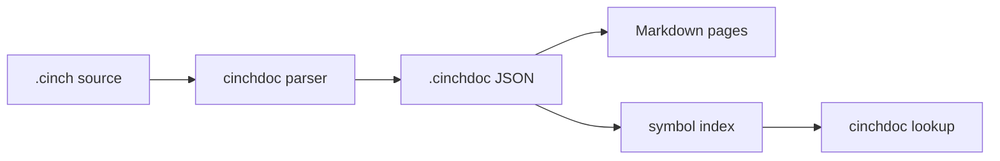

# Documentation comments specification

Draft 0.1. This chapter defines the source-level documentation comment format,
how comments attach to declarations, the canonical `.cinchdoc` artifact, and the
symbol lookup model. The reference implementation is `cinch doc` in
`compiler/src/cinchdoc.rs`.

Documentation is not part of a module's checked contract. A `.cinchdoc` change
does not change `iface_hash`, does not invalidate a compiled interface, and does
not force dependents to recompile. Prose and signatures are linked by symbol
identity when a checked interface is available, but the document remains
advisory evidence.

# 1 Lexical forms

A leading documentation comment starts with `-- |`:

```cinch
-- | The optional value: `None` or `Some x`.
data Option a where
  None :: Option a
  Some :: a -> Option a
```

A trailing documentation comment starts with `-- ^` and attaches to the
preceding declaration, constructor, field, or method:

```cinch
data Option a where
  None :: Option a
  Some :: a -> Option a
  -- ^ A present value.
```

The block forms are `{-| ... -}` and `{-^ ... -}`:

```cinch
{-| A block-documented value. -}
value :: Int
```

Rules:

- A `-- |` block begins with the marker line. Following `--` lines are its
  continuation. A blank file line ends the block. A new `-- |` or `-- ^` line
  begins another block.
- The marker consumes one optional space after `|` or `^`. A continuation line
  consumes `--` and one optional space. Further indentation is preserved so
  Markdown code blocks and lists survive.
- A block documentation comment ends at the first `-}`. Nested block comments
  are not interpreted inside a documentation block; use a fenced code block for
  code that contains `-}`.
- Ordinary `--` comments are implementation comments, not documentation. They
  are ignored by the canonical parser.
- A **legacy** mode accepts a contiguous `--` block immediately before a
  declaration as documentation. This exists so the existing library can migrate
  without a flag day. A legacy document is marked `legacy: true`; canonical
  markers are preferred and win over a legacy block.
- Documentation comments may appear before attributes; attributes are skipped
  when finding the target declaration.

# 2 Association

A leading documentation block attaches to the **next significant declaration**.
Significant means the next non-blank, non-comment line after the block, skipping
attribute lines. A line that is `import`, `export`, `module`, `where`, or another
non-declaration statement breaks the association; the documentation is an orphan
rather than silently attaching to a later declaration.

A trailing block attaches to the **nearest preceding declaration**, including a
declaration whose header spans several lines.

Association is scope-aware:

| Position | Target |
| --- | --- |
| Before `module M where` | Module documentation |
| Before `data`, `record`, `codata`, or `type` | The type |
| Before a constructor inside a `data` block | The constructor |
| Before a field inside a `record` block | The field |
| Before `signature S where` | The signature |
| Before a method type inside a signature block | The method |
| Before a value's type signature or first equation | The value |
| Before `instance` | The instance |
| Before `infix`, `infixl`, `infixr` | Every operator named on that line |
| Before `law`, `contract`, `stage`, `macro`, `rewrite`, `upgrade`, `prim` | That declaration |

A leading block inside a data or signature block attaches to the next member, not
to the enclosing type or signature. A module's documentation block is the nearest
leading block before the `module` line.

Two explicit leading blocks for one declaration are a `duplicate-doc`
diagnostic. The nearest block wins. A legacy block never overrides an explicit
block.

# 3 Markdown

The body is Markdown. The reference renderer supports the CommonMark subset
used by the documentation site:

- paragraphs, emphasis, strong emphasis, lists, block quotes, and headings;
- inline code and fenced code blocks, with the language tag preserved
  (`cinch` for Cinch code);
- links and images;
- tables where the renderer supports them;
- inline math (`$...$`) and display math (`$$...$$`) through the site's KaTeX
  renderer;
- Mermaid diagrams in a `mermaid` fenced block;
- executable test blocks in a `cinch test` fence.

Documentation is untrusted text. Renderers MUST escape HTML by default and MUST
sanitize any raw HTML they choose to allow. The parser does not execute or
evaluate code fences.

The **summary** is the first non-empty paragraph. It is plain text with inline
Markdown removed, and it is what lookup results show.

## Diagrams

A `mermaid` fence is a first-class diagram. The parser preserves it in
`markdown` and records it as a diagram source; the site renders it to SVG.



## Math

Math is ordinary Markdown math. Complexity is $O(\log n)$ inline, and display:

$$\sum_{i=1}^{n} i = \frac{n(n+1)}{2}$$

The parser excludes fenced code and inline code when extracting math. The site
renders math with KaTeX. Raw TeX is not executed.

## Executable examples

A `cinch test` fence is a test case, not prose. The fence info may carry
`name=...`. Sections are `--- input`, `--- stdin`, `--- args`, `--- expect`,
`--- error`, and `--- exit`.

````markdown
```cinch test name=increment
--- input
increment :: Int -> Int
increment x = x + 1

main :: Int
main = if increment 1 == 2 then 0 else 1
--- exit
0
```
````

A stdin and argument fixture:

````markdown
```cinch test name=main-args
--- input
main :: Int
main = 0
--- args
--verbose input.txt
--- stdin
hello
--- exit
0
```
````

A failure case uses `--- error` and the expected diagnostic text:

````markdown
```cinch test name=reject-empty
--- input
main = 0
--- error
empty list
```
````

The parser records every test as `{name, mode, input, stdin, args, expect,
error, exit, line}` in the document. The `test` command compiles and runs it:

```sh
cinch doc test compiler/prelude \
  --compiler compiler/target/debug/cinch --legacy
```

`--- input` is a complete program or a module body. The runner wraps a module
body in `module Main where` and passes `--- args` after `--`. It compares
`--- expect` with stdout after trimming trailing newlines, `--- exit` with the
process exit code, and requires a nonzero exit for `--- error`. A `>` REPL
transcript is recorded but has no executable runner, because it needs an
interactive evaluator the batch compiler does not provide.

# 4 Symbol links

A documentation link may target a symbol with the `symbol:` scheme:

```cinch
-- | The mapped option. See [`map`](symbol:Data.List.map) and
-- [`Option`](symbol:Data.Option.Option).
```

The parser records every link as:

```json
{ "text": "map", "target": "Data.List.map", "resolved": true }
```

Resolution is best effort. With a complete symbol index, an exact declaration id
or a bare declaration name resolves. Without an index, external targets remain
unresolved and produce an `unresolved-symbol` diagnostic when strict checking is
enabled. A renderer MUST NOT turn an unresolved target into a live link.

# 5 Metadata tags

Tag lines start with `@` and a known tag name. They are metadata, not body text,
and are removed from the rendered Markdown. Unknown `@` lines are ordinary prose.

| Tag | Meaning |
| --- | --- |
| `@since VERSION` | First version containing the declaration |
| `@see SYMBOL[, SYMBOL]` | Related declarations |
| `@deprecated TEXT` | Deprecation notice |
| `@experimental TEXT` | Stability warning |
| `@param NAME TEXT` | One parameter description |
| `@arg NAME TEXT` | Synonym for `@param` |
| `@typeparam NAME TEXT` | One type parameter description |
| `@field NAME TEXT` | One record field or constructor field description |
| `@returns TEXT` | Result description |
| `@safety TEXT` | Preconditions required for safe use |
| `@errors TEXT` | Failure modes represented in the result or effects |
| `@law TEXT` | A law this declaration relies on or provides |
| `@effect TEXT` | An effect or capability obligation worth calling out |

Tags are additive. A declaration may also use ordinary Markdown headings such as
`# Examples`, `# Laws`, or `# Safety`; the renderer preserves them in the body.
Tags are the machine-readable form for lookup and for generated indexes.

Example:

```cinch
-- | Map a function over an option.
--
-- # Examples
--
-- ```cinch
-- map-option (\x -> x + 1) (Some 1)
-- ```
--
-- @since 0.1.0
-- @see Data.Option.Option
-- @param f the transformation
-- @returns the mapped option
map-option :: forall a b. (f :: a -> b) -> (o :: Option a) -> Option b
```

# 6 Canonical `.cinchdoc`

A `.cinchdoc` file is canonical JSON: UTF-8, sorted object keys, declarations in
source order, no timestamps. It records the source hash so a stale document is
detectable.

```json
{
  "schema": 1,
  "module": "Data.Option",
  "source": "compiler/prelude/Data/Option.cinch",
  "sourceSha256": "...",
  "doc": {
    "summary": "The optional value: None or Some x.",
    "markdown": "...",
    "tags": { "since": "0.1.0" },
    "links": [{ "text": "Option", "target": "Data.Option.Option", "resolved": true }],
    "tests": [],
    "math": [{ "tex": "O(1)", "display": false, "line": 8 }],
    "legacy": false,
    "line": 1
  },
  "declarations": [
    {
      "id": "Data.Option.Option",
      "kind": "data",
      "name": "Option",
      "signature": "data Option a",
      "doc": { "summary": "...", "markdown": "...", "tags": {}, "links": [], "tests": [], "math": [], "legacy": false, "line": 12 },
      "parameters": [],
      "typeParameters": [],
      "fields": [],
      "children": [
        {
          "id": "Data.Option.Some",
          "kind": "constructor",
          "name": "Some",
          "signature": "Some :: a -> Option a",
          "doc": null,
          "children": [],
          "source": { "line": 16 }
        }
      ],
      "source": { "line": 13 }
    }
  ],
  "orphans": [],
  "diagnostics": []
}
```

Field rules:

- `schema` is `1`.
- `module` is the declared module name.
- `source` is the repository-relative source path or the path given to the tool.
- `sourceSha256` is the SHA-256 of the source bytes.
- `doc` and every declaration `doc` are `null` or a document object.
- `signature` is the checked rendered scheme when an interface is supplied;
  otherwise it is the declaration's source line. The checked interface is
  authoritative when the two disagree.
- `parameters` merges `@param` and `@arg` text with named binders such as
  `(f :: a -> b)` from the signature. Each entry has `name`, `type`, and `doc`.
- `typeParameters` and `fields` carry the `@typeparam` and `@field` entries.
- `tests` carries parsed `cinch test` fences. Each test has `name`, `mode`,
  `input`, `stdin`, `args`, `expect`, `error`, `exit`, `line`, and `fence`.
- `math` carries inline and display TeX spans with `tex`, `display`, and `line`.
- `children` are constructors, fields, methods, or declarations nested in the
  enclosing block.
- `source.line` is one-based.
- `orphans` record explicit documentation blocks with no target.
- `diagnostics` record parser findings; unknown fields are allowed for forward
  compatibility.

# 7 Identities and lookup

A documentation identity follows the checked symbol identity where one exists.
Without an interface, the parser uses these stable forms:

| Declaration | Identity |
| --- | --- |
| Module | `Module` |
| Type | `Module.Type` |
| Constructor | `Module.Type.Constructor` |
| Field | `Module.Type.field` |
| Value | `Module.value` |
| Signature | `Module.Signature` |
| Method | `Module.Signature.method` |
| Instance | The checked instance id, normally `Module.Class_Target` |
| Fixity | `Module.operator` |
| Foreign | The checked symbol or `Module.name` |

A lookup accepts an exact id first, then a bare declaration name. A symbol index
has the form:

```json
{
  "schema": 1,
  "symbols": [
    {
      "id": "Data.Option.maybe",
      "module": "Data.Option",
      "kind": "value",
      "name": "maybe",
      "summary": "The fold: the default unless there is a value.",
      "source": "compiler/prelude/Data/Option.cinch",
      "line": 47
    }
  ]
}
```

The index is a lookup aid, not a second source of truth. The `.cinchdoc` file and
the checked interface remain authoritative for text and signatures.

# 8 Relationship to `.cinchif`

`.cinchif` records the checked contract. `.cinchdoc` records prose. They are
separate artifacts for three reasons:

1. Editing a comment must not invalidate a compiled interface or a package
   artifact.
2. Documentation may be absent, partial, or written by a different tool.
3. A documentation renderer must not be able to change what the checker accepts.

A `.cinchdoc` may use the interface's `symbol`, `identity`, instance `id`, and
rendered `scheme` fields. It MUST NOT claim a signature the interface does not
have. If no interface is supplied, the source line is recorded as a provisional
signature and the document is explicitly marked as interface-free.

# 9 Diagnostics

| Code | Meaning |
| --- | --- |
| `duplicate-doc` | Two explicit documentation blocks target one declaration; the nearest wins |
| `unresolved-symbol` | A `symbol:` link has no matching declaration in the available index |
| `orphan-doc` | An explicit leading or trailing block has no declaration target |
| `stale-doc` | Reserved for consumers that compare `sourceSha256` with the current source |

Orphans are reported, not silently attached to a later declaration. A legacy
block with no target is ignored without an orphan diagnostic, because ordinary
comments before imports are not documentation.

# 10 Migration

The canonical marker is `-- |`. Existing source may use `--` blocks; the
reference parser accepts them only with `--legacy`, records `legacy: true`, and
prefers an explicit `-- |` block when both exist. New code SHOULD use the
canonical markers. A formatter or migration pass MAY rewrite legacy blocks, but
it MUST preserve the text and line associations.

# 11 Reference tooling

The reference implementation is the compiler's `doc` command
(`compiler/src/cinchdoc.rs`):

```sh
cinch doc extract compiler/prelude/Data/Option.cinch \
  --legacy --out /tmp/Data.Option.cinchdoc

cinch doc lookup Data.Option.maybe --dir compiler/prelude --legacy

cinch doc index compiler/prelude --legacy --out /tmp/cinch-docs.json

cinch doc render compiler/prelude/Data.Option.cinch --legacy
```

`--iface MODULE.cinchif` supplies checked identities and rendered schemes.
`--legacy` accepts the existing `--` convention. `render` turns `cinch` fences
into HTML highlighted by `tooling/tree-sitter-cinch`; `--plain` keeps plain
Markdown fences. `cinch doc markdown` applies the same highlighting to an
arbitrary Markdown file or stdin. The library reference generator uses the same
compiler command; `--validate-docs` parses every library source without
regenerating pages.

The format is the contract; the compiler command is the reference
implementation.
